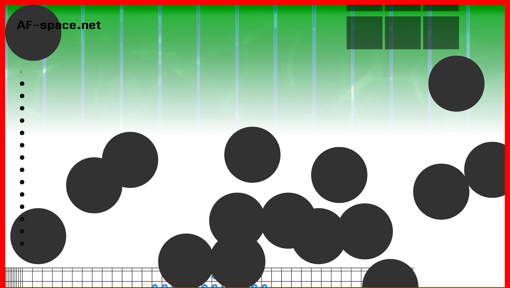
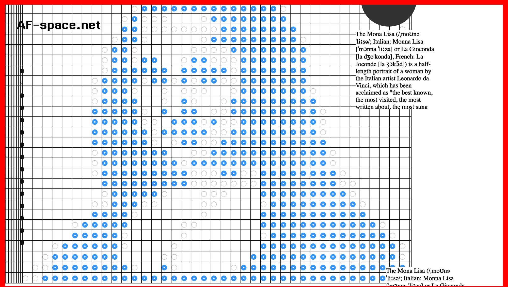
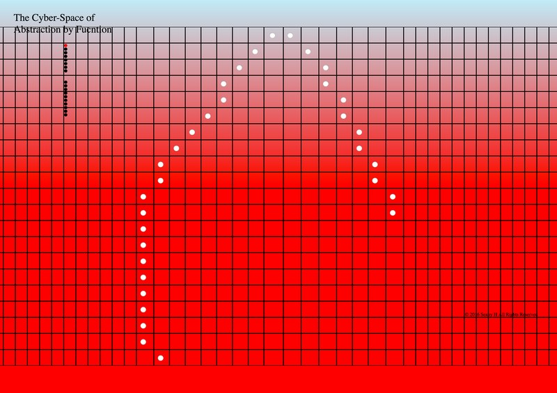
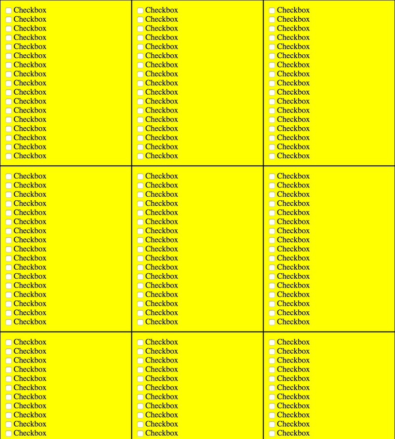
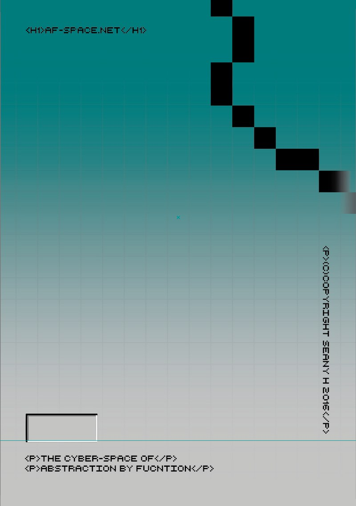

Web page · FHD · Color · Stereo · Single projection screen

An edited internet space made for Hong's undergraduate graduation exhibition in 2016.

Internet users pass by emails, software and websites without recognizing them as art or as design with formal value, much as they walk past sculptures or murals in public places. What limits this recognition is the functionality and placeness of the content.

Through a process of "screen division" that breaks down and redistributes, both formally and functionally, the many aesthetic elements found online (layouts, colors and various functional elements), the work sought to shed new light on elements considered worthless and to develop new, experimental and aesthetic content.

This video is a reproduction captured from the page running on the web. The original work was developed with HTML, CSS, JavaScript and jQuery, and was live at af-space.net from November 2016 to February 2017.

