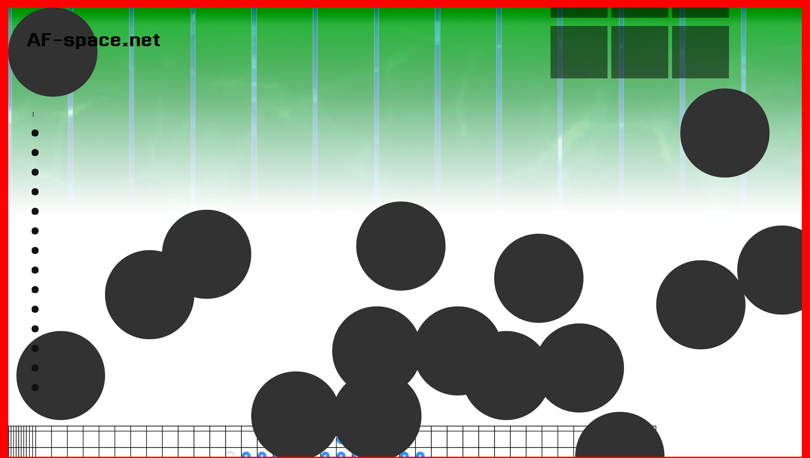
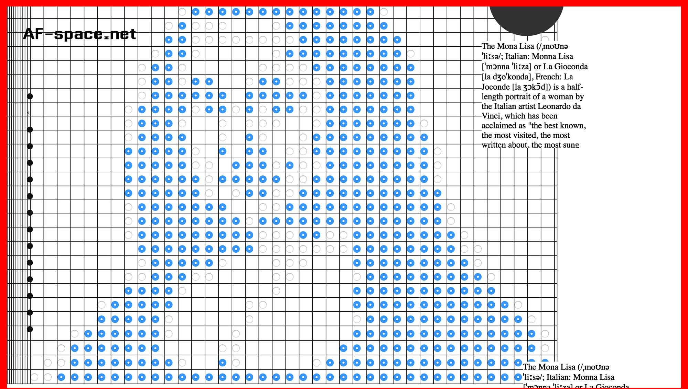
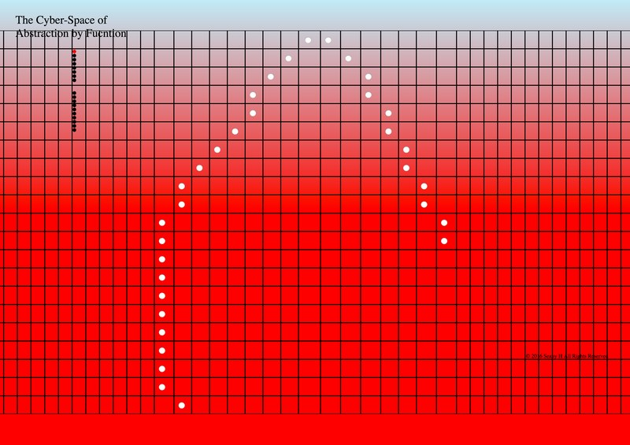
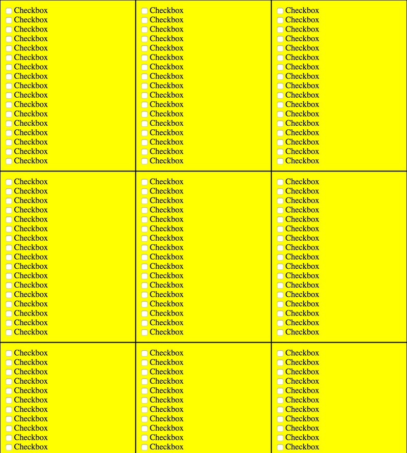
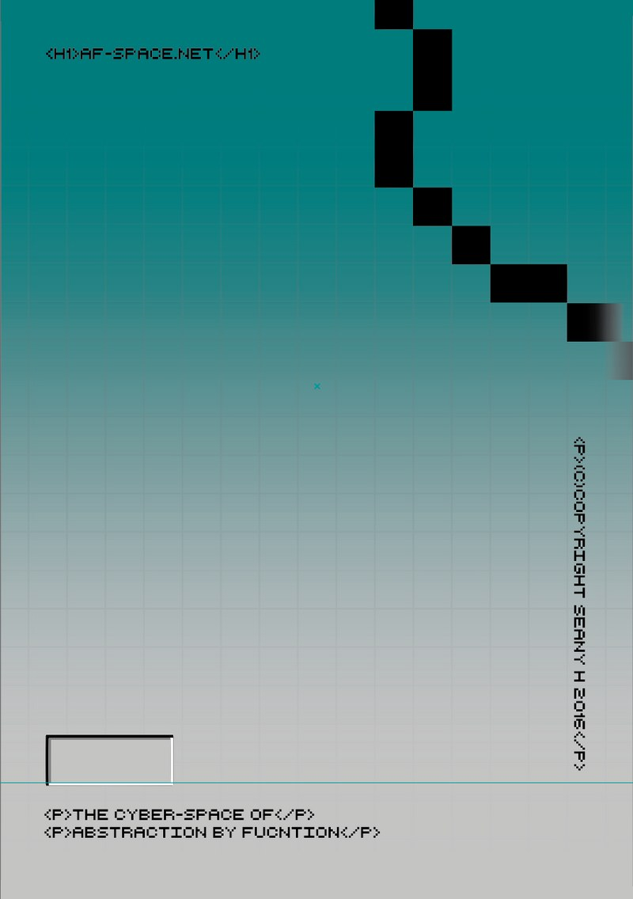

웹페이지 · FHD · 컬러 · 스테레오 · 1 프로젝션 스크린

2016년 학부 졸업전시를 위해 제작한 편집된 인터넷 공간이다.

인터넷 유저들은 공공장소에 있는 조각이나 벽화를 그냥 지나치는 것처럼 이메일이나 소프트웨어, 웹사이트를 예술 혹은 조형적으로 가치가 있는 디자인이라고 인식하지 못한 채 무심코 지나친다. 그러한 인식의 제한 요인은 콘텐츠의 기능성과 장소성에서 온다.

인터넷 공간에서 발견되는 많은 미학적 요소(레이아웃, 컬러, 다양한 기능적 요소)를 조형적, 기능적으로 분쇄하고 재분배하는 '스크린 분할' 과정을 통해 무가치하게 여겨졌던 요소들을 재조명하고 더 나아가 새롭고 실험적이며 심미적인 콘텐츠를 개발하고자 했다.

본 영상은 페이지가 웹에서 실제 구동하는 스크린을 캡처한 복제본이며 원본 작업은 HTML, CSS, JavaScript, jQuery 등을 사용해 개발했다. 2016년 11월부터 2017년 2월까지 af-space.net에서 송출되었다.

