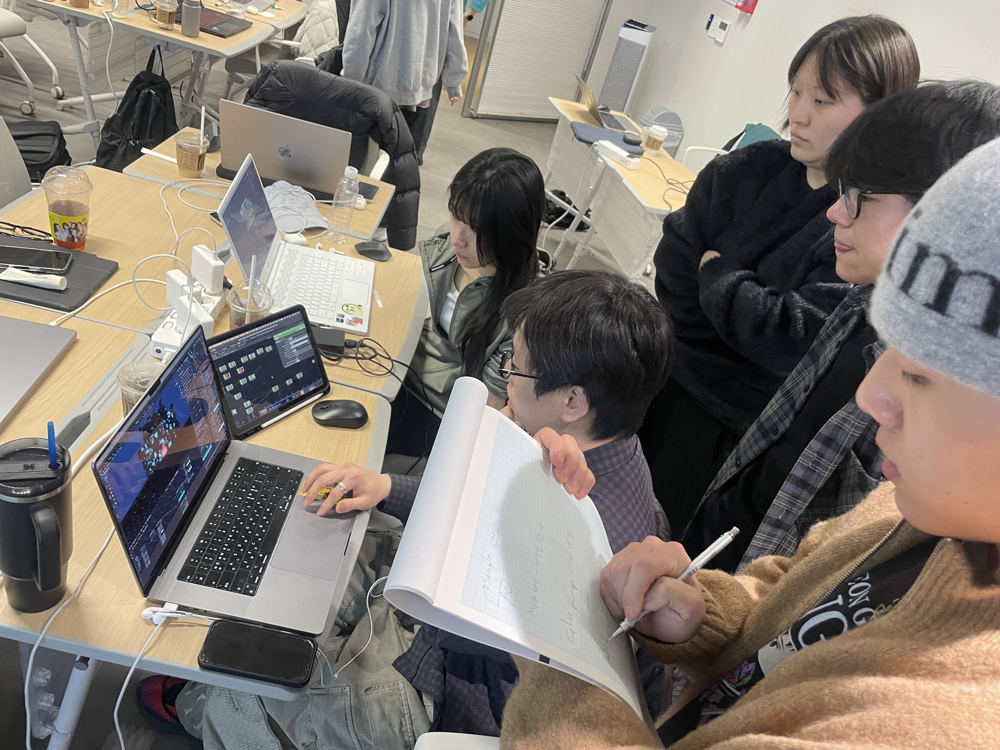
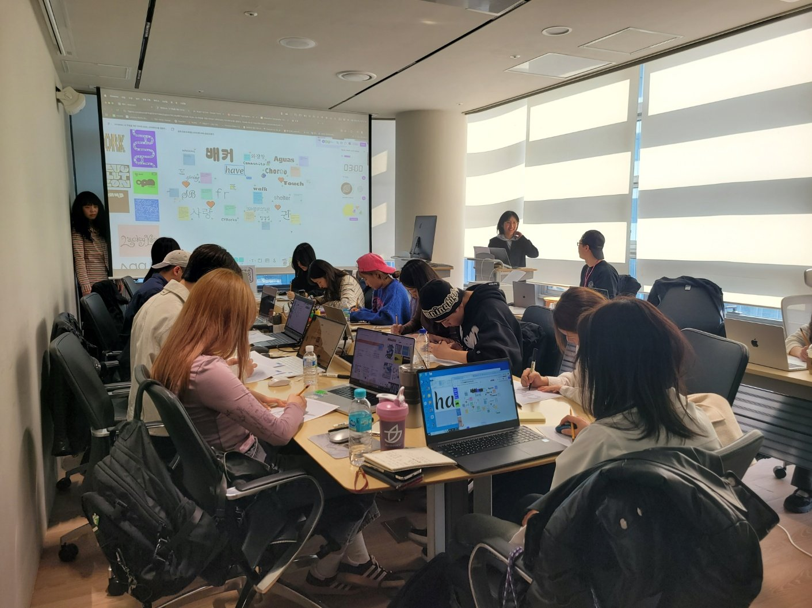
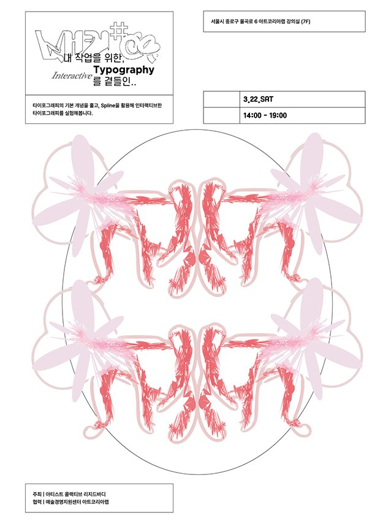
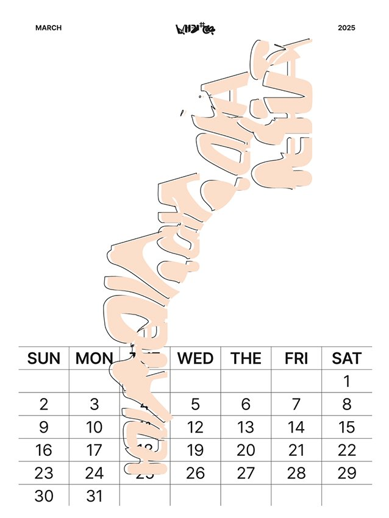
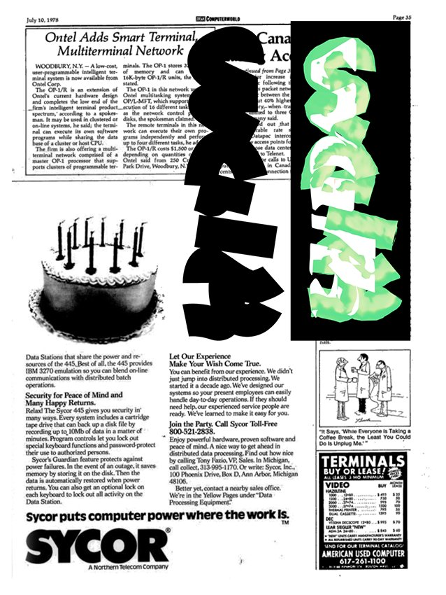

Hong took part as facilitator and tech advisor in sessions #3, #4 and #5 of 'Baeker: A Learning Community,' a workshop series by Rigidbody and Arts Korea Lab.

The sessions covered topics including 'Interactive Typography for My Work' and 'Interactive Procedural Modeling.' Participating artists built typography and 3D forms that respond to the mouse and screen, tailored to their own practice. The series concluded in July 2025 with the retrospective ≪AI Commune on the Stage of Capitalism≫ at Arts Korea Lab.

Interactive Typography · Procedural Modeling · Web

  
  <video src="/projects/backer/typo-2.mp4" autoplay muted loop playsinline></video>
  <video src="/projects/backer/typo-3.mp4" autoplay muted loop playsinline></video>

  <video src="/projects/backer/poster.mp4" autoplay muted loop playsinline></video>

  <video src="/projects/backer/web-1.mp4" autoplay muted loop playsinline></video>
  <video src="/projects/backer/web-2.mp4" autoplay muted loop playsinline></video>

## Credits

Director: Ardong (Giryung Nam) 
Tech Advisors & Facilitators: Myeonggyu Kim, Cyan Hong, Eunsu Oh, Gaeun Yeo 
Session 4 Interactive Typography Facilitator & Design: Seim Shin
