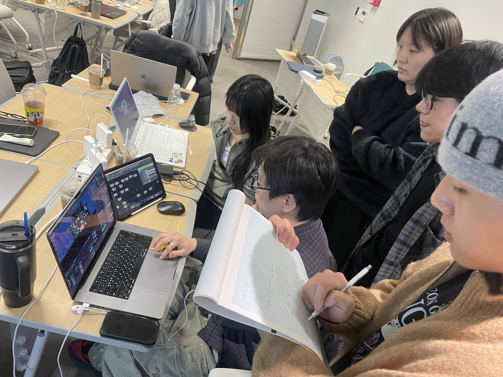
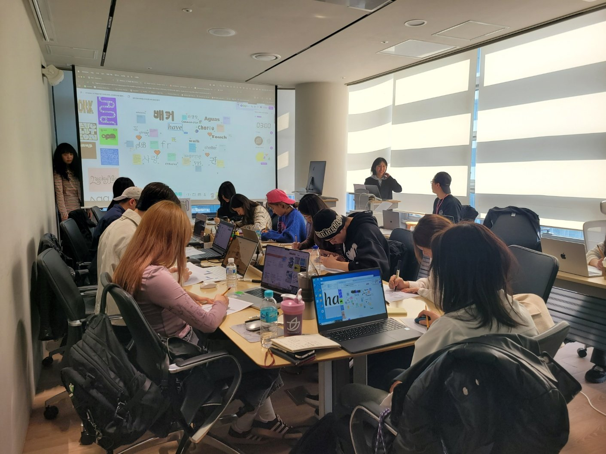
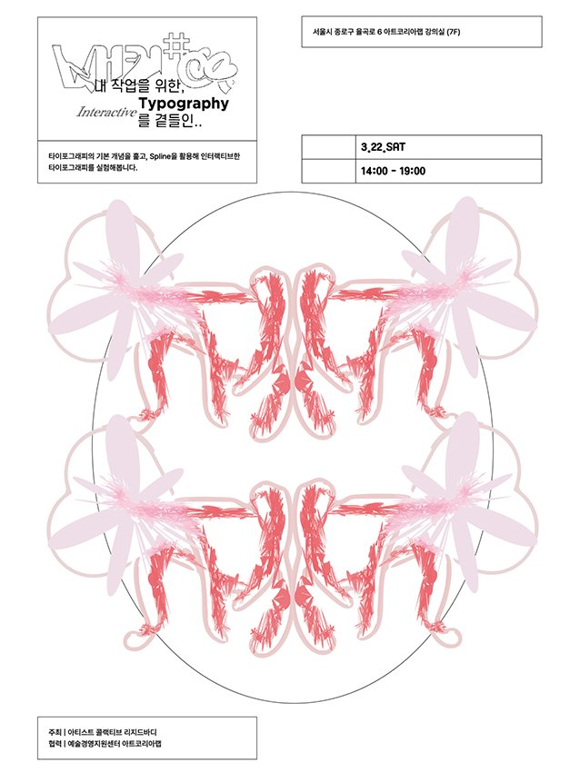
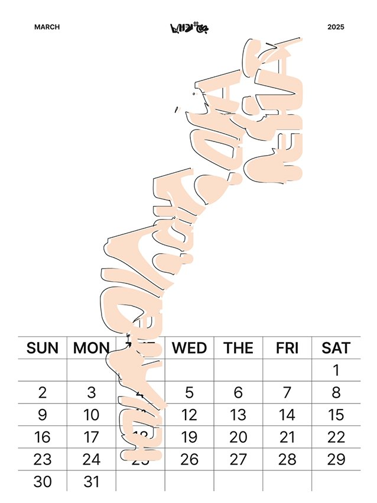
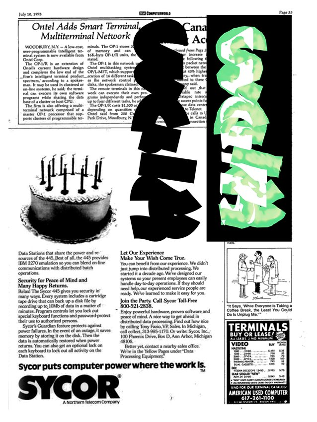

리지드바디와 아트코리아랩이 함께한 워크숍 시리즈 '배커: 배우는 커뮤니티'의 #3, #4, #5 회차에 퍼실리테이터이자 테크 어드바이저로 참여했다.

'내 작업을 위한 Interactive Typography'와 'Interactive Procedural Modeling' 등을 다뤘다. 참여 작가들은 마우스와 화면에 반응하는 타이포그래피와 3D 형태를 자기 작업에 맞게 만들었다. 시리즈는 2025년 7월 아트코리아랩에서 회고전 ≪자본주의 무대 위 인공지능 코뮌≫으로 마무리됐다.

Interactive Typography · Procedural Modeling · Web

  
  <video src="/projects/backer/typo-2.mp4" autoplay muted loop playsinline></video>
  <video src="/projects/backer/typo-3.mp4" autoplay muted loop playsinline></video>

  <video src="/projects/backer/poster.mp4" autoplay muted loop playsinline></video>

  <video src="/projects/backer/web-1.mp4" autoplay muted loop playsinline></video>
  <video src="/projects/backer/web-2.mp4" autoplay muted loop playsinline></video>

## 크레딧

디렉터: 아르동(남기륭) 
테크 어드바이저 및 퍼실리테이터: 김명규, 홍서연, 오은수, 여가은 
4회차 인터랙티브 타이포그래피 퍼실리테이터 및 디자인: 신세임
