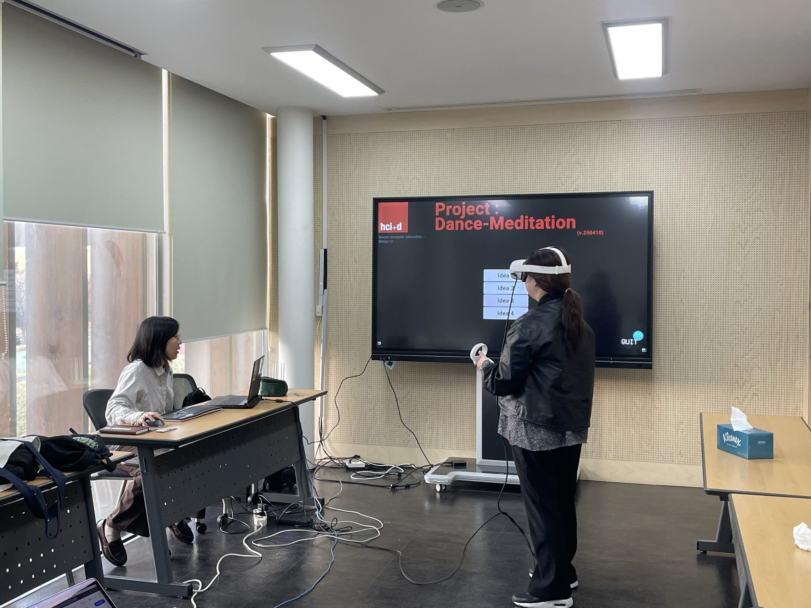
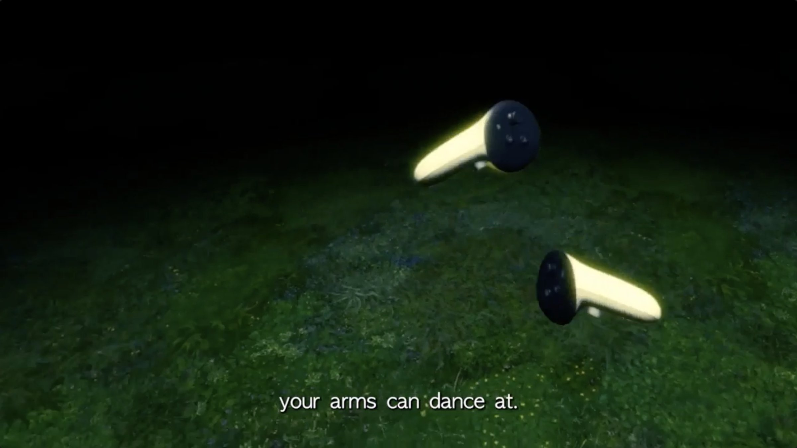
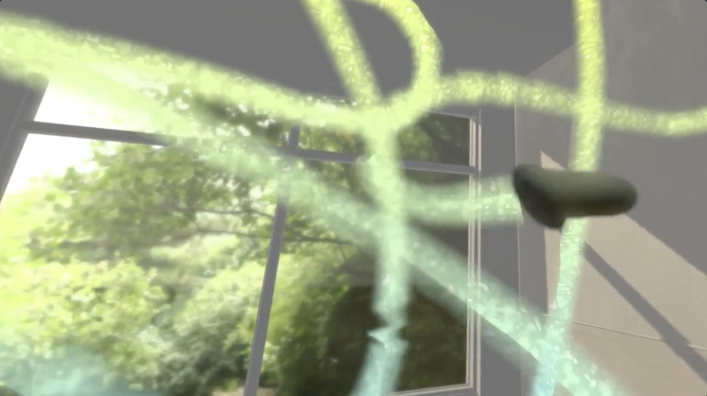
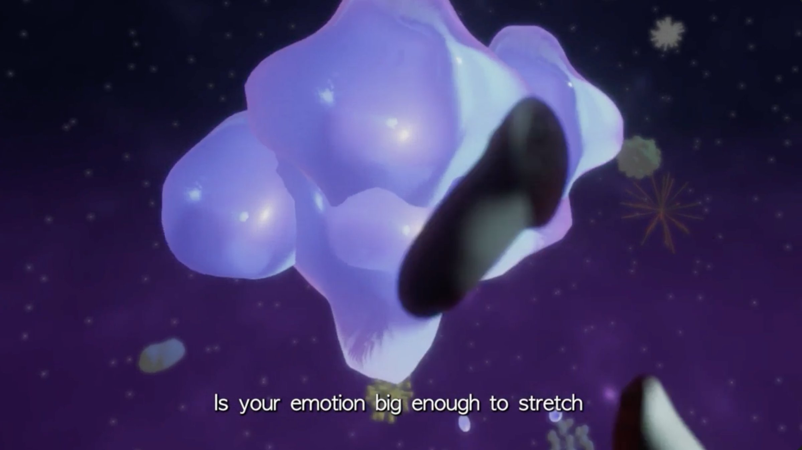
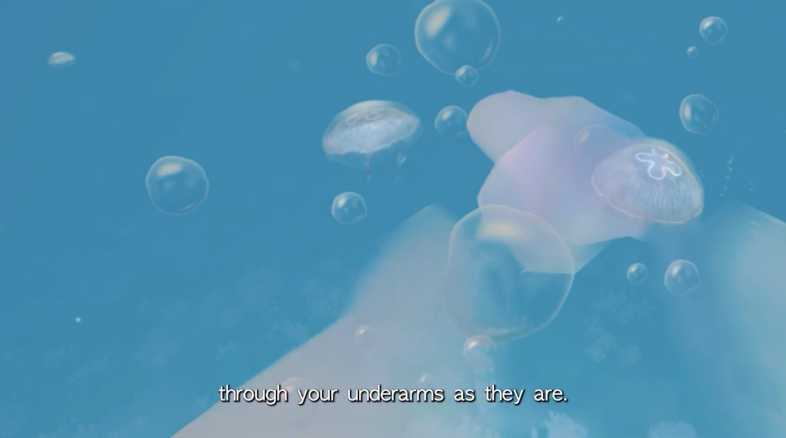
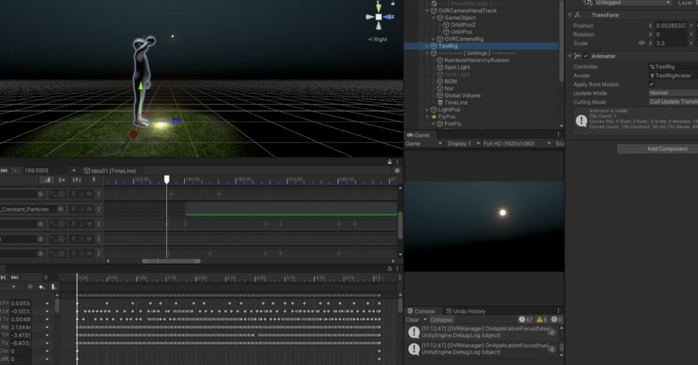
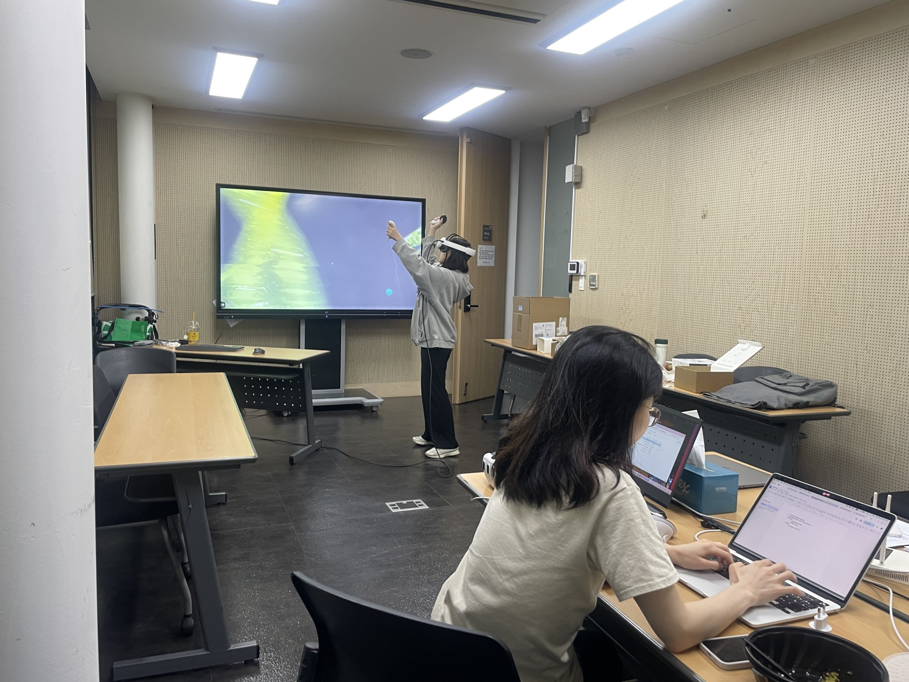

A dance meditation VR made with Seoul National University HCI+D Lab. Hong led VR direction and production and presented the work at CHI 2026 as a co-author.

The four stages of meditation unfold as different virtual worlds. You awaken the body by following fireflies, draw your movement as lines of light and strike masses of emotion with your hands. In the end you become a jellyfish and drift slowly.

The study looks at how the design of a virtual space changes how the body actually moves.

Meta Quest 3 · Unity · Hand Tracking

## Credits

Authors: Suhwoo Yoon, Dakyeom Ahn, Yunseo Choi, Seoyeon Hong, Hajin Lim 
VR Direction, Production & Build: Cyan Hong 
Lab: HCI+D Lab, Department of Communication, Seoul National University
