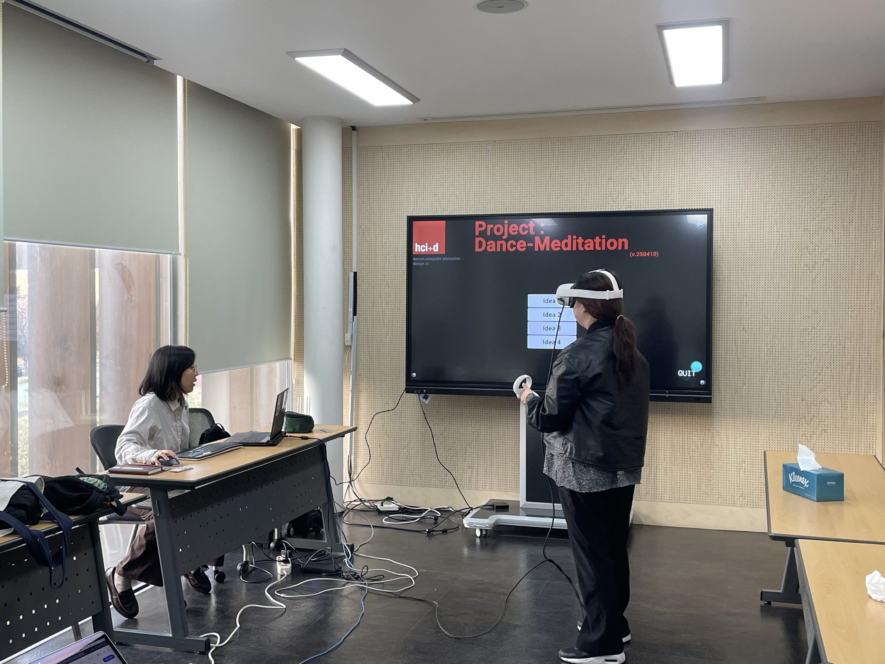
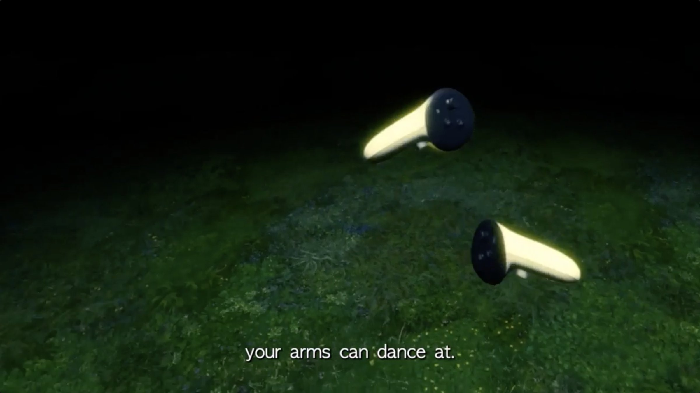
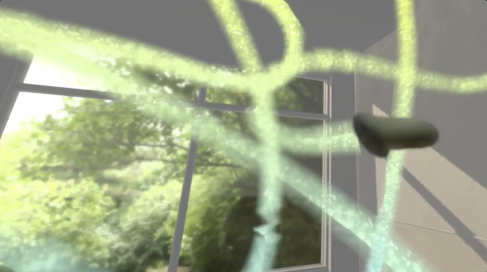
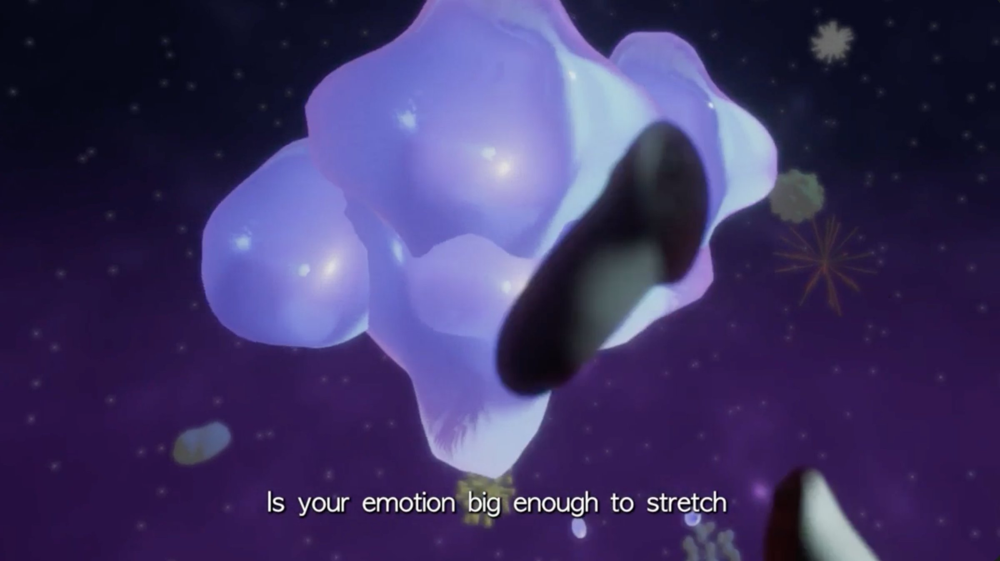
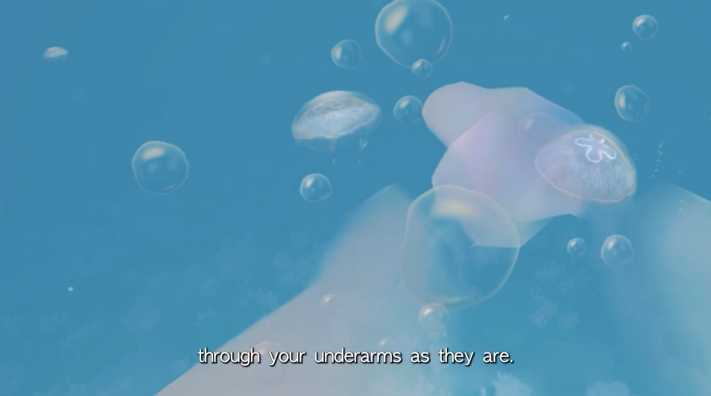
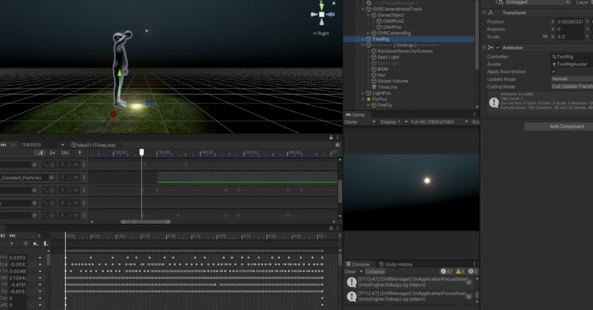
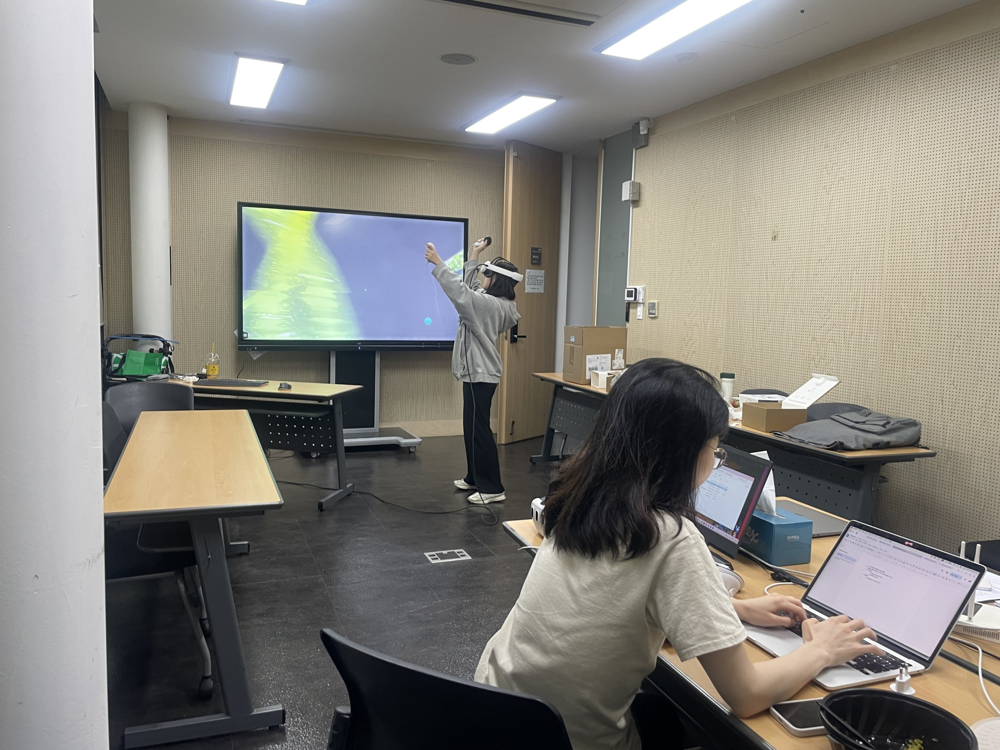

서울대학교 HCI+D Lab과 함께 만든 댄스 명상 VR. VR 연출과 제작을 맡았고 CHI 2026에 공동저자로 발표했다.

명상의 네 단계가 각각 다른 가상 세계로 펼쳐진다. 반딧불이를 따라 몸을 깨우고 움직임을 빛의 선으로 그리고 감정의 덩어리를 손으로 친다. 마지막에는 해파리의 몸이 되어 천천히 떠다닌다.

가상공간의 설계가 실제 몸의 움직임을 어떻게 바꾸는지 살핀 연구다.

Meta Quest 3 · Unity · Hand Tracking

## 크레딧

저자: 윤서우, 안다겸, 최윤서, 홍서연, 임하진 
VR 연출·제작·빌드: 홍서연 
연구실: 서울대학교 언론정보학과 HCI+D Lab
