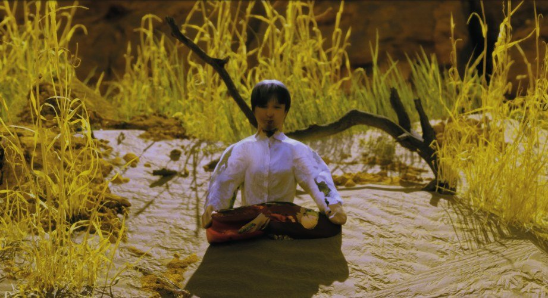
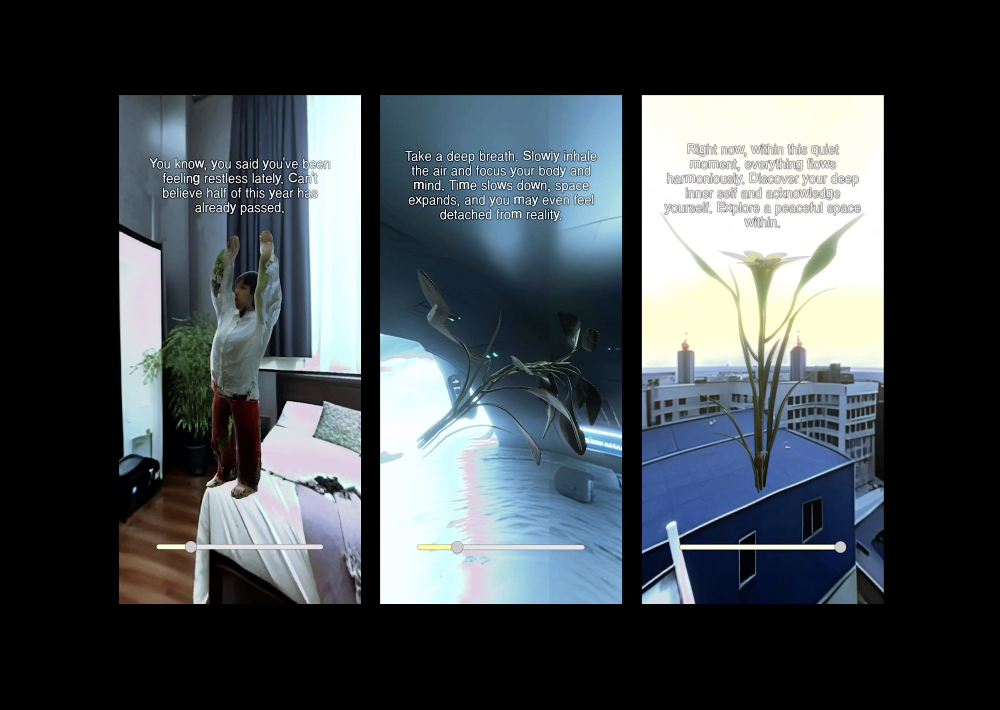
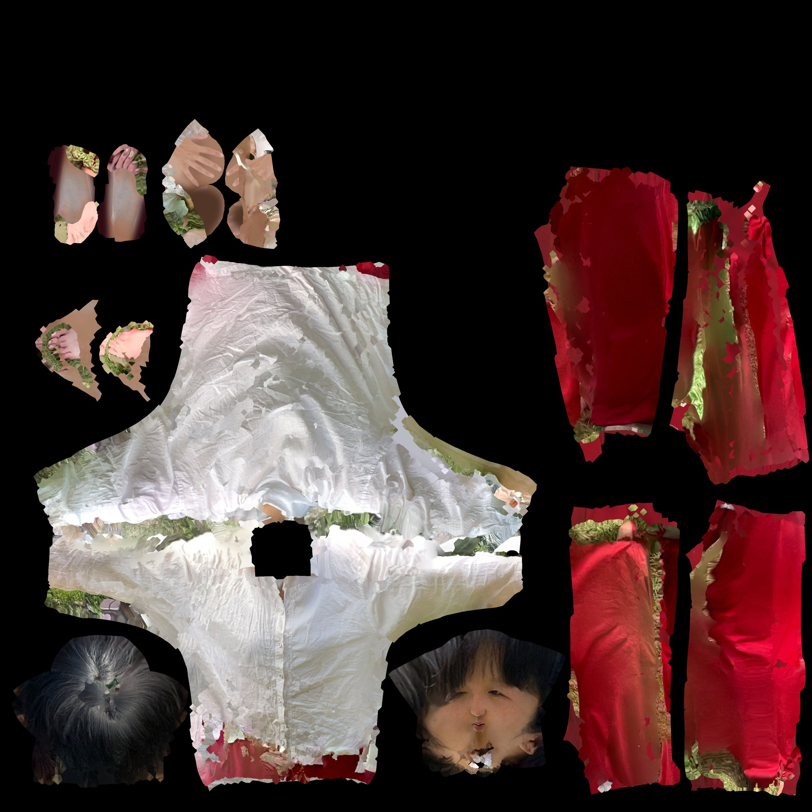

An app work about a being that breathes in virtual space, released as an iOS app.

As the user moves a scroll UI at the bottom of the screen to pace their breath, the character performs yoga poses in time. A short letter is heard along with the flow of the yoga.

The character was made from a 3D scan of the artist's body with motion capture applied. The work explores the comfort a virtual space can offer in a daily life where the real and the virtual overlap. Through the familiar medium of the smartphone, anyone can breathe with a virtual being anytime and anywhere.

Unity · iOS · 3D Scan · Motion Capture

