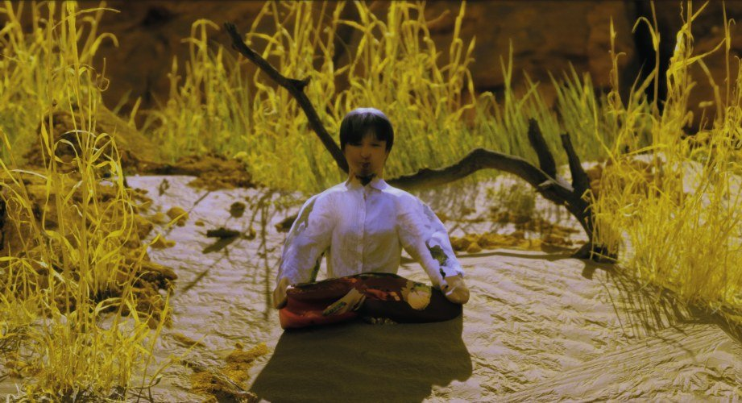
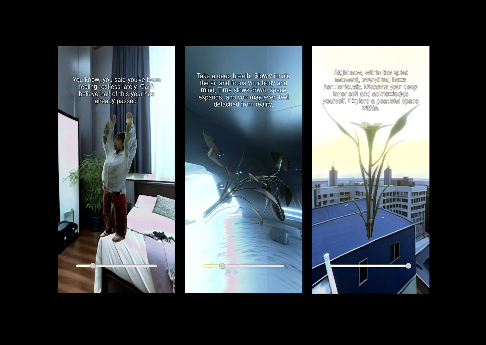
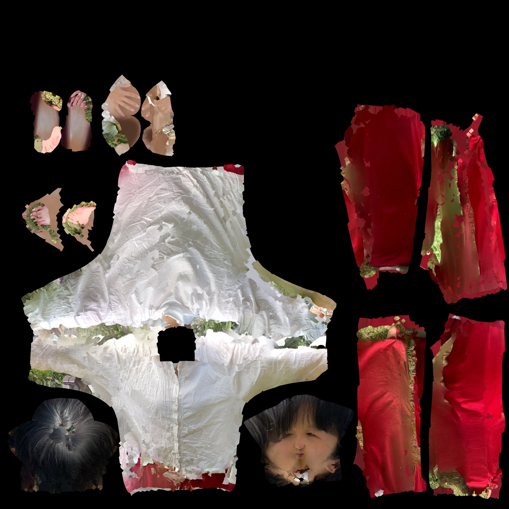

가상공간 속 존재가 숨 쉬는 모습을 담은 앱 작품. iOS 앱으로 배포했다.

사용자가 화면 아래의 스크롤 UI를 움직이며 호흡을 조절하면 캐릭터가 그에 맞춰 요가 동작을 한다. 요가의 흐름과 함께 짧은 편지가 들려온다.

캐릭터는 작가의 몸을 3D 스캔해 만들고 모션 캡처 데이터를 입혔다. 현실과 가상이 겹쳐진 일상에서 가상공간이 줄 수 있는 위안을 탐구했다. 스마트폰이라는 익숙한 매체로 언제 어디서든 가상의 존재와 함께 숨 쉴 수 있게 했다.

Unity · iOS · 3D Scan · Motion Capture

