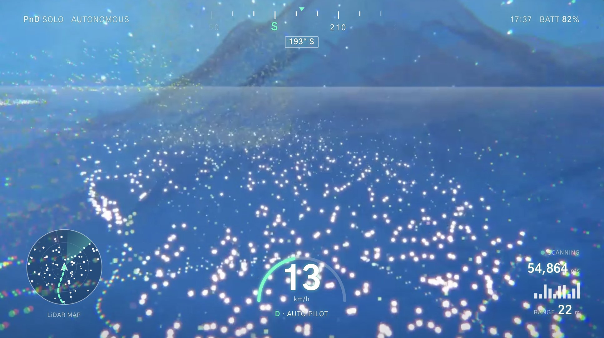
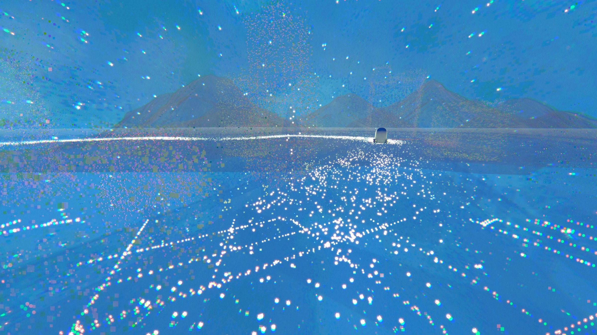
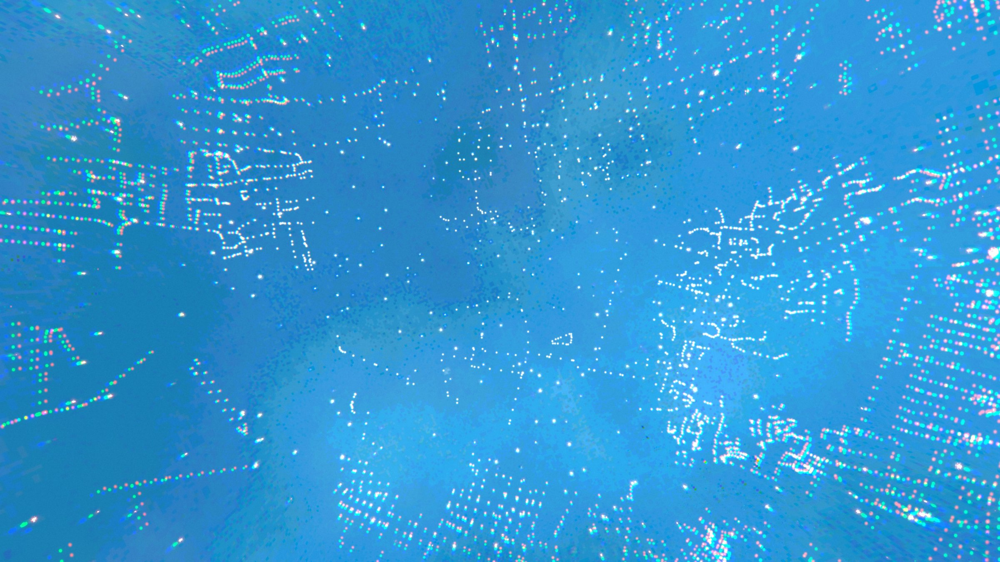
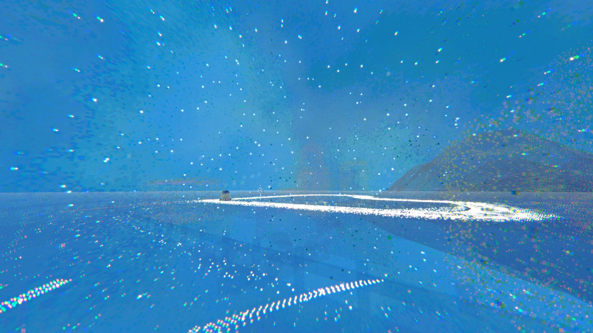
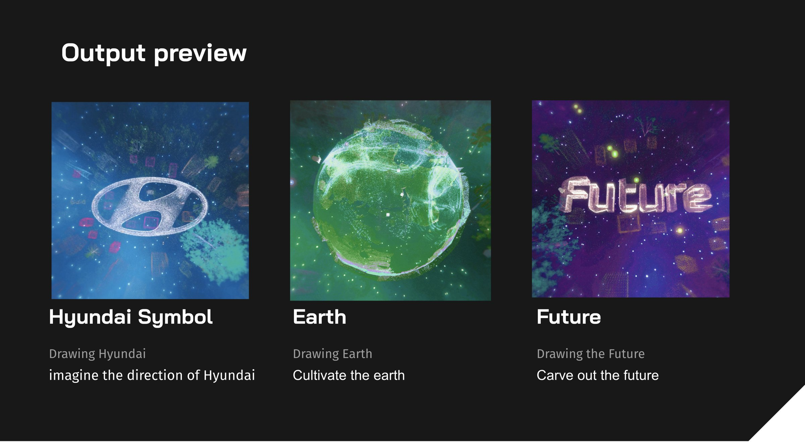

*The Shape of a Journey: Drawing the Future* is a work Hong created as a researcher in Hyundai Design Center's Next Generation Vehicle NFT R&D. It reinterprets Hyundai Motor's single-person mobility PnD and its autonomous driving technology as media art.

Just as PnD scans the world with LiDAR, the viewer moves forward by pressing a button to light up the surroundings in points. The coordinates and points a robot sees turn into a snowy landscape and a night sky, and the path travelled remains as glowing points. The viewer explores the world through the eyes of the mobility.

Unity · LiDAR · Point Cloud

