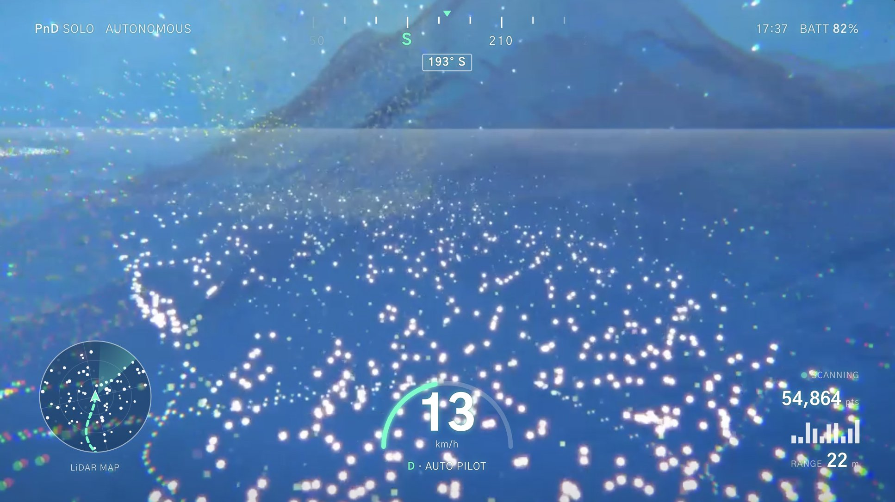
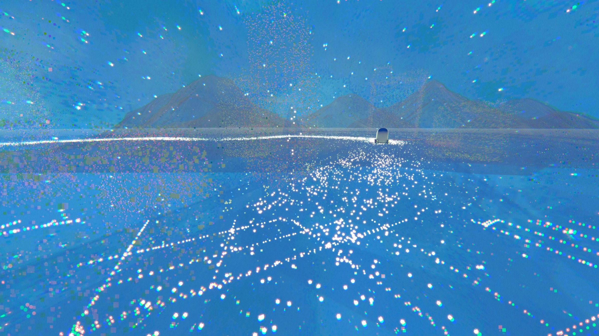
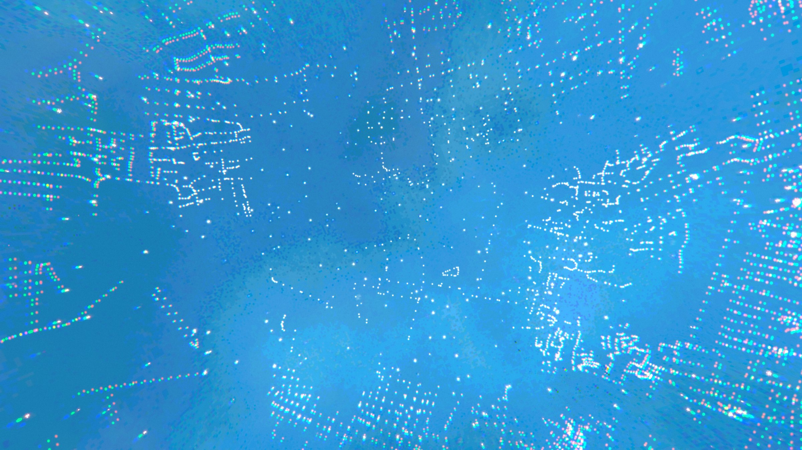
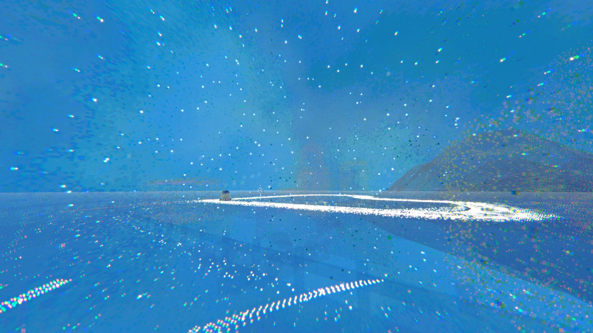
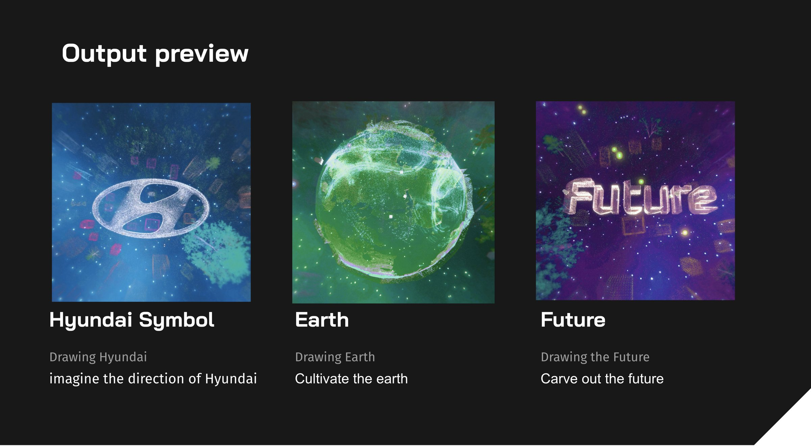

현대디자인센터의 Next Generation Vehicle NFT R&D에 연구원으로 참여해 만든 작품 「여정의 형태: 미래를 그리다」. 현대자동차의 1인용 모빌리티 PnD와 자율주행 기술을 미디어아트로 다시 해석했다.

PnD가 라이다 센서로 세상을 스캔하듯 관객은 버튼을 눌러 주변을 점으로 밝히며 나아간다. 로봇이 보는 좌표와 점들은 눈 오는 풍경과 밤하늘로 바뀌고 지나온 길은 빛나는 점으로 남는다. 관객은 모빌리티의 시선으로 세상을 탐험하게 된다.

Unity · LiDAR · Point Cloud

