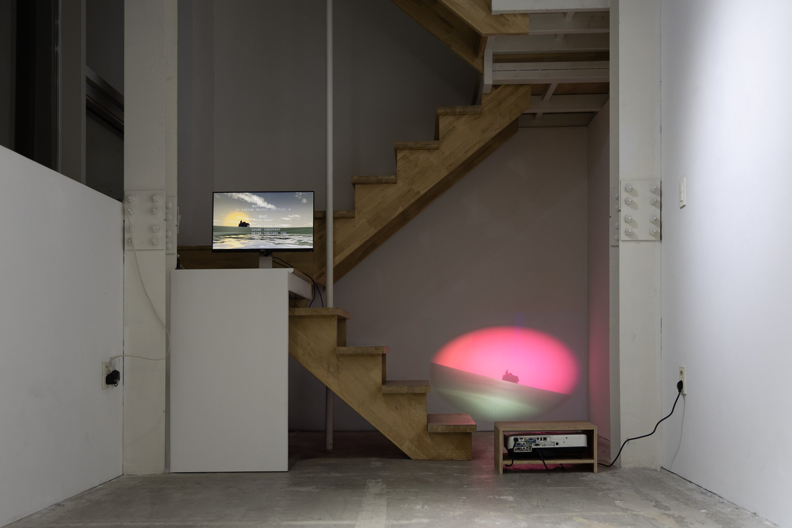
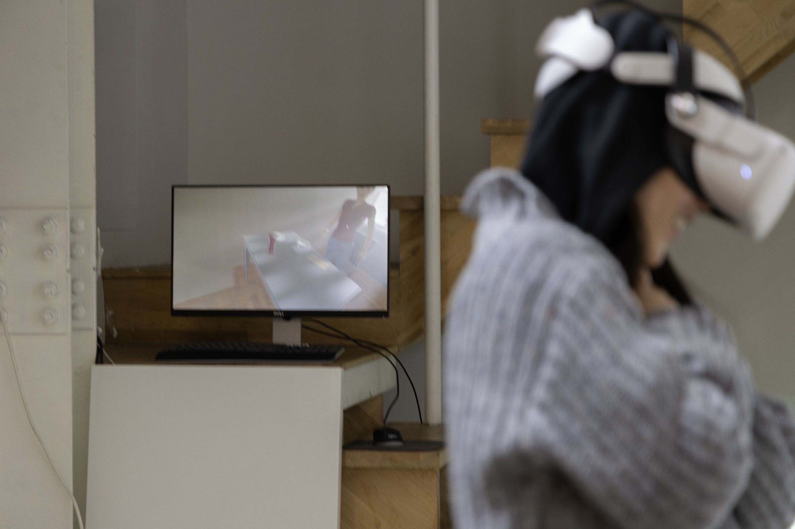
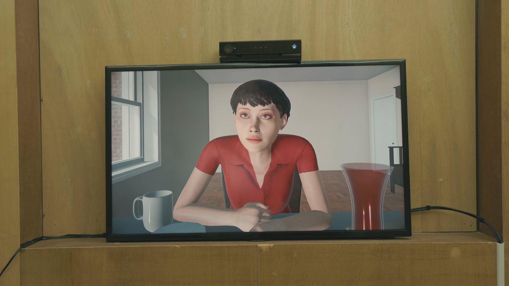
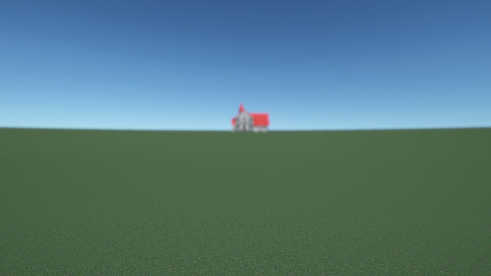
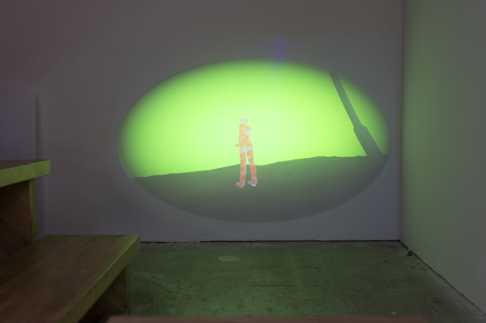
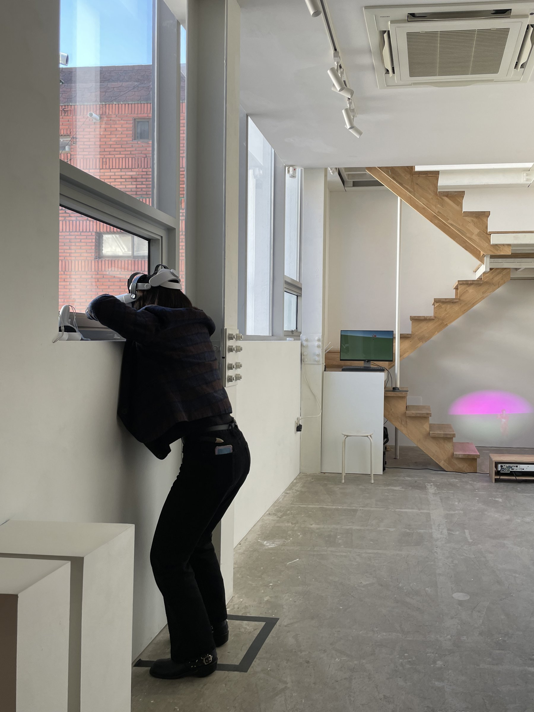
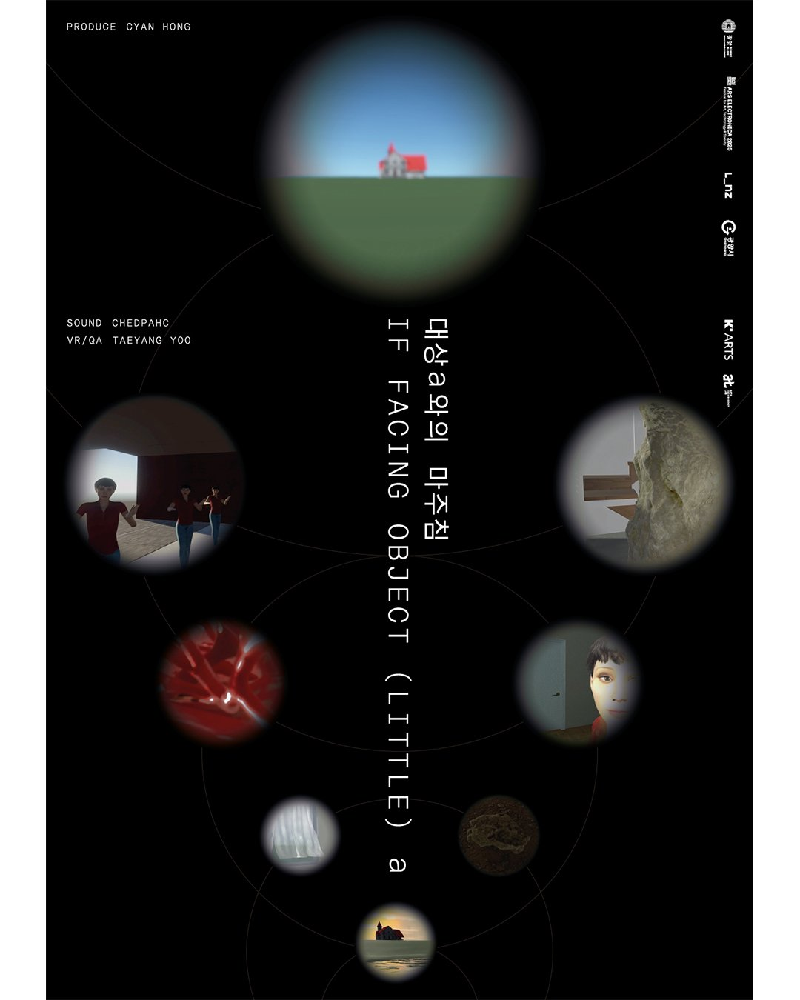
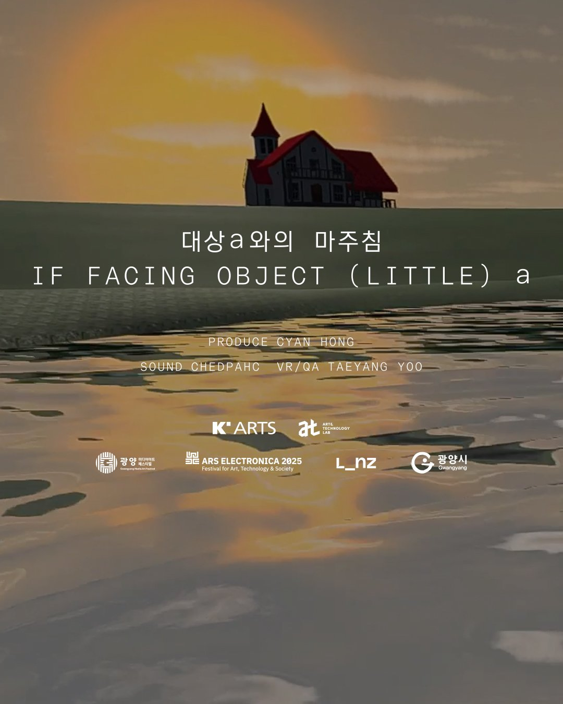

A 16-minute VR installation in which the visitor and virtual beings look at each other. Exhibited at the 2025 Gwangyang International Media Art Festival and presented at the K-Arts AT Lab showcase.

The beings in the work have no physical form, yet they gain meaning through their relationship with the visitor. Now that connecting with others in digital environments has become part of everyday life, the work asks how we accept and choose those relationships.

Wearing a headset, the visitor walks through the virtual space, which responds to what they look at and for how long. Two screens stand side by side at the end of the space. The left screen shows the participant's gaze and the right screen shows the virtual being looking back at the participant. Other visitors watching the scene also become part of the work.

VR · Unity · Head Tracking

## Credits

Production: Cyan Hong 
Sound: Chedpahc 
VR/QA: Taeyang Yoo 
Supported by: K-Arts Art & Technology Lab (AT Lab) 
Poster Design: studio jho

## Installations & Screenings

≪Mediators≫, Onsu Gonggan 
Gwangyang International Media Art Festival (GIMAF) 
'A.I x ART x HUMAN' Advanced Convergence Content Showcase, K-Arts AT Lab
