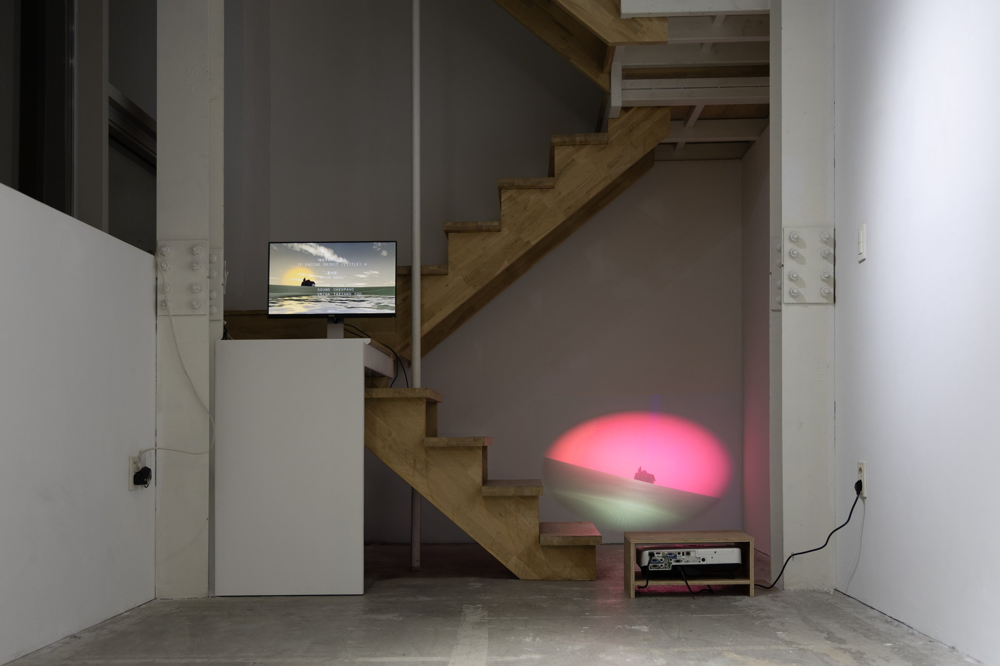
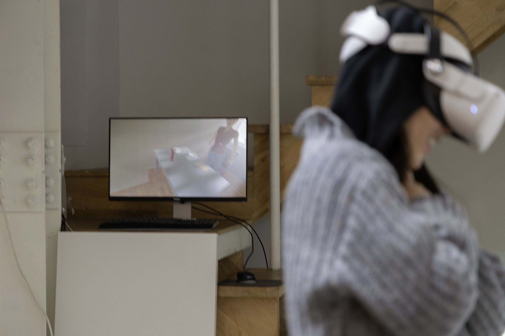
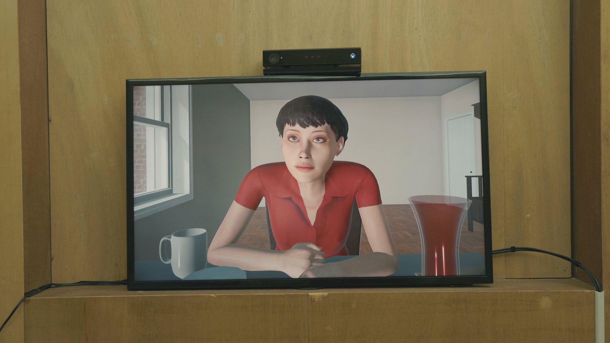
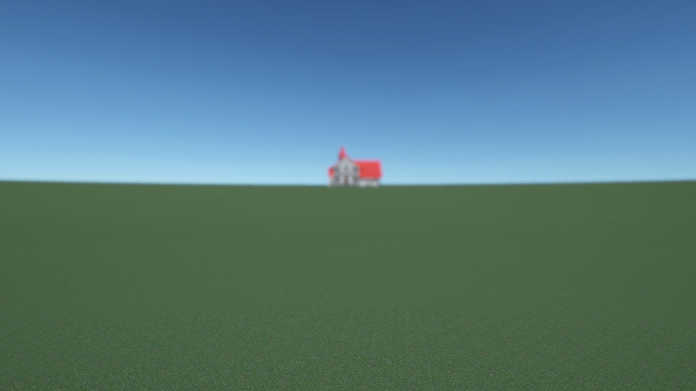
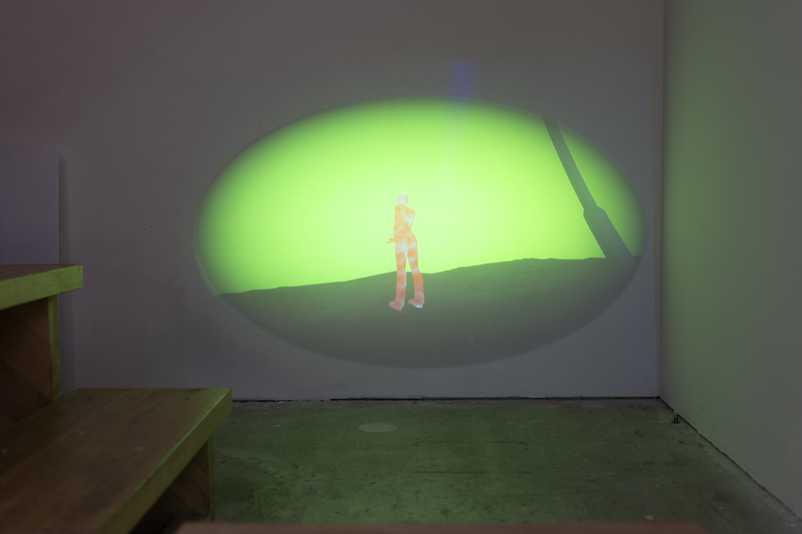
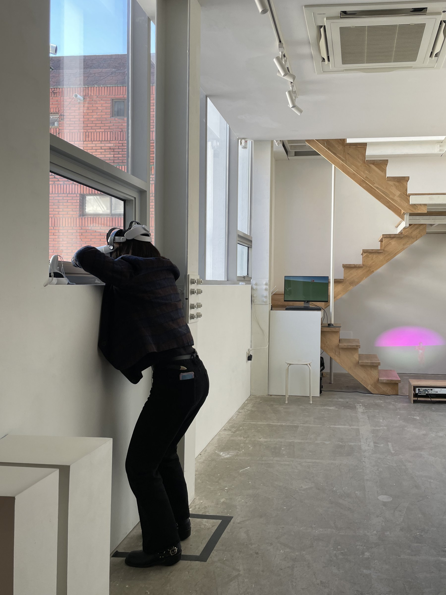
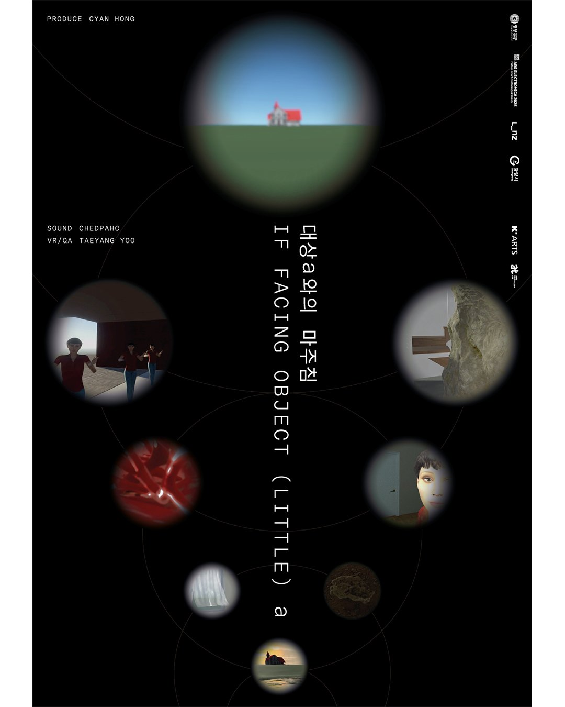
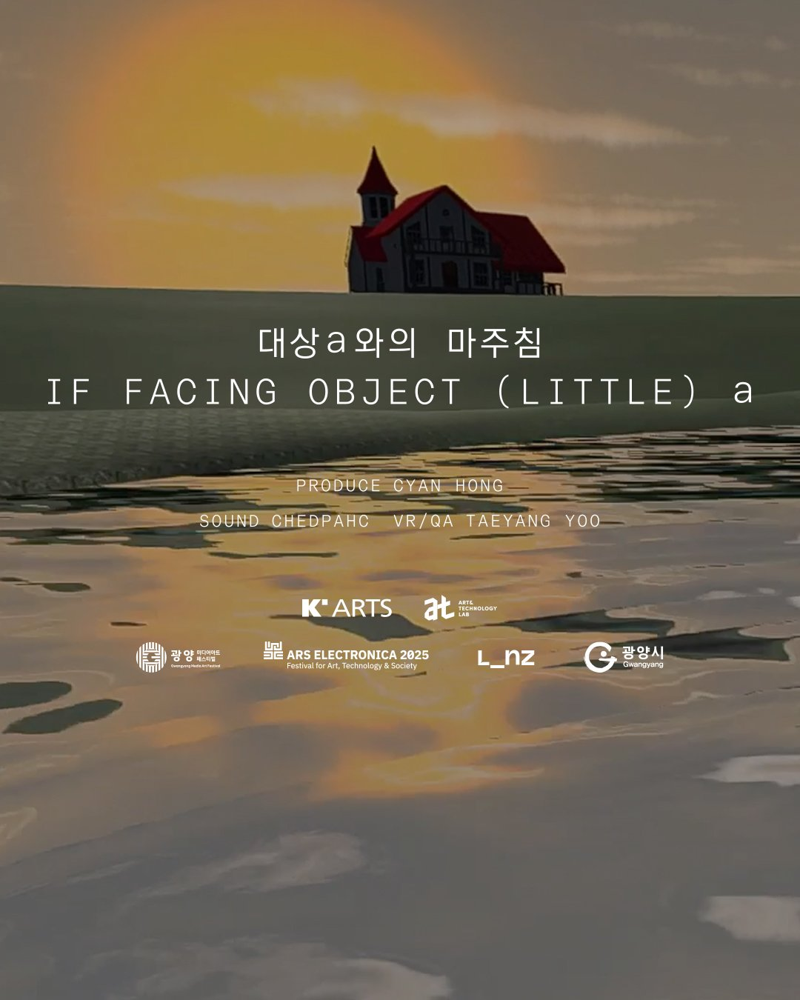

관객과 가상의 존재가 서로를 바라보는 16분 길이의 VR 설치 작품. 2025년 광양국제미디어아트페스티벌에서 전시했고 한국예술종합학교 AT랩 쇼케이스에서 선보였다.

작품 속 존재들은 물리적 실체가 없지만 관객과 관계를 맺으며 의미를 갖게 된다. 디지털 환경에서 타자와 교감하는 일이 일상이 된 지금 그 관계를 어떻게 받아들이고 선택할지 묻는다.

관객은 헤드셋을 쓰고 가상공간을 걸어 다닌다. 관객이 무엇을 얼마나 오래 바라보는지에 따라 공간이 반응한다. 전시장 끝에는 두 개의 화면이 나란히 놓인다. 왼쪽 화면은 참여 관객의 시선을 보여주고 오른쪽 화면은 가상의 존재가 참여 관객을 바라보는 시선을 보여준다. 그 장면을 지켜보는 다른 관객도 작품의 일부가 된다.

VR · Unity · Head Tracking

## 크레딧

제작: 홍서연 
사운드: Chedpahc 
VR/QA: 유태양 
제작지원: 한국예술종합학교 AT랩 
포스터 디자인: studio jho

## 설치 및 상영

≪매개자들≫, 온수공간 
광양국제미디어아트페스티벌 
'A.I x ART x HUMAN' 첨단 융복합 콘텐츠 쇼케이스, 한국예술종합학교 AT랩
