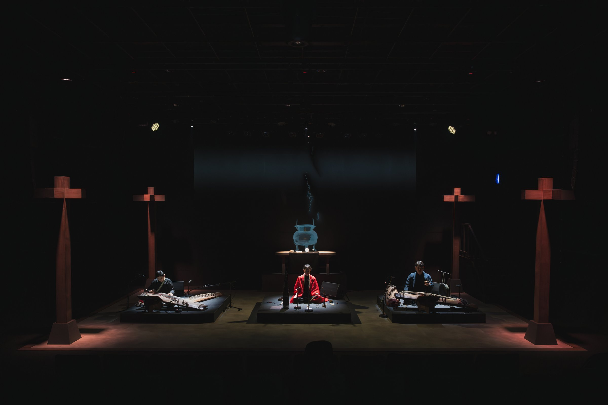
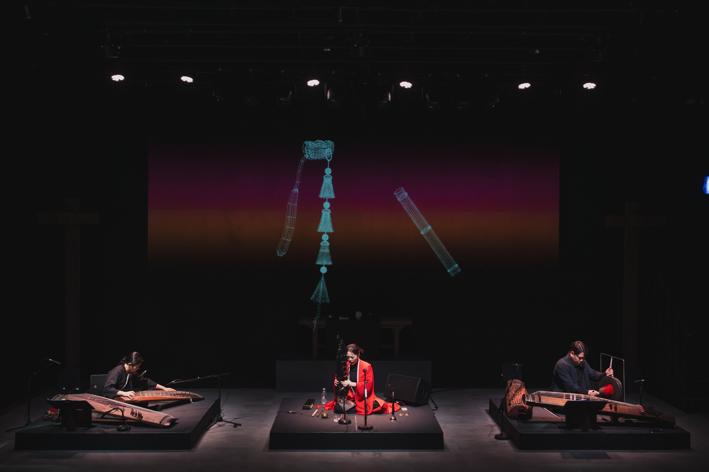
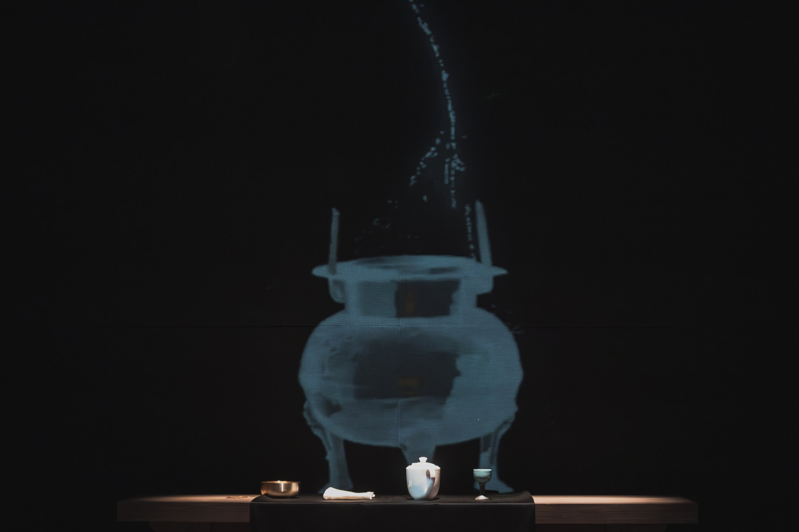
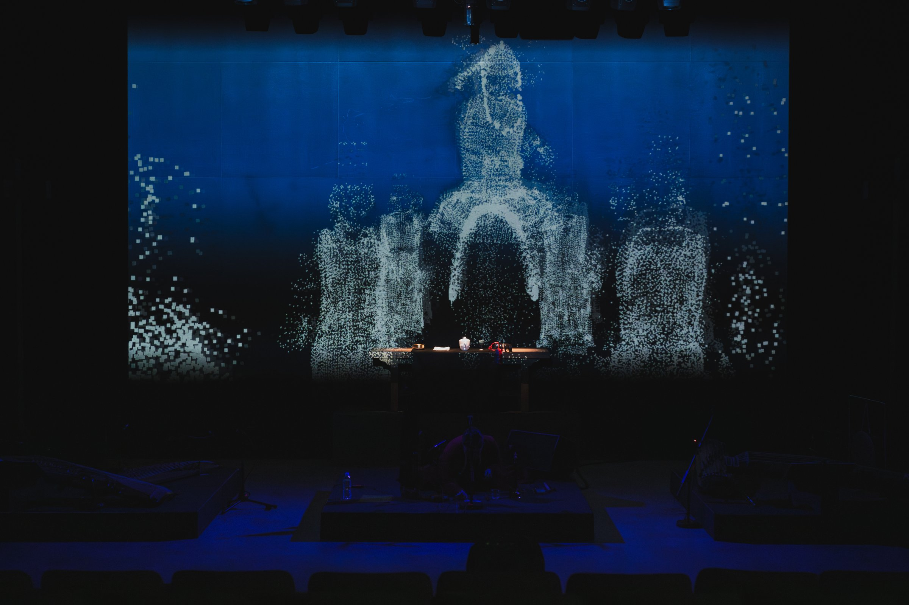

Hong served as video director for a reinterpretation of Jongmyo Jeryeak by piri player Chorong Oh. The 60-minute performance took place at Kim Hee-soo Art Center in 2023.

"How does ritual take part in human life, and what does music mean within that ritual?" The performance treats Jongmyo Jeryeak as ritual music for jaerae (再來), being born again into this world, and searches for its meaning.

The atmosphere of Jongmyo Daeje, a UNESCO Intangible Cultural Heritage, was carried into audio-reactive point cloud visuals. Ritual scenes such as the royal procession and the ritual vessels appear as points that gather and scatter in response to the music. Moving between figuration and abstraction, the points take on the restrained look of Korean painting.

TouchDesigner · Audio Reactive · Point Cloud

## Credits

Music Director, Composition & Performance: Chorong Oh 
Producer: Areum Shin 
Composition & Performance: Seonggeun Kim, Yujeong Ji 
Sound: Ikhwan Noh 
Video Director: Cyan Hong 
Video Technician: Taeyang Yoo 
Lighting: Hyerim Park 
Stage Manager: Jonghun Park 
Venue: Kim Hee-soo Art Center 
Supported by: Soorim Cultural Foundation
