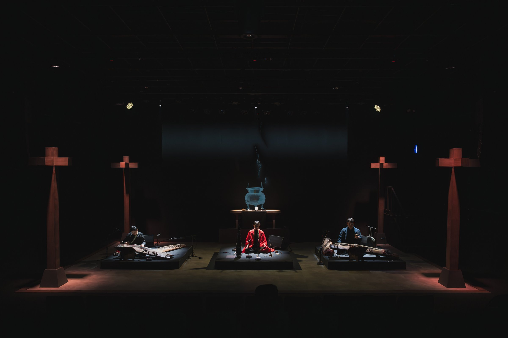
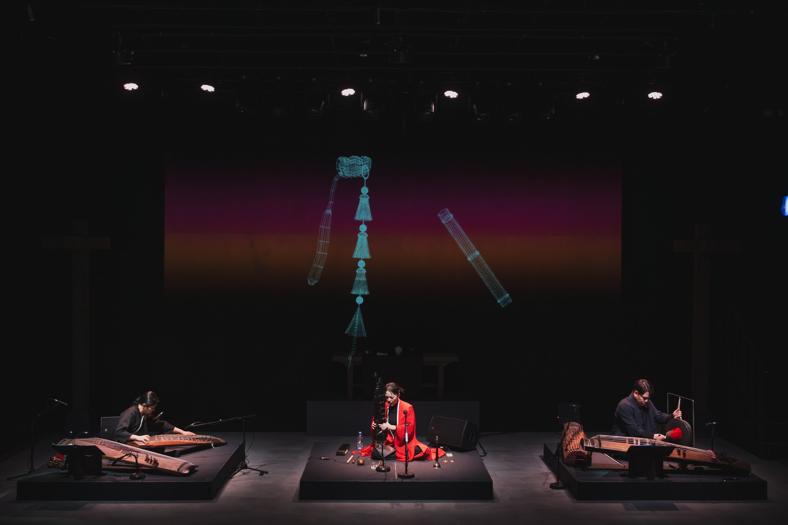
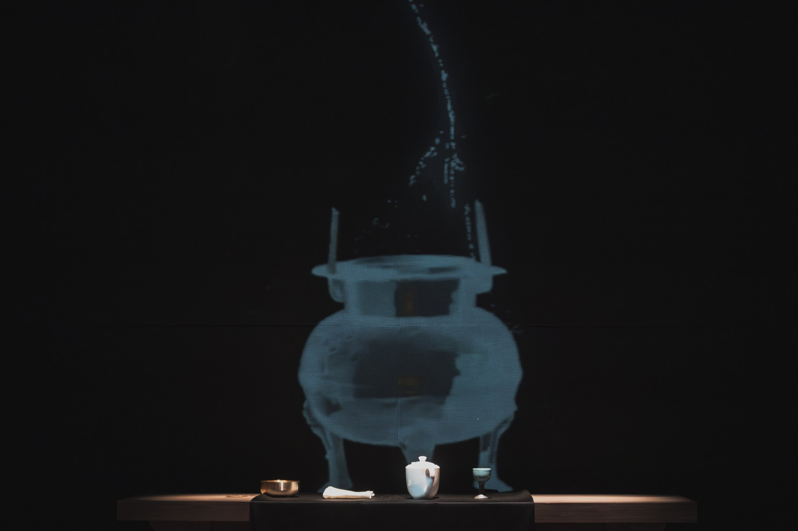
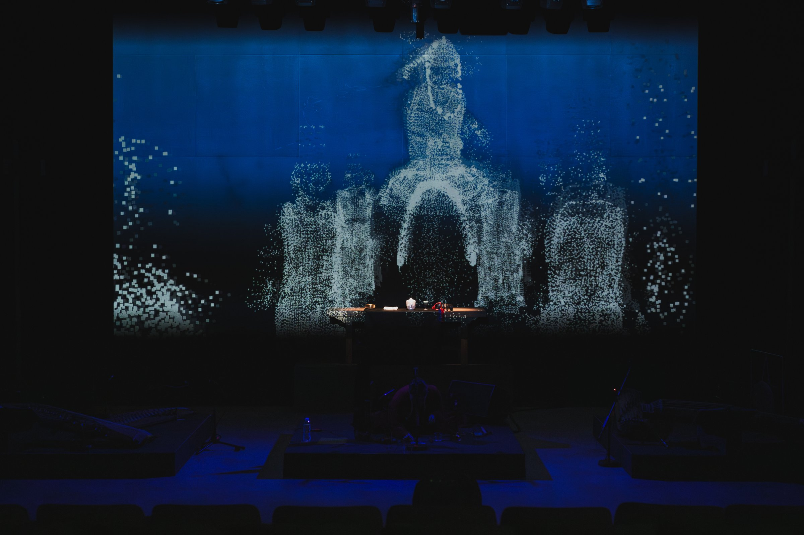

피리 연주자 오초롱이 재창작한 종묘제례악 공연에서 영상감독을 맡았다. 2023년 김희수아트센터에서 60분 동안 공연했다.

"의식은 인간의 삶에 어떻게 관여하고 음악은 그 의식에서 어떤 의미를 갖는가?" 공연은 종묘제례악을 '재래(再來): 다시 이 세상에 태어남'을 위한 의식음악으로 보고 그 의미를 찾아간다.

유네스코 인류무형문화유산인 종묘대제의 분위기를 오디오 리액티브 포인트 클라우드 영상으로 옮겼다. 어가행렬과 제기 같은 의식의 장면이 점으로 나타나 연주에 반응하며 모이고 흩어진다. 점은 구상과 추상을 오가며 절제된 한국화의 모습을 만든다.

TouchDesigner · Audio Reactive · Point Cloud

## 크레딧

음악감독·창작·연주: 오초롱 
기획: 신아름 
창작·연주: 김성근, 지유정 
음향: 노익환 
영상감독: 홍서연 
영상 테크니션: 유태양 
조명: 박혜림 
무대감독: 박종훈 
공연장: 김희수아트센터 
지원: 수림문화재단
