From 2023 to 2025, Hong taught as an instructor in the Multimedia Track of the Korea National Institute for the Gifted in Arts (KNIGA).

The classes started from observing and recording the senses, then moved sound, images and body movement into digital media. Students recorded sound as drawings and interacted with the screen through their bodies in front of projections to create their own works.

Multimedia · Interactive · Projection

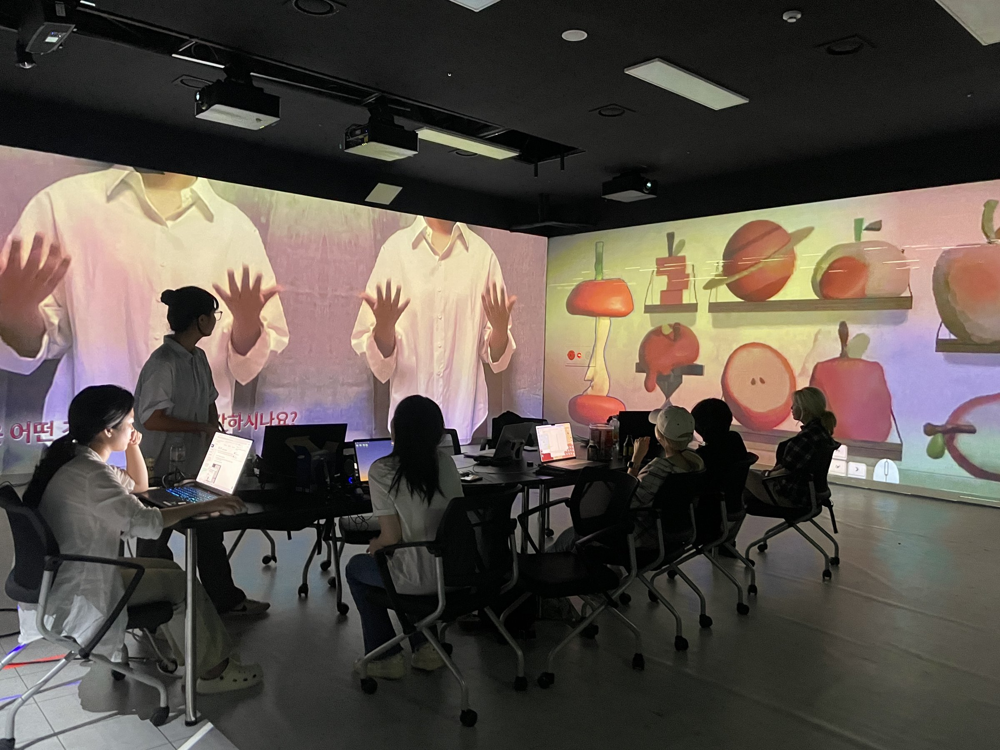

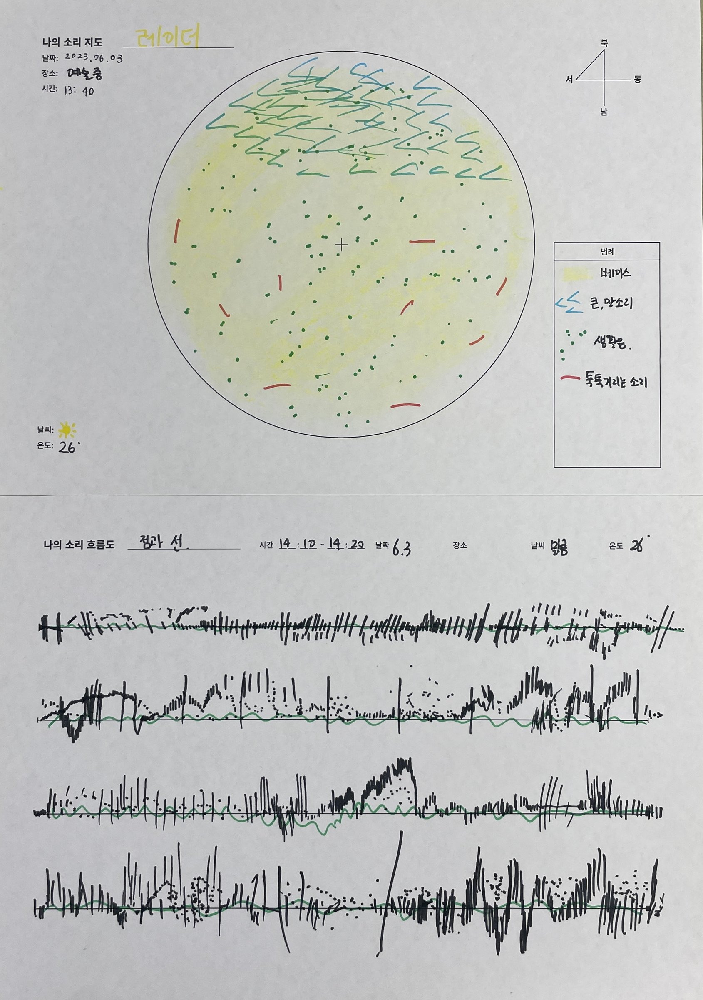
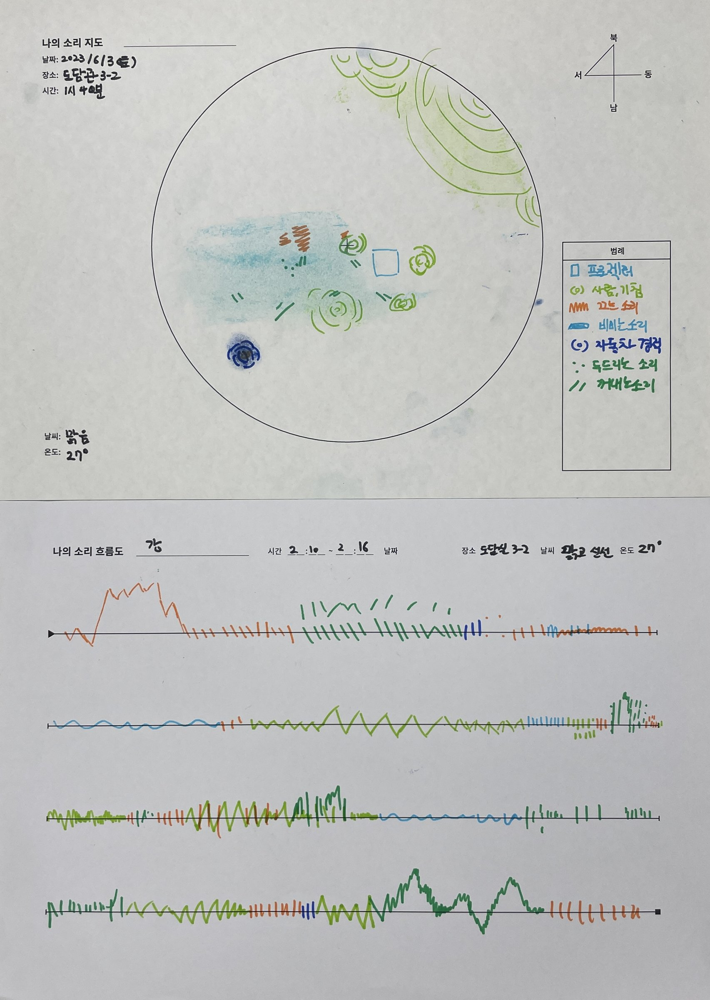

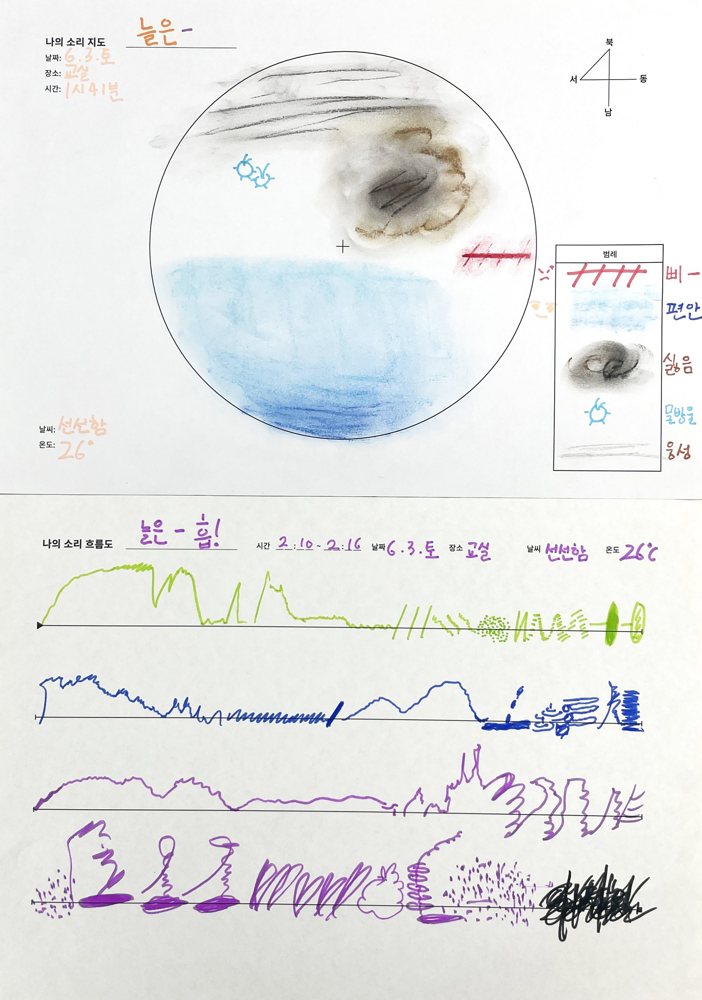
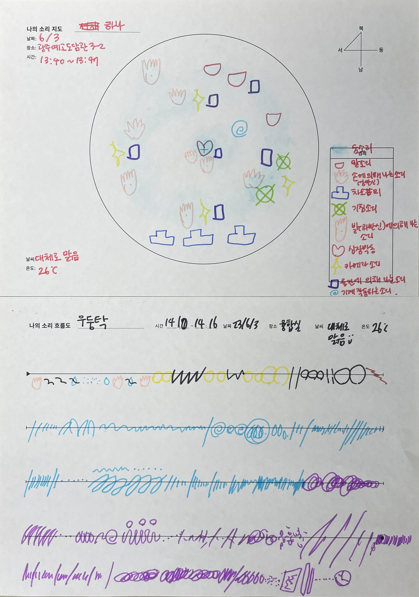

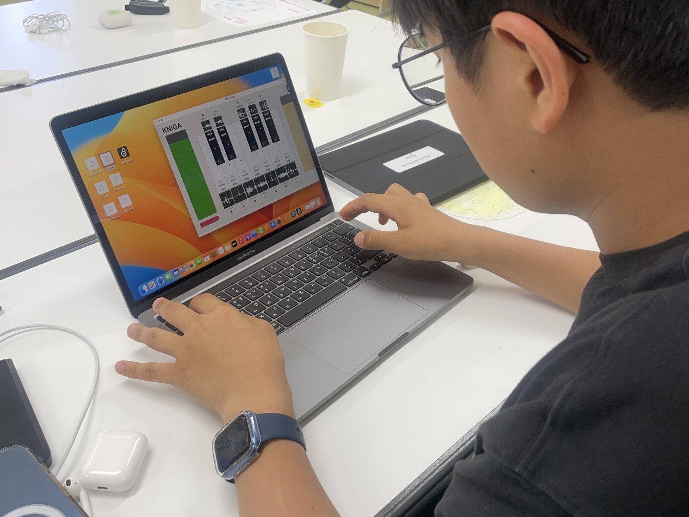

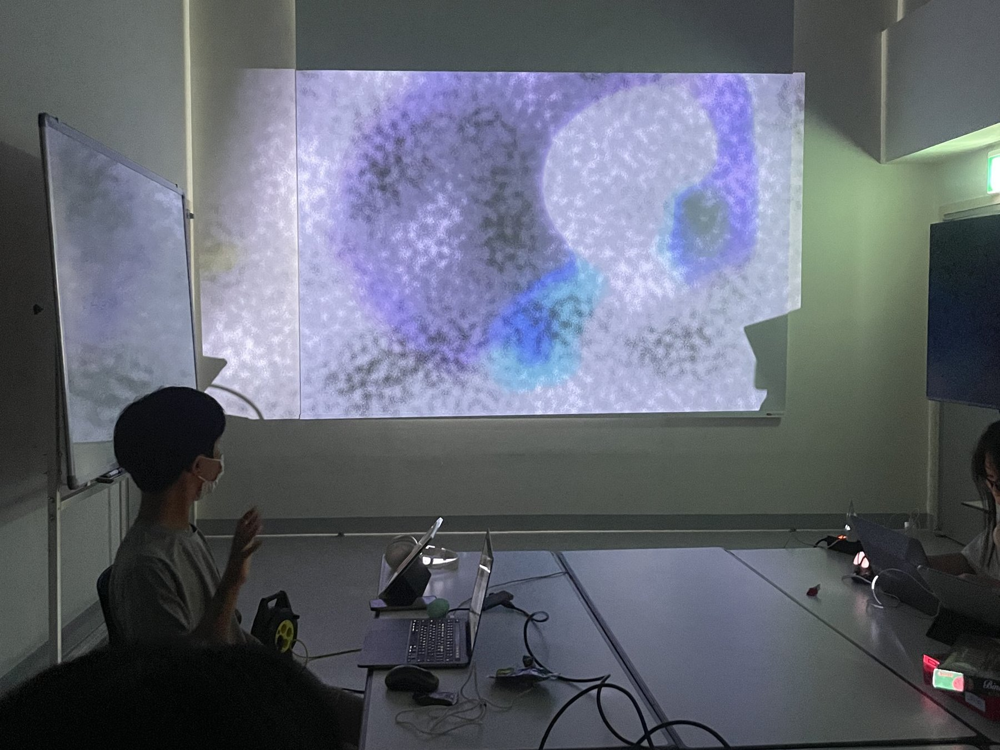

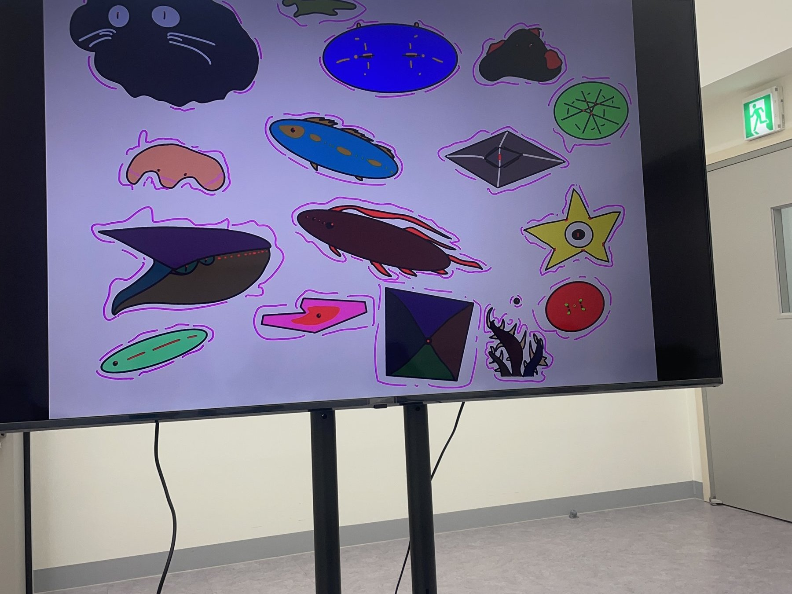

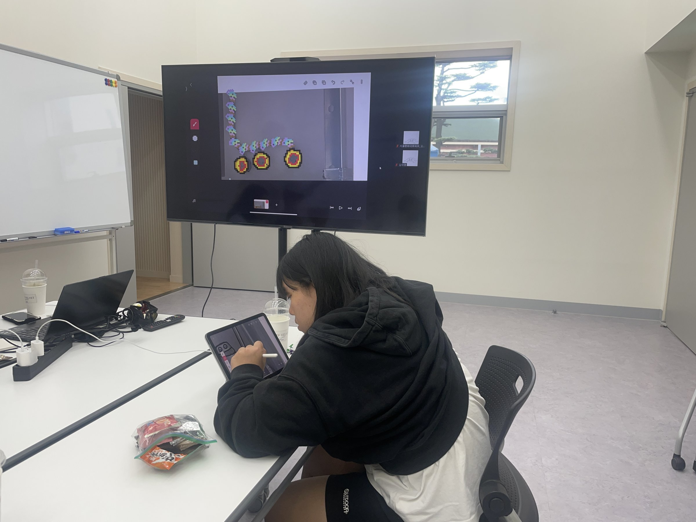

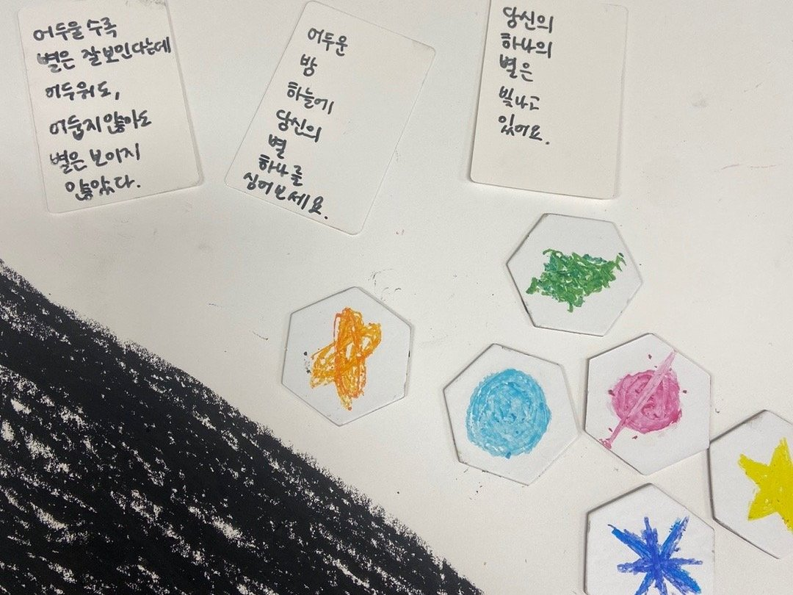

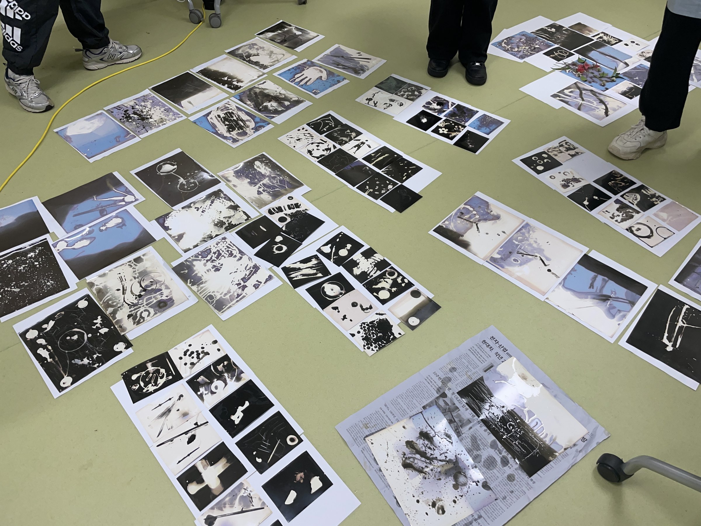
