2023년부터 2025년까지 한국예술영재교육원 멀티미디어트랙에서 강사로 수업했다.

감각을 관찰하고 기록하는 데서 출발해 소리와 이미지와 몸의 움직임을 디지털 매체로 옮기는 수업을 했다. 학생들은 소리를 그림으로 기록하고 프로젝션 앞에서 몸으로 화면과 상호작용하며 각자의 작품을 만들었다.

Multimedia · Interactive · Projection

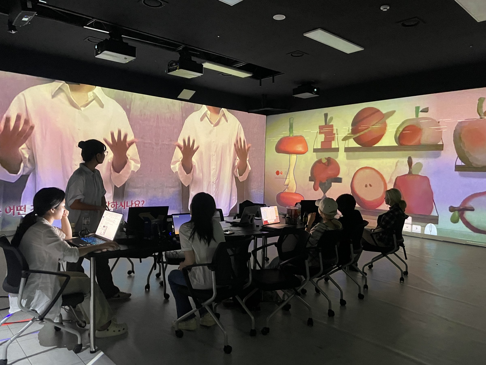

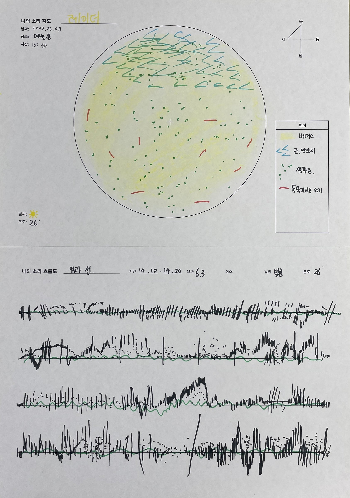
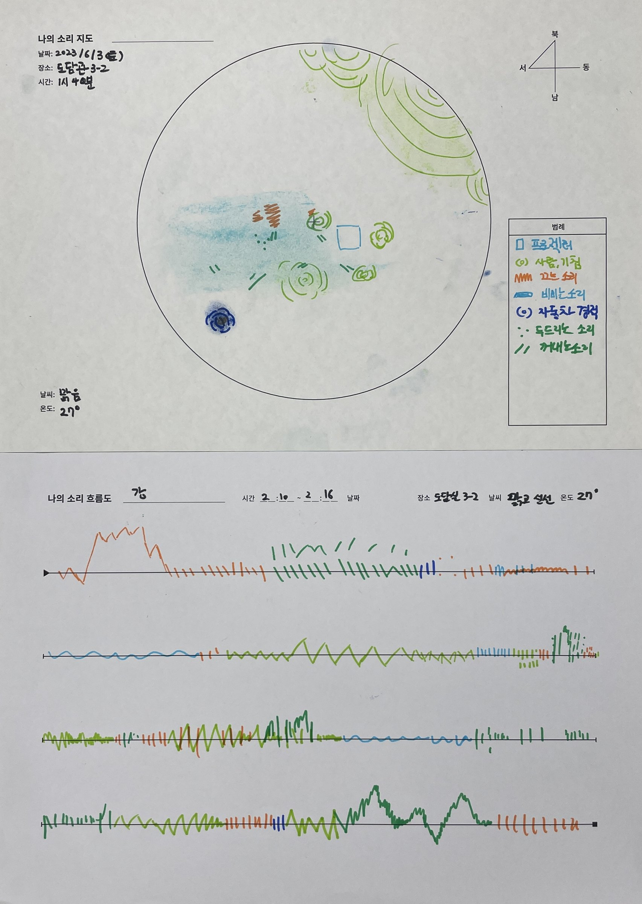

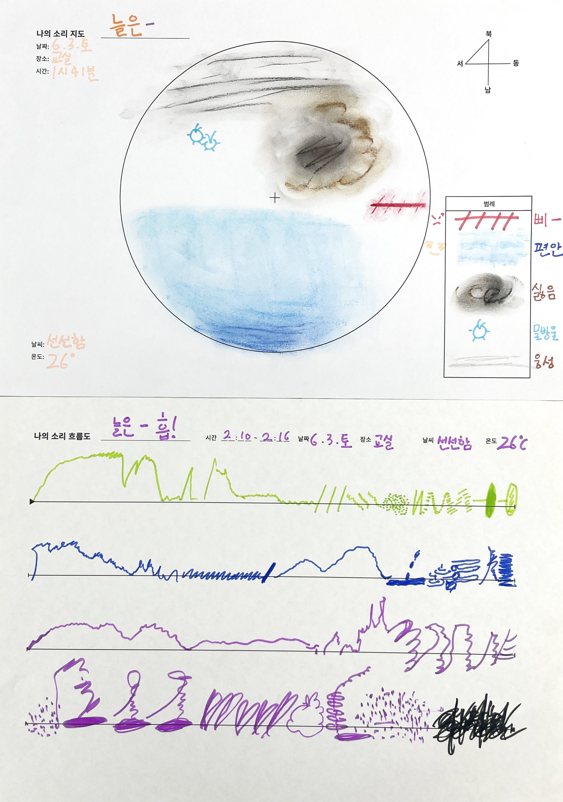
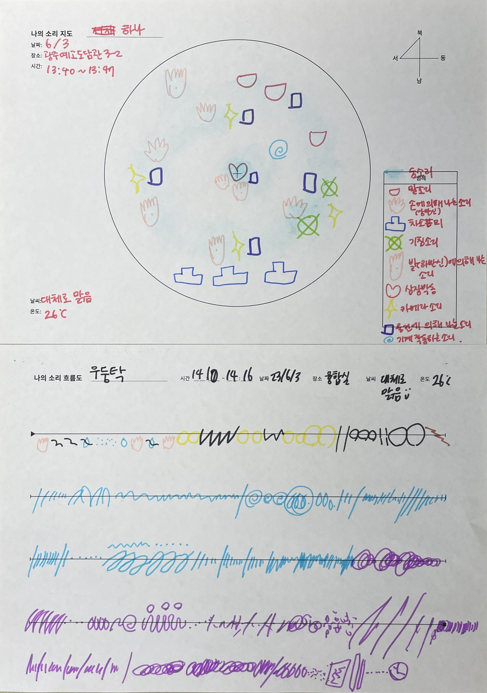

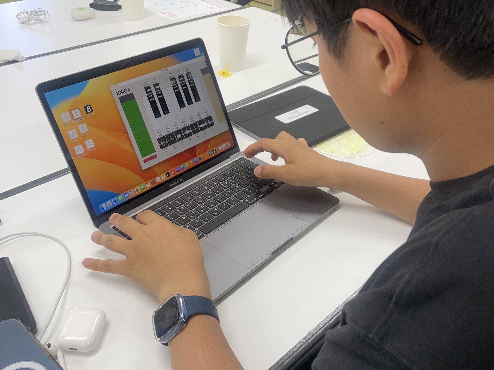

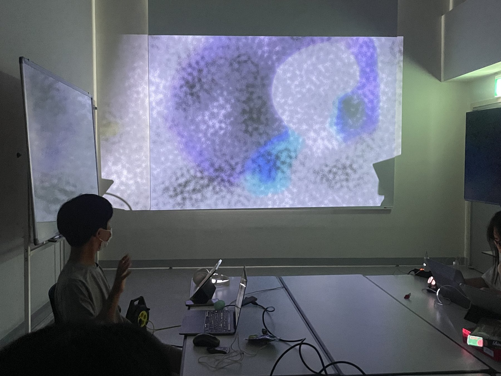

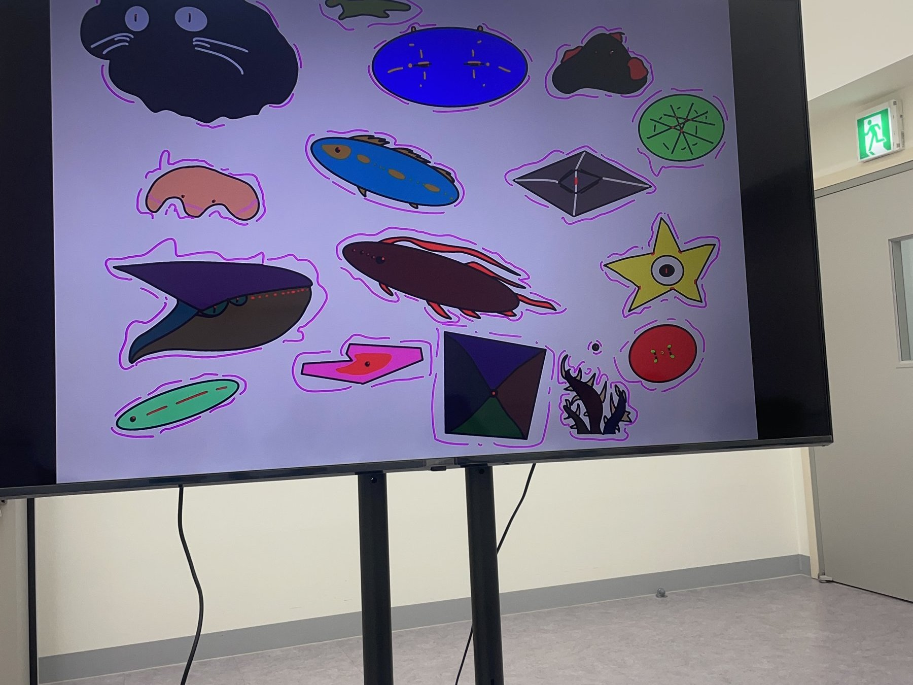

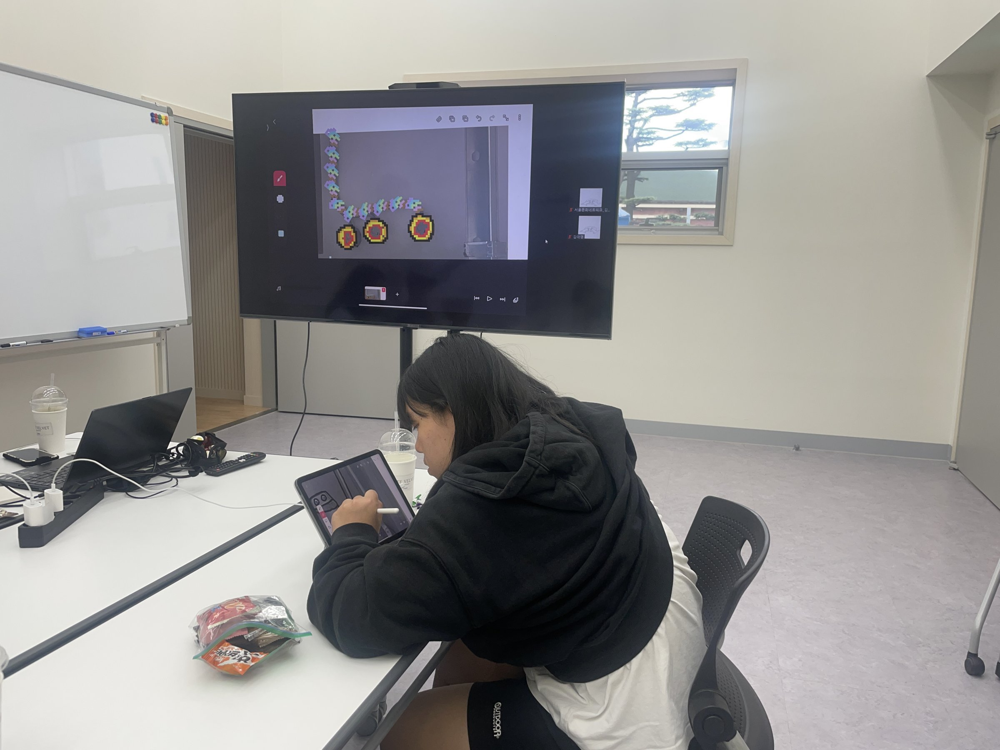

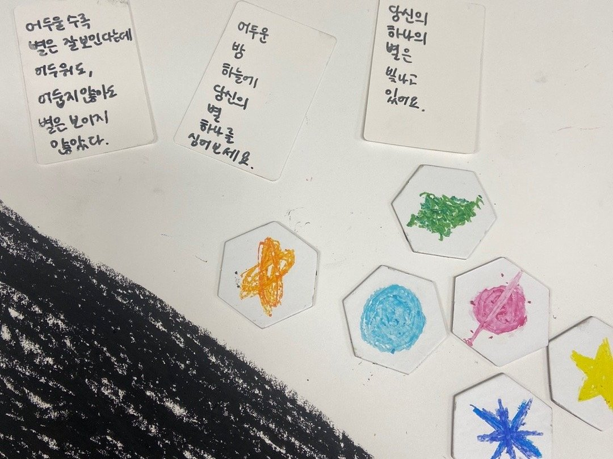

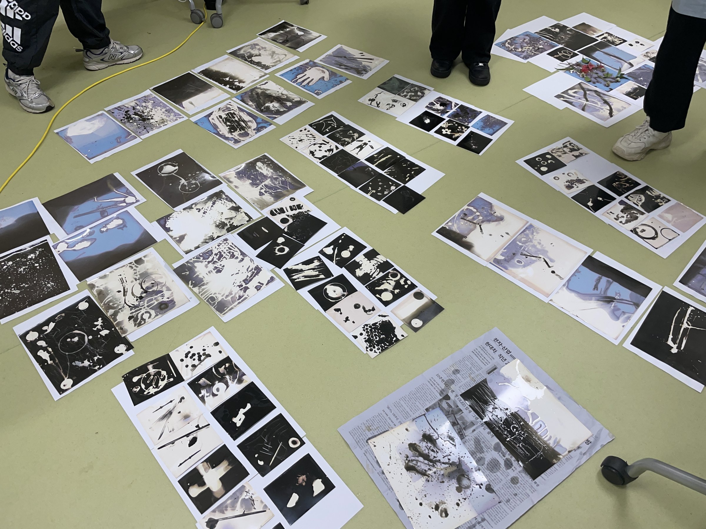
