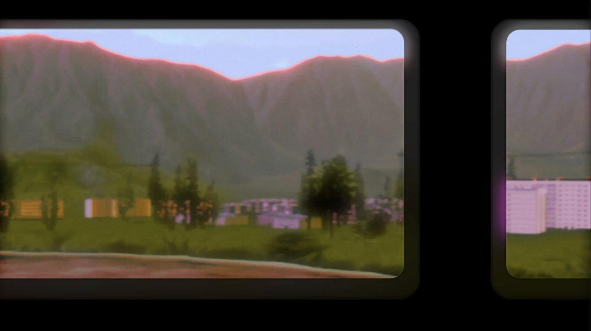
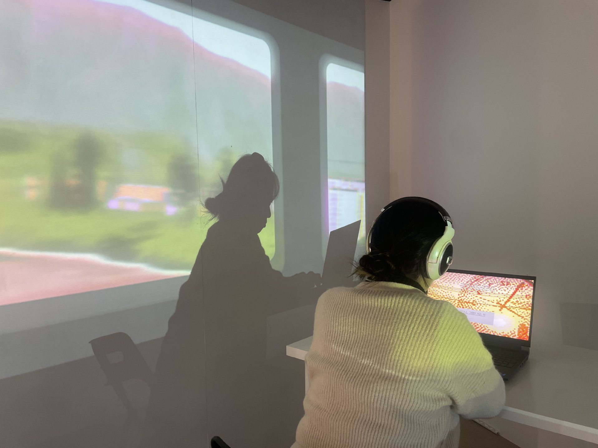
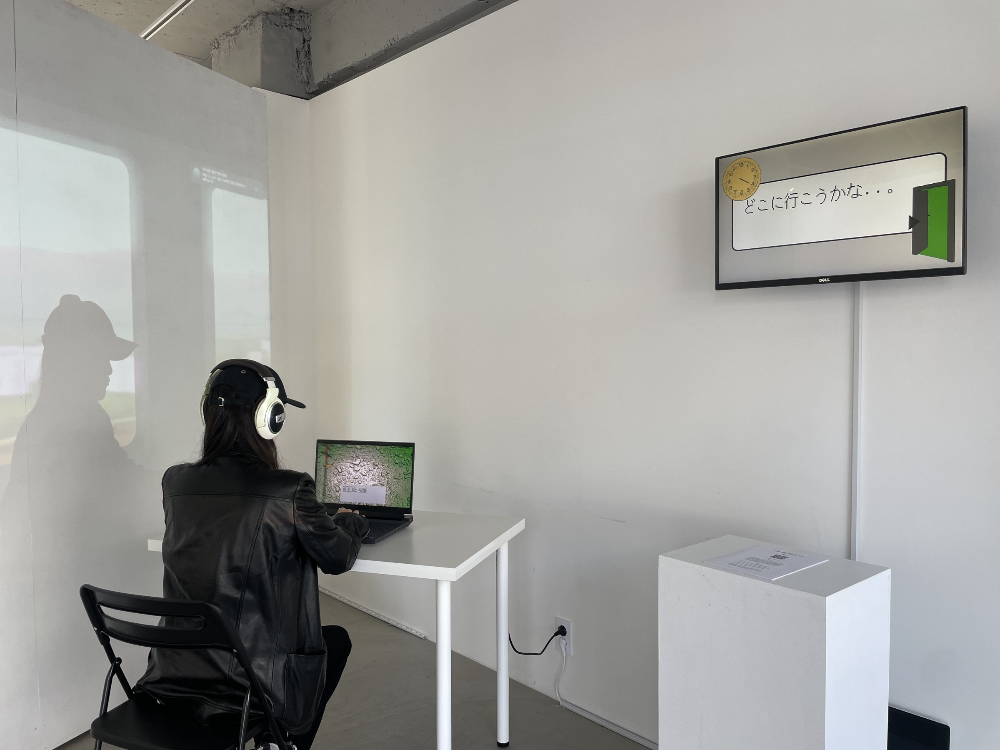
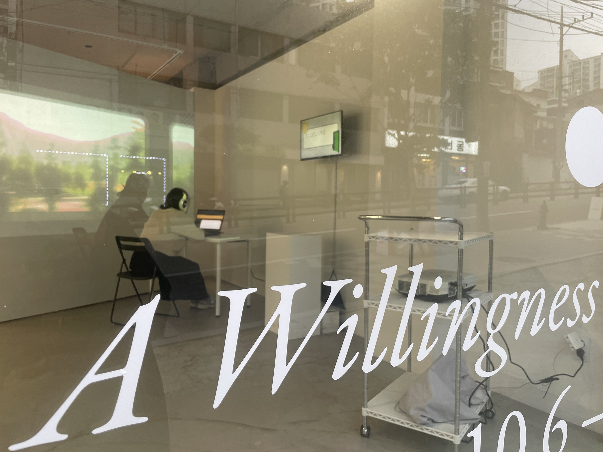
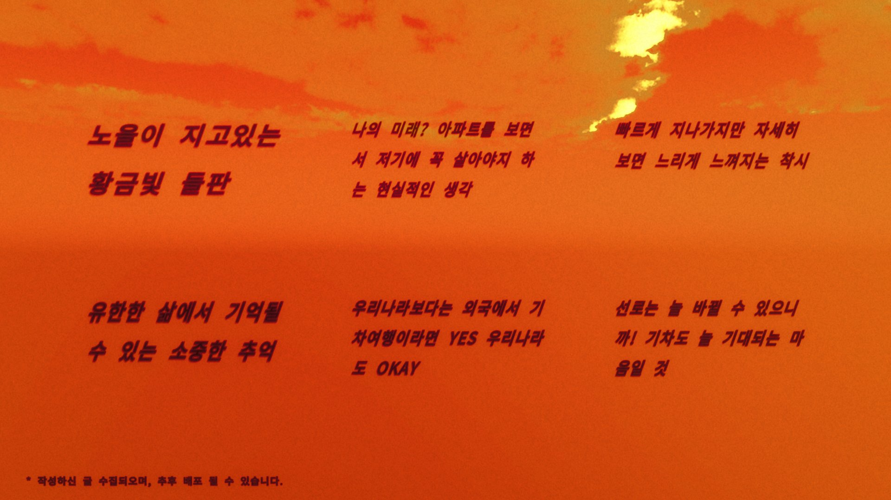
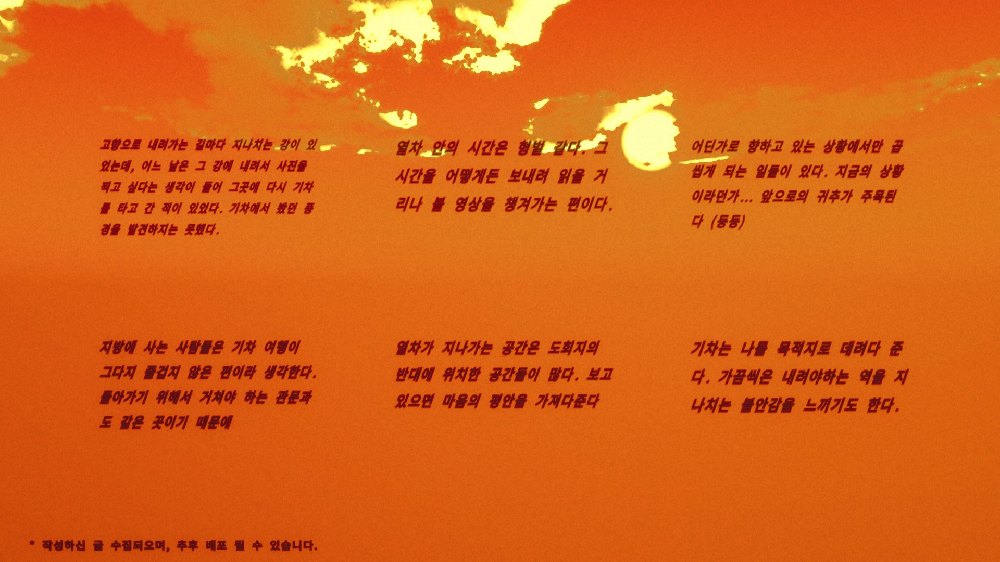
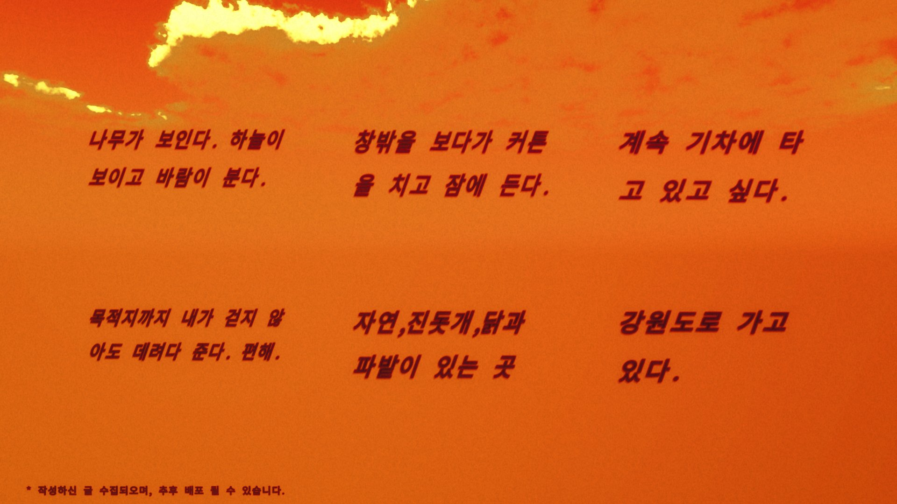
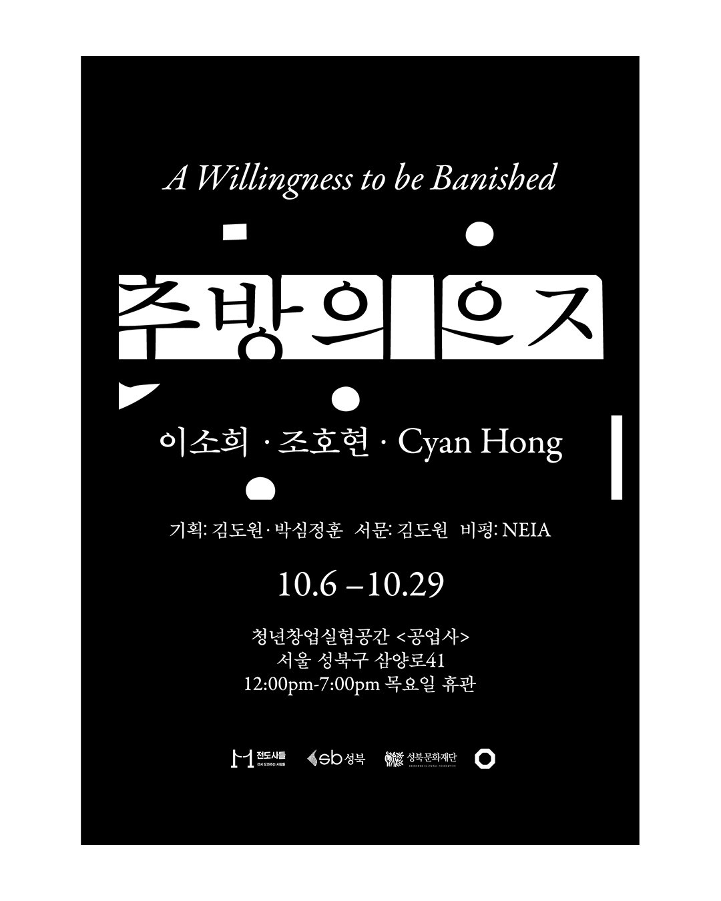

An alternative game made in Unity, exhibited in 2023 in the group exhibition ≪The Willingness to Be Banished≫ by Seongbuk Cultural Foundation.

The visitor boards a train and finds a seat. Looking at the landscape passing by the window brings up a window for writing. The short messages visitors leave are gathered in the ending credits when the train reaches its last stop.

There is no goal to win in this game. Visitors watch the scenery at their own pace, write, or simply stay. The work asks, "Where are we?"

Unity · Game · Installation

## Credits

Poster Design: studio jho
