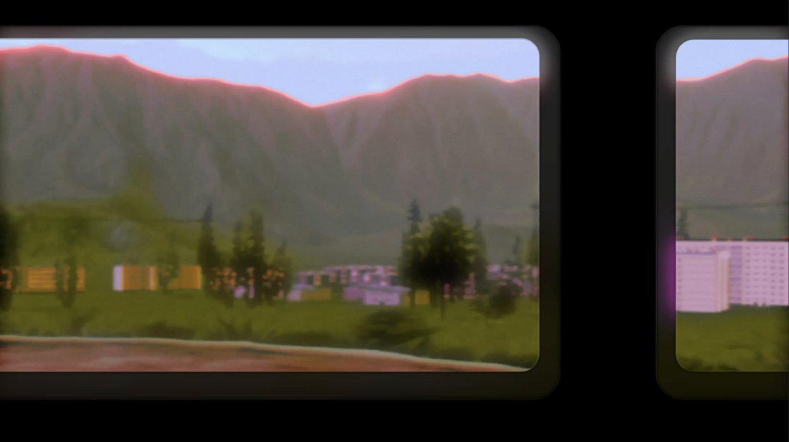
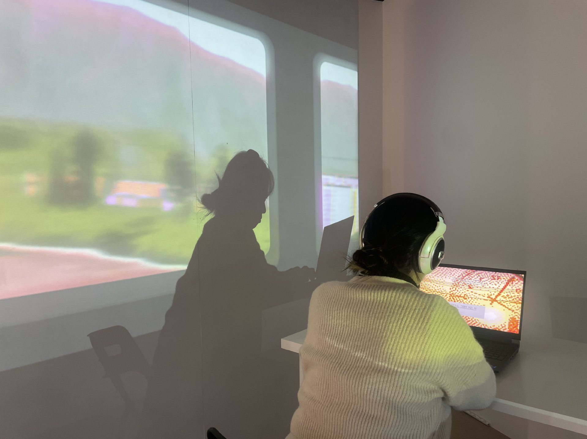
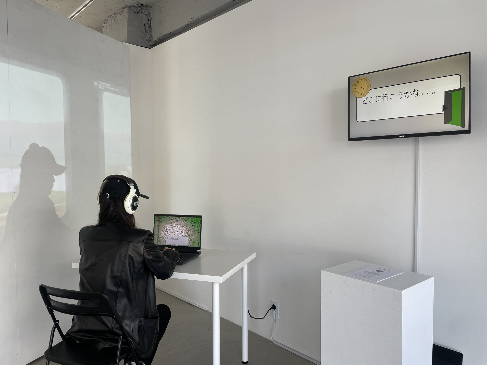
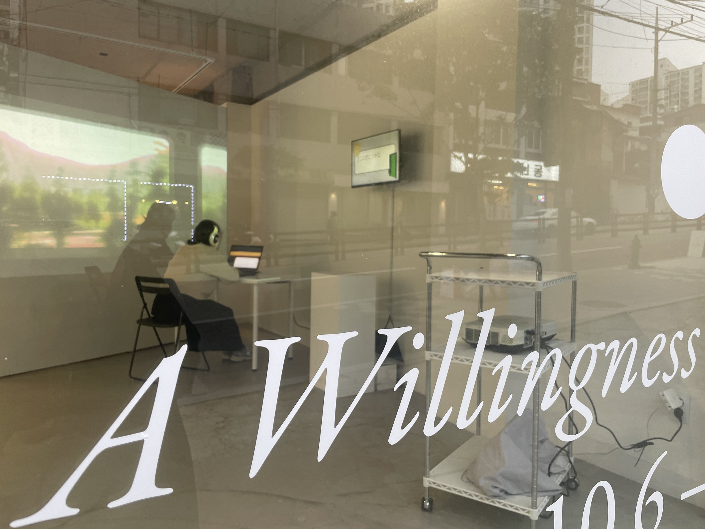
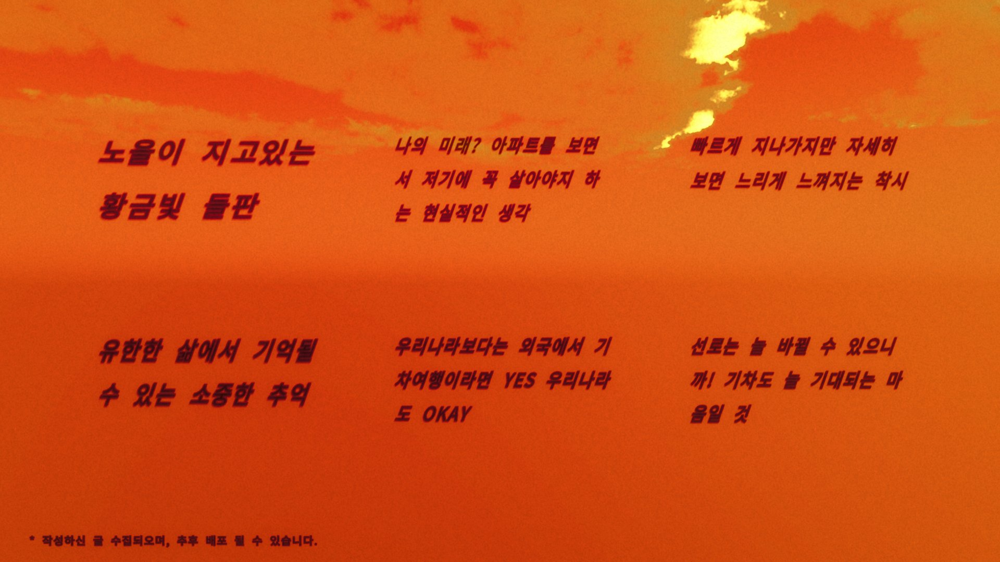
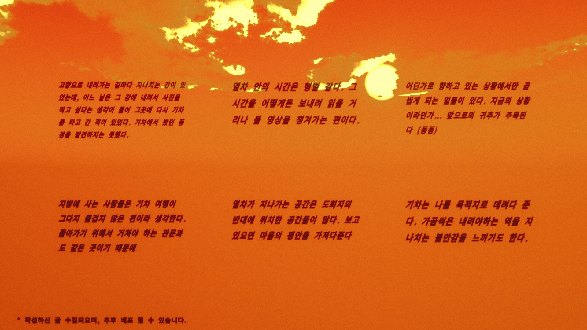
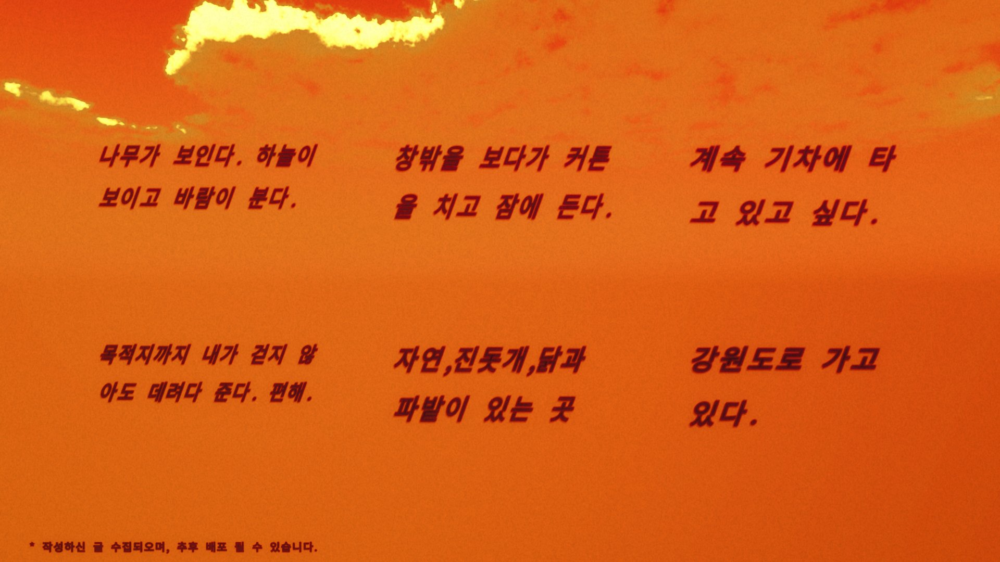
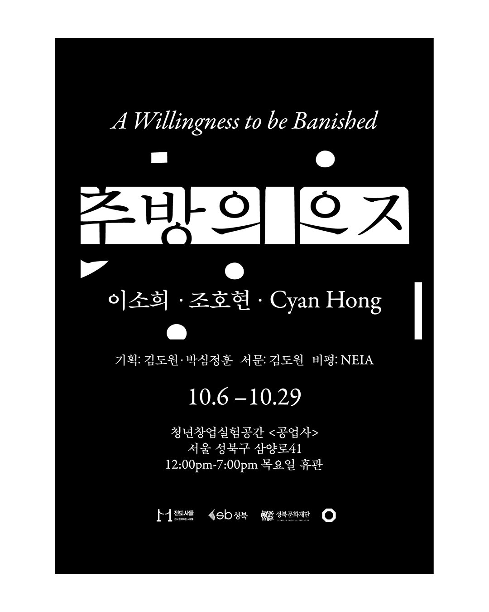

Unity로 만든 얼터너티브 게임. 2023년 성북문화재단 그룹전 ≪추방의 의지≫에서 전시했다.

관객은 기차에 올라 자리를 찾아 앉는다. 창밖으로 흐르는 풍경을 바라보면 글을 쓸 수 있는 창이 뜬다. 관객이 남긴 짧은 글은 기차가 종착지에 닿을 때 엔딩 크레딧에 함께 모인다.

이 게임에는 이겨야 할 목표가 없다. 관객은 각자의 속도로 풍경을 보며 글을 쓰거나 멍하니 머문다. 작품은 "우리가 있는 곳은 어디인가요?"라고 묻는다.

Unity · Game · Installation

## 크레딧

포스터 디자인: studio jho
