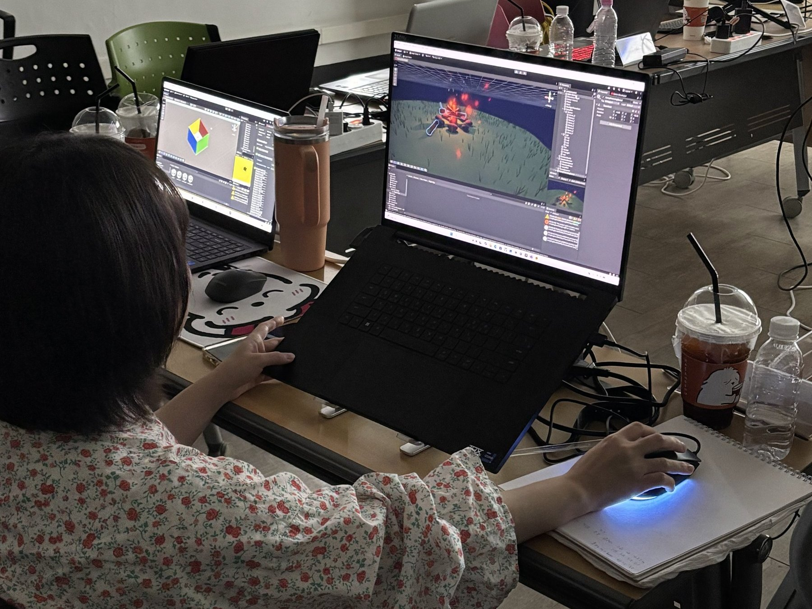
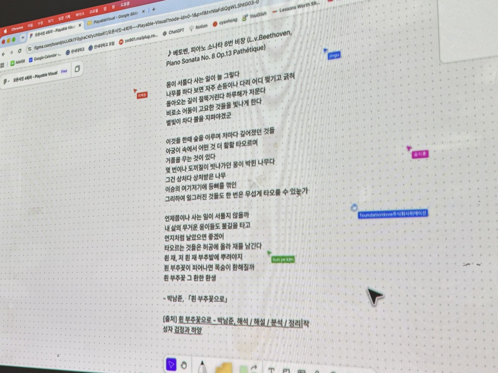
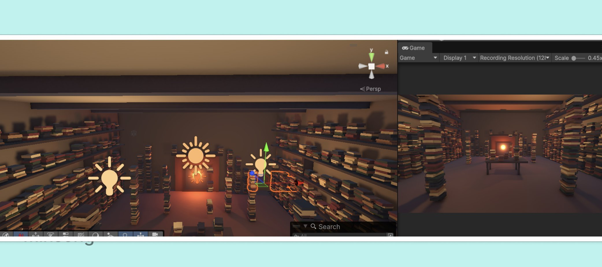
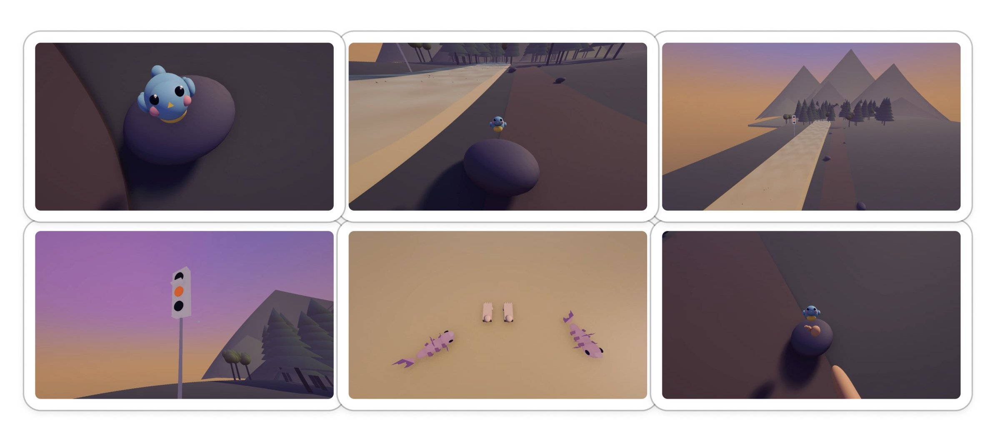
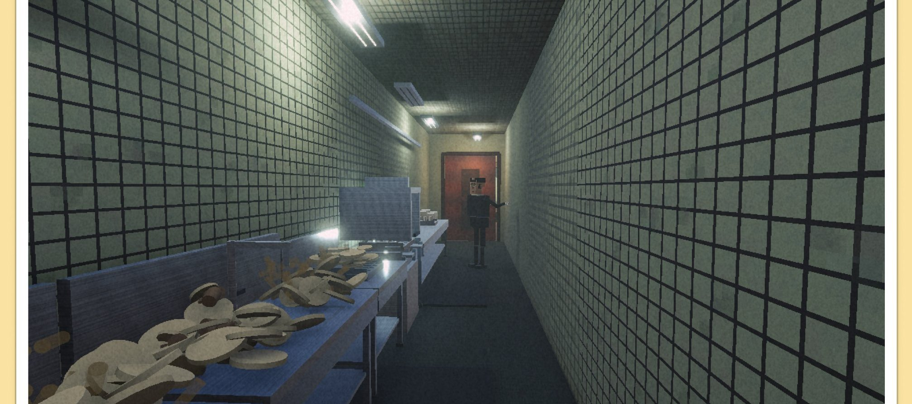
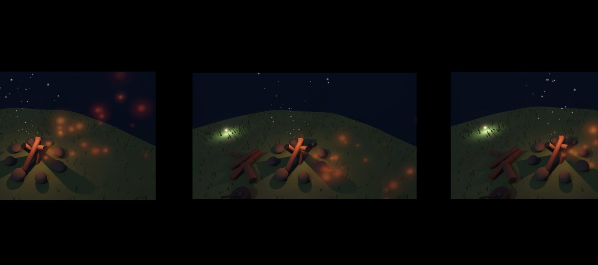
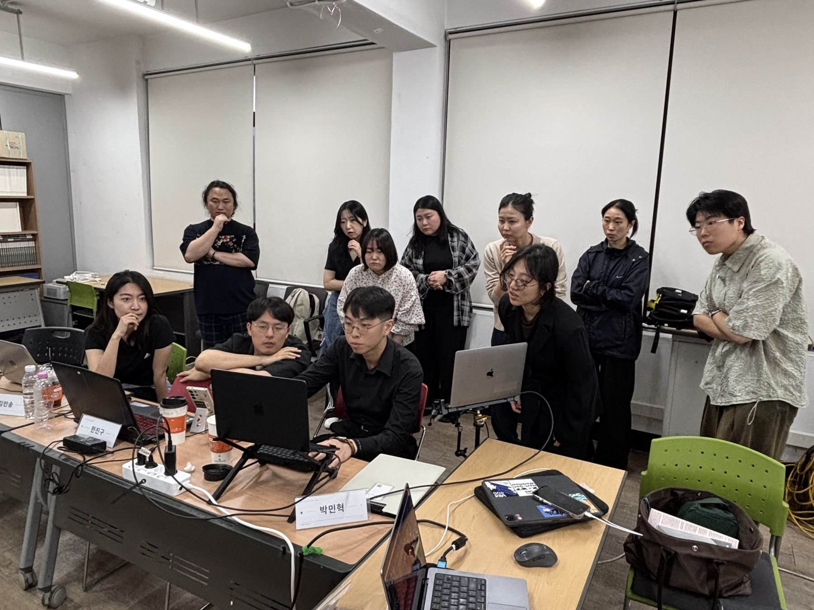

A workshop in Open Circuit Busan, a program for local artists by Busan Cultural Foundation and KAIST. Hong worked with artists in fine art, music and literature on the theme of spatializing poetry.

Starting from their own poems, the artists built spaces for them in the Unity game engine by instructing an AI in plain language. No coding is needed: an AI connected through MCP creates the objects, materials and lighting. In three hours every participant completed a space for their poem.

Claude · MCP · Unity

## Credits

Program Director: Junhyung Bae 
Organized by: Busan Cultural Foundation, KAIST
