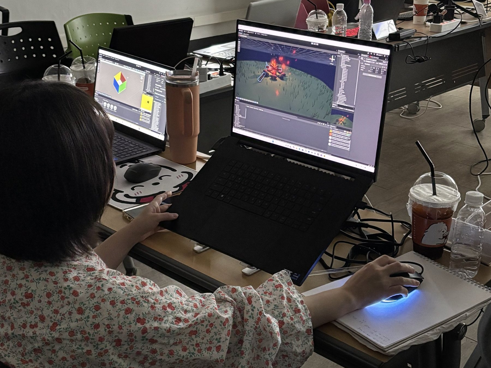
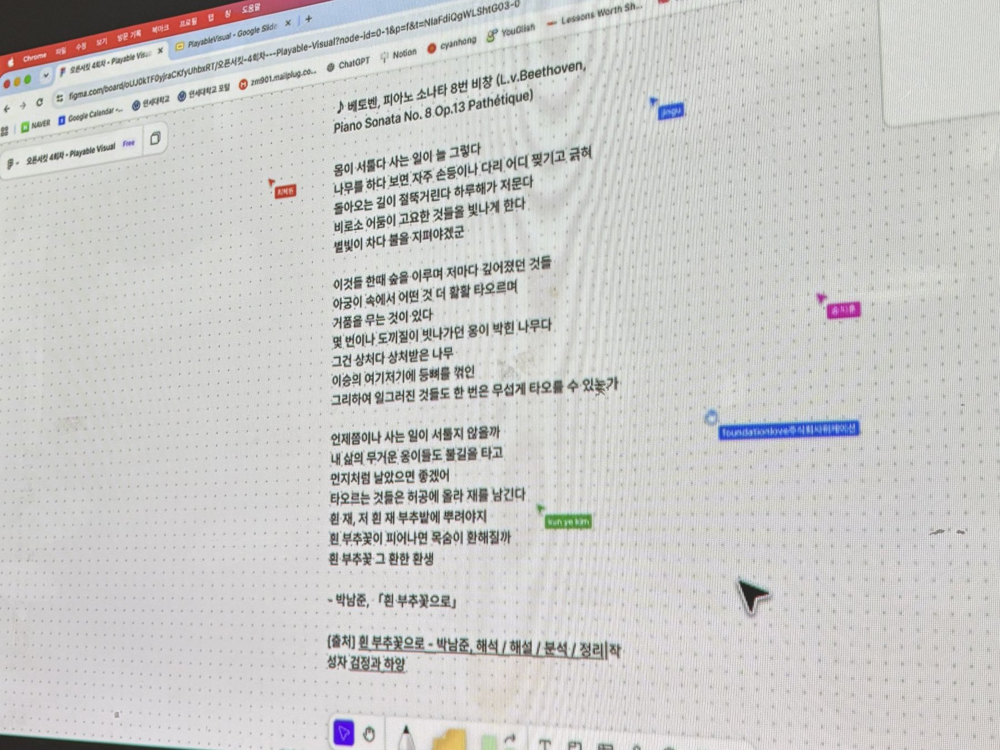
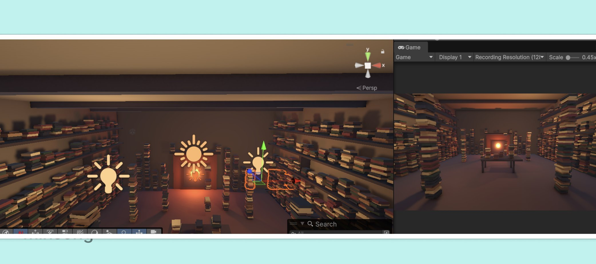
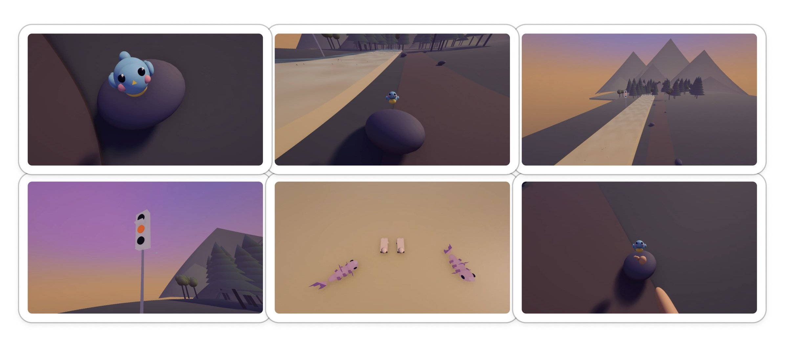
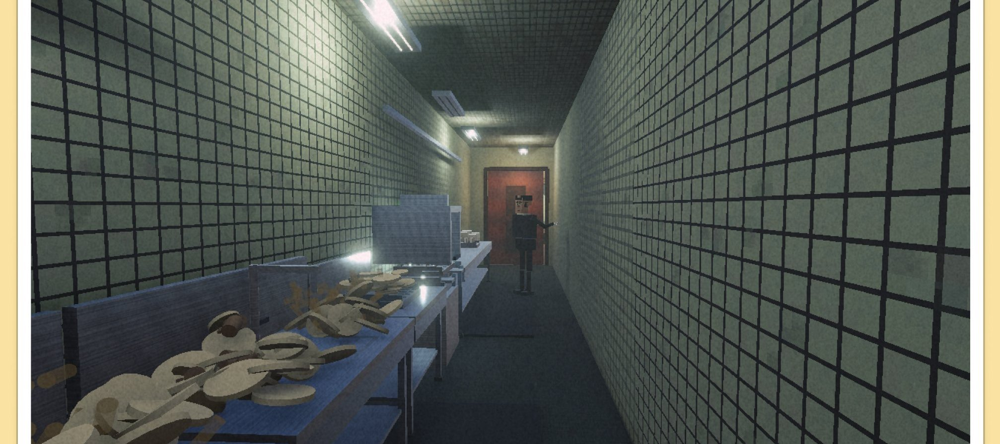
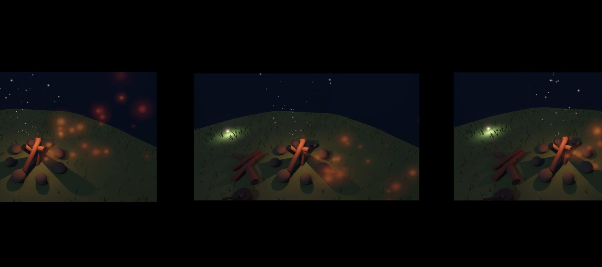
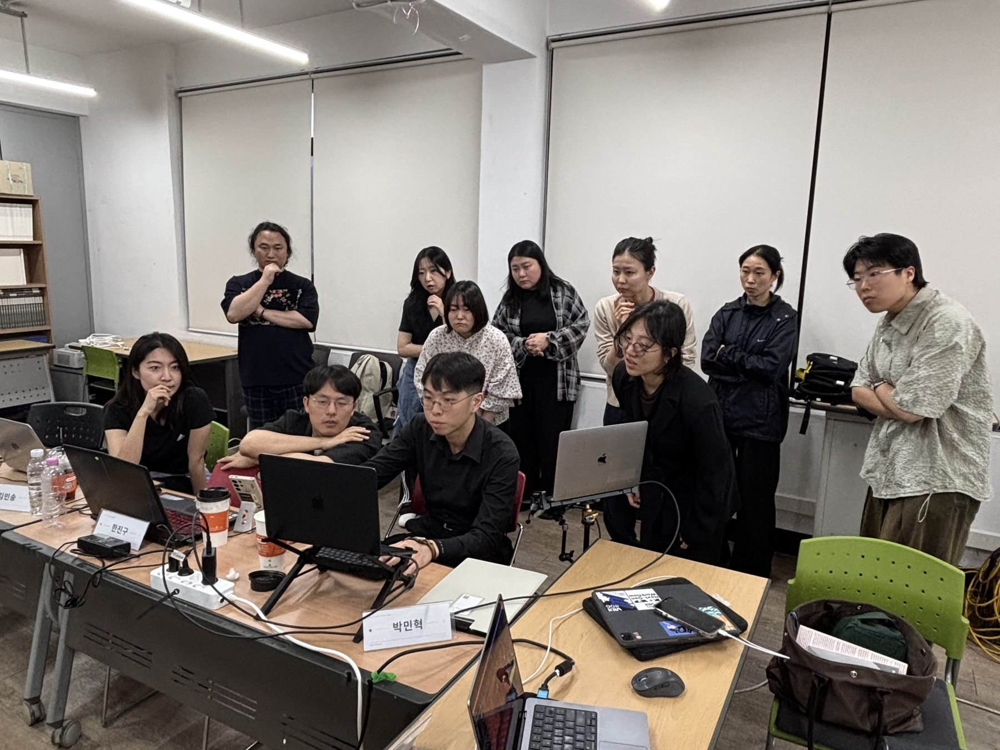
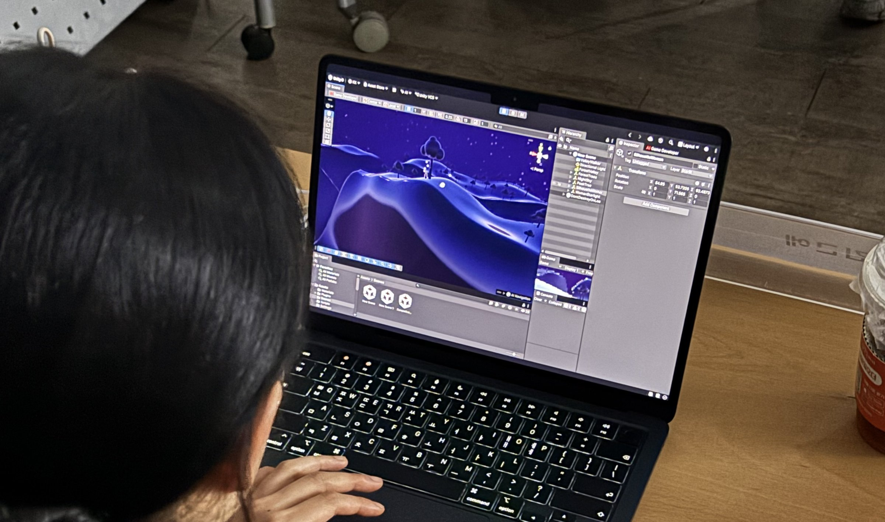

부산문화재단과 KAIST가 함께한 지역작가 프로그램 오픈서킷 부산의 워크숍. 순수미술과 음악과 문학을 하는 작가들과 '시의 공간화'를 주제로 작업했다.

작가들은 자기 시를 가지고 AI에게 말로 지시하며 게임엔진 Unity 안에 그 시의 공간을 지었다. 코딩을 몰라도 MCP로 연결된 AI가 오브젝트와 재질과 조명을 만든다. 3시간 만에 모든 참여 작가가 자기 시의 공간을 완성했다.

Claude · MCP · Unity

## 크레딧

프로그램 디렉터: 배준형 
주최·주관: 부산문화재단, KAIST
