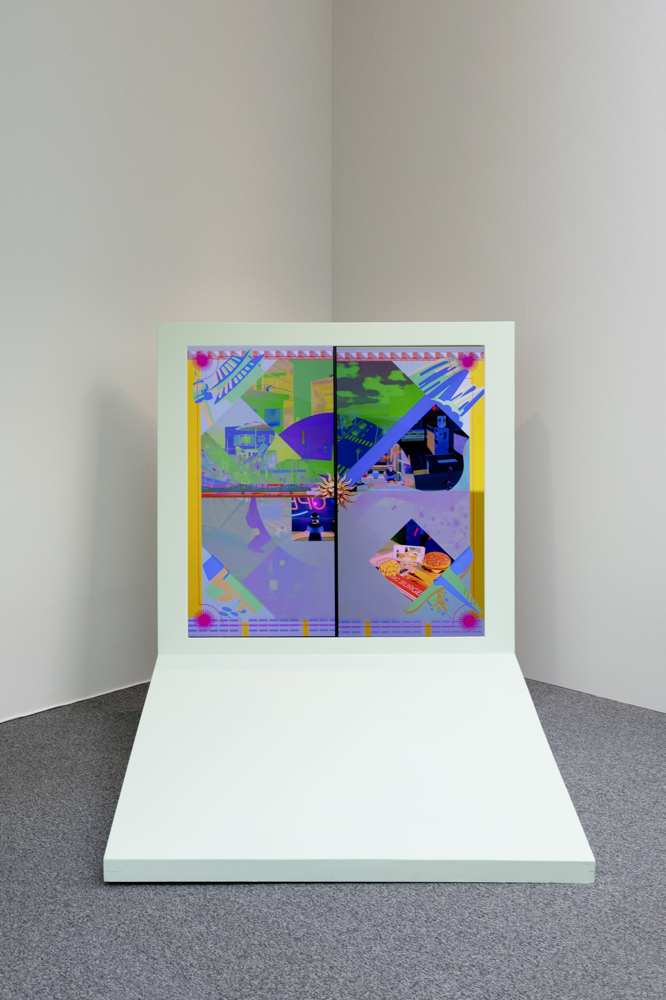
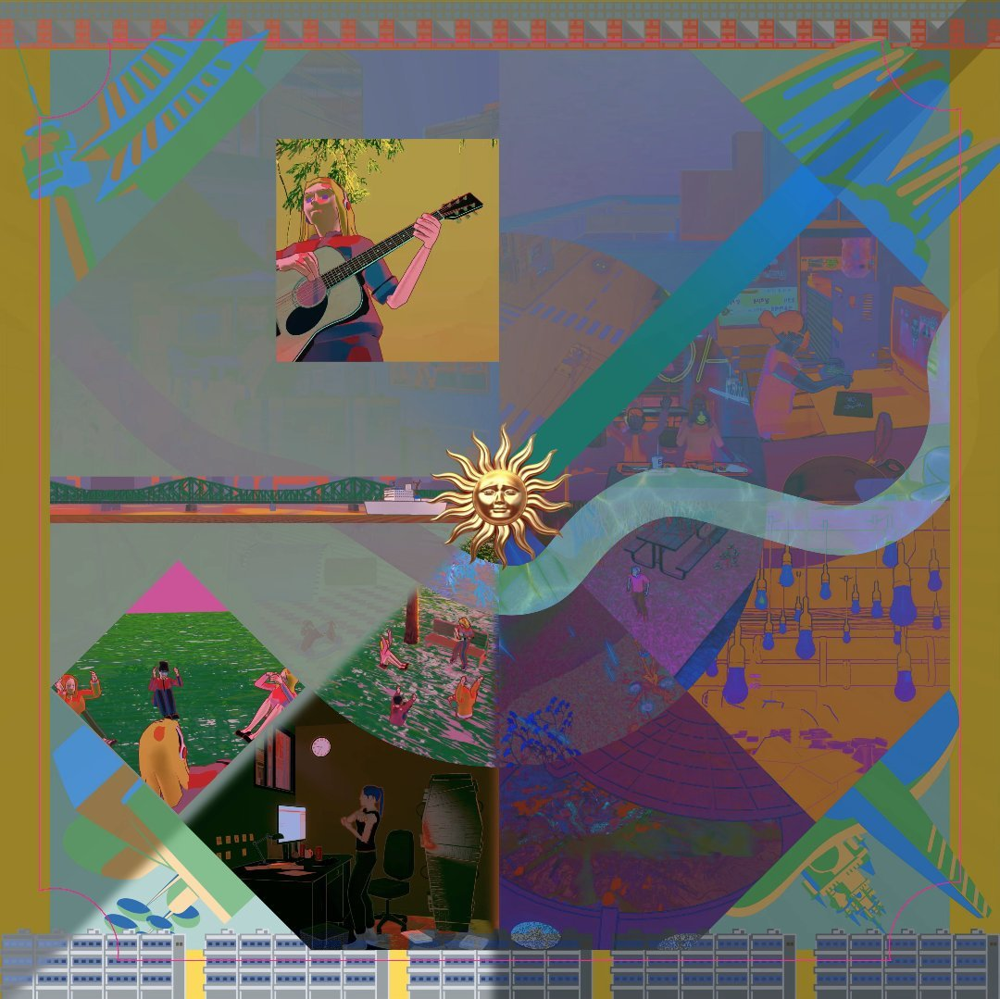
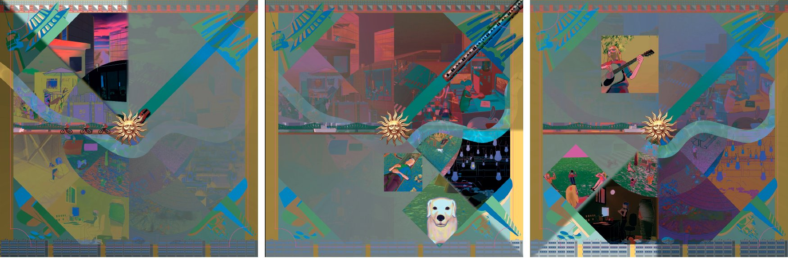
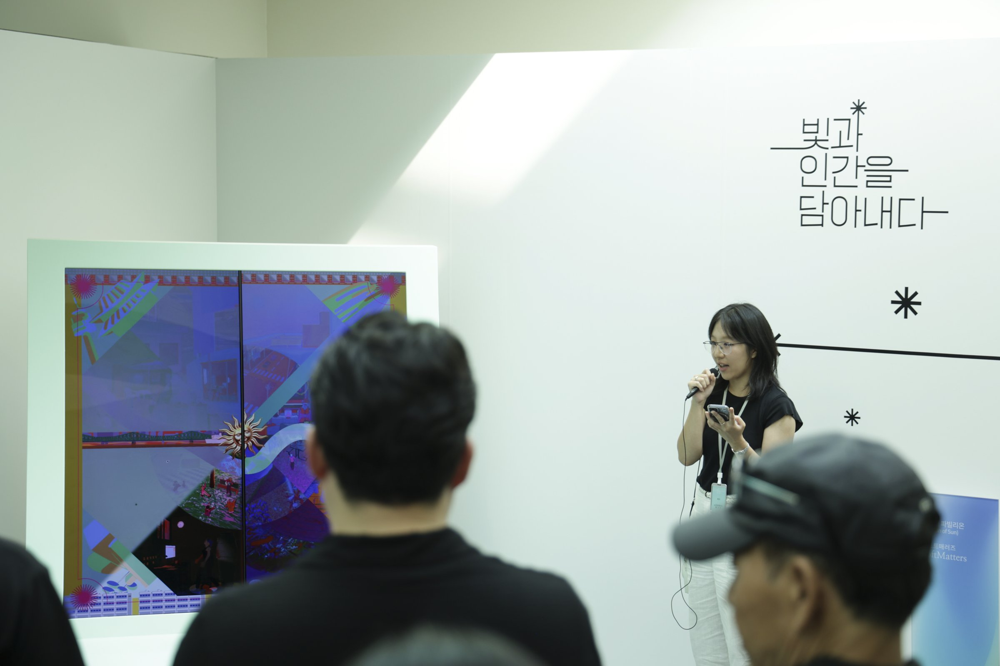
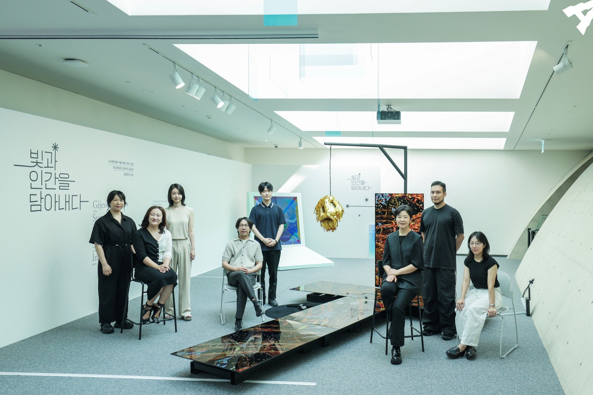

A video installation selected for the LG Arts Center Media Art Open Call for Emerging Artists and exhibited at LG Arts Center. Produced under the name Softmatters.

The daily lives of many characters unfold side by side on a single screen. Following the paths the characters take, viewers pick the stories they want to see, and different stories emerge depending on what they focus on. The work revisits, in today's medium, the way murals and religious paintings once laid out many scenes at a glance.

It was inspired by stained glass. From afar, light and color come first; up close, specific and surreal stories appear within. Eight spaces built in Unity were varied across four times of day to make 32 scenes, woven into eight compositions that change over time.

Unity · Installation · Loop

## Credits

Softmatters 
Production & Planning: Cyan Hong 
Planning & Production: Sanghee
