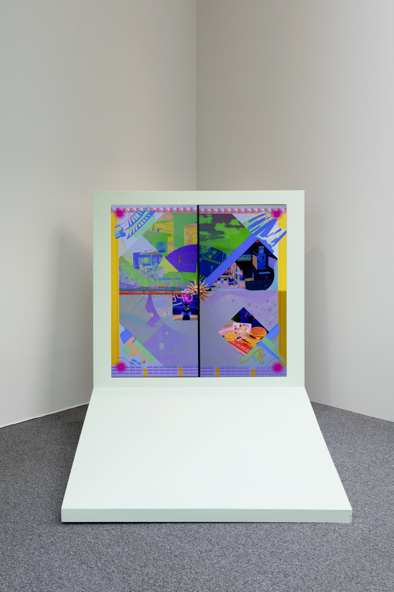
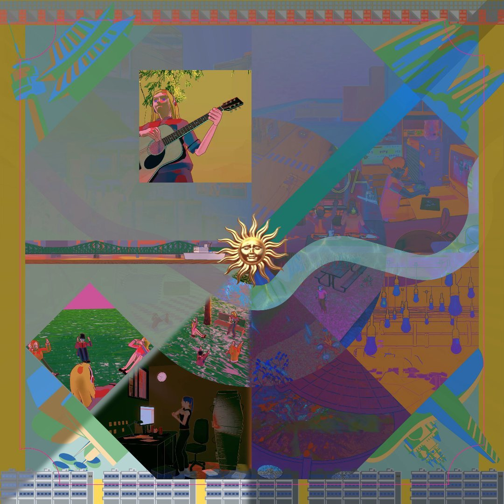
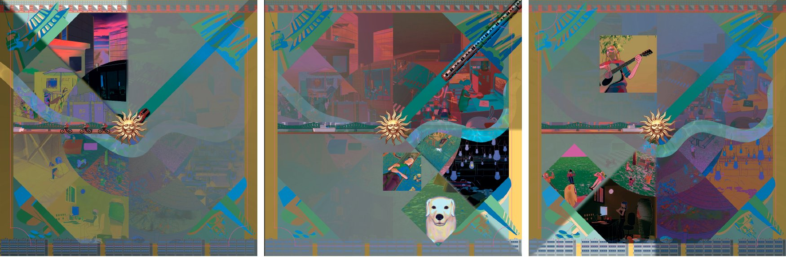
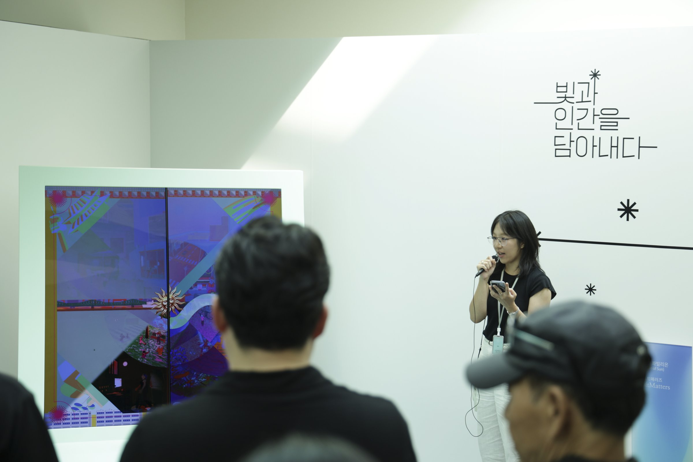
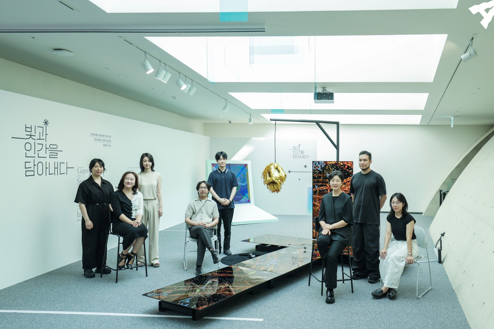

LG아트센터 미디어아트 신진작가 공모에 선정되어 전시한 영상 설치 작품. 소프트매러즈 이름으로 제작했다.

한 화면 안에 여러 인물의 일상이 나란히 펼쳐진다. 관객은 인물들이 지나가는 경로를 따라가며 원하는 이야기를 골라 본다. 무엇에 집중하느냐에 따라 다른 이야기가 읽힌다. 여러 장면을 한눈에 펼쳐 보이던 벽화나 종교화의 방식을 지금의 매체로 다시 시도했다.

스테인드글라스에서 영감을 받았다. 멀리서는 빛과 색이 먼저 보이고 가까이 다가가면 그 안의 구체적이고 초현실적인 이야기가 보인다. Unity로 만든 8개의 공간을 4개의 시간으로 변주해 32개의 장면을 만들고 시간에 따라 바뀌는 8개의 컴포지션으로 엮었다.

Unity · Installation · Loop

## 크레딧

소프트매러즈 
제작·기획: 홍서연 
기획·제작: 상희
