A research project on the aesthetics of virtual space production techniques, supported by the K-Arts Art Collider Lab and released as a web publication.

The project took the view that a space's identity comes less from objective information such as coordinates or materials than from the senses and emotions of the people who experience it. It reread production techniques such as LiDAR, mapping software and VR tools from an aesthetic perspective, turning elements of functionally designed digital space into spaces that carry emotion.

Each chapter, including 'Pioneering,' 'Occupying,' 'Entrance,' 'Shadow of the Sun,' 'God Ray' and 'Wall of Points,' contains experimental work and writing. The text was written by GPT-3 (text-davinci-003) and edited by Hong.

Web Publication · LiDAR · VR · GPT-3

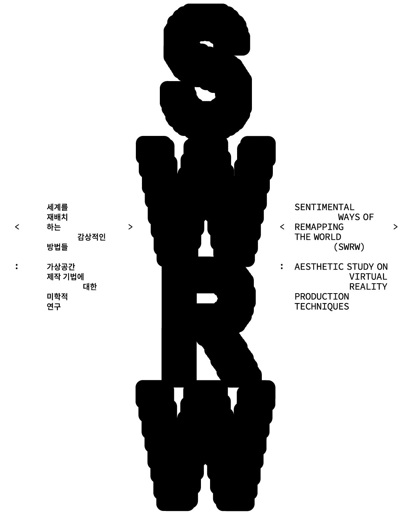

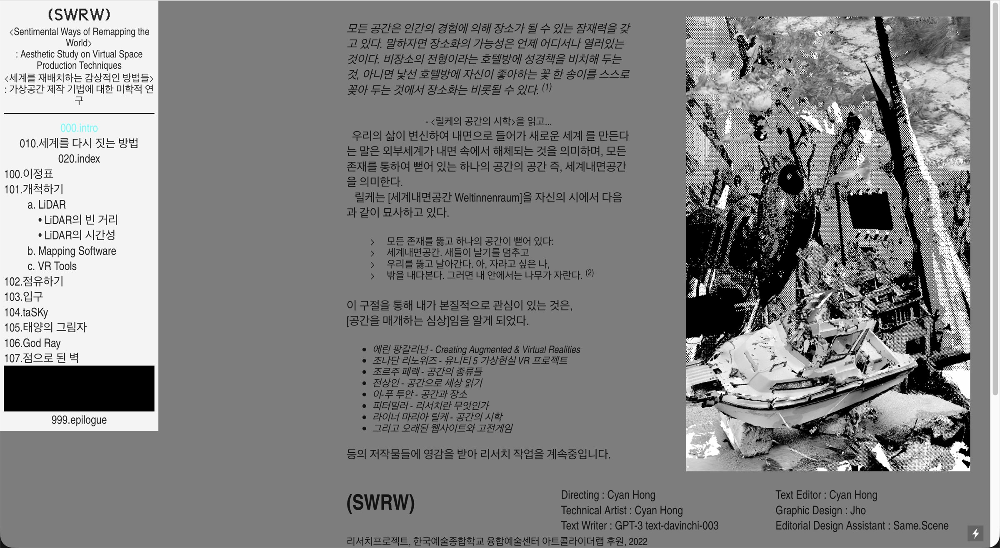

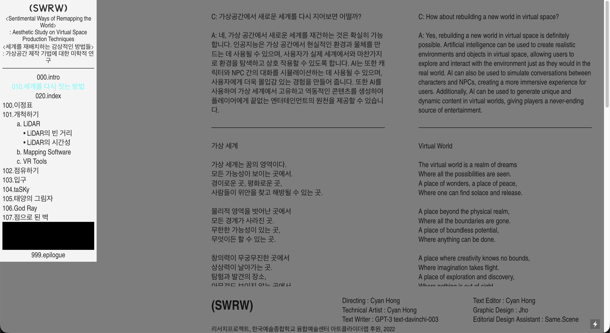

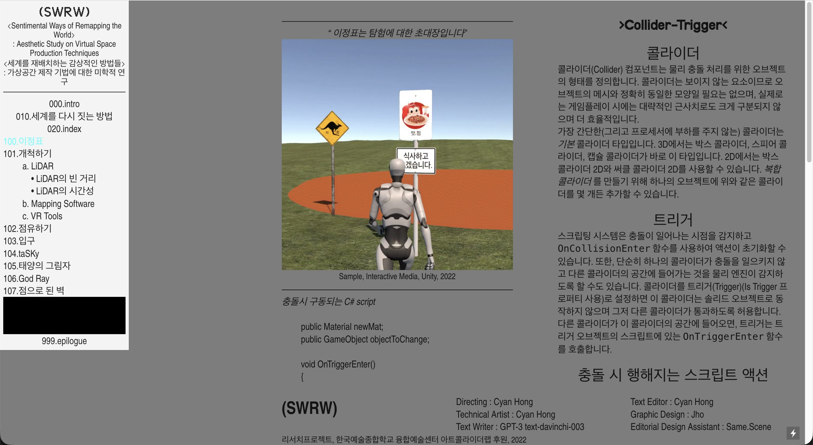

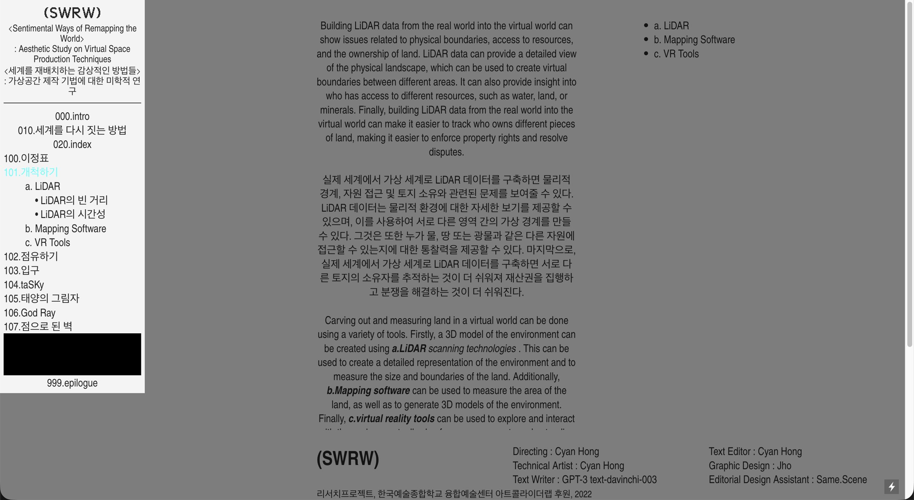

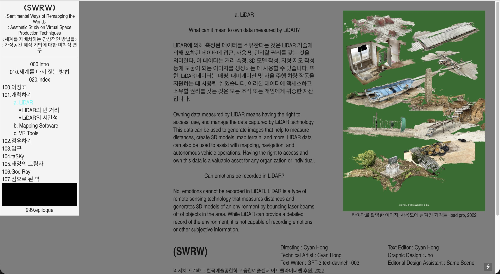

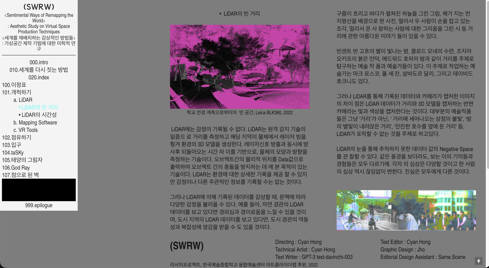

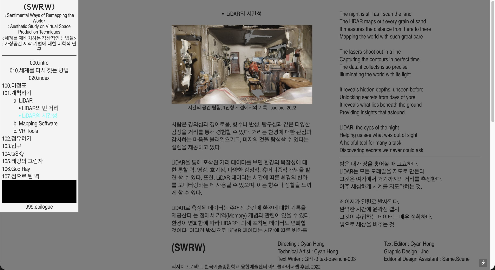

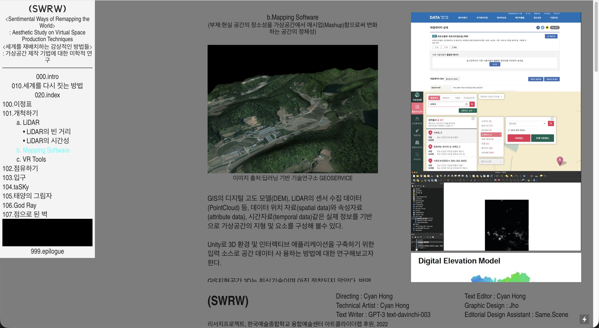

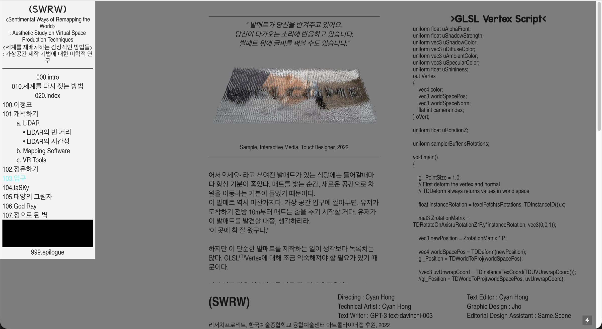

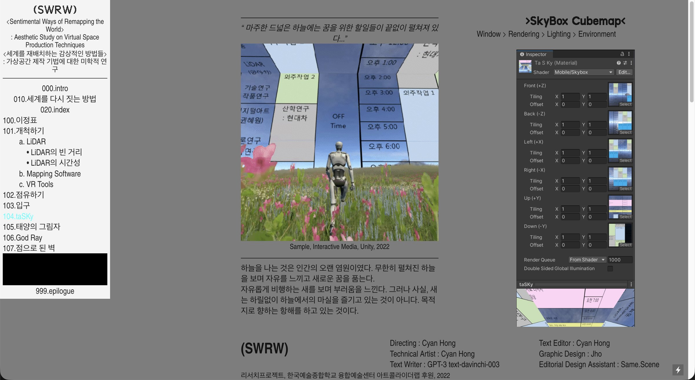

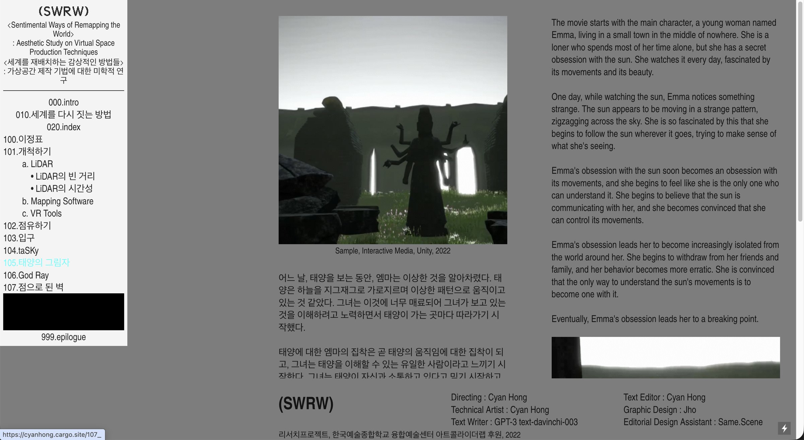

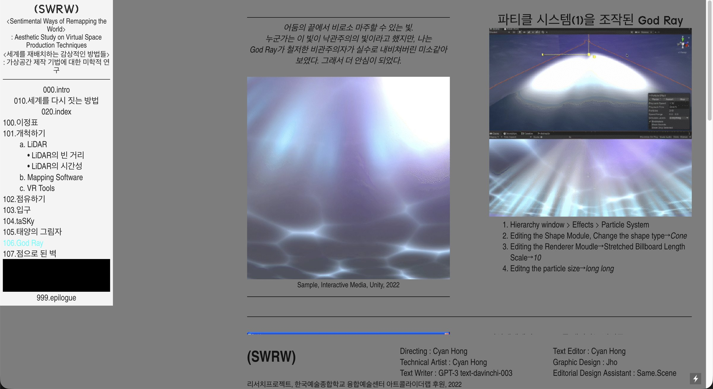

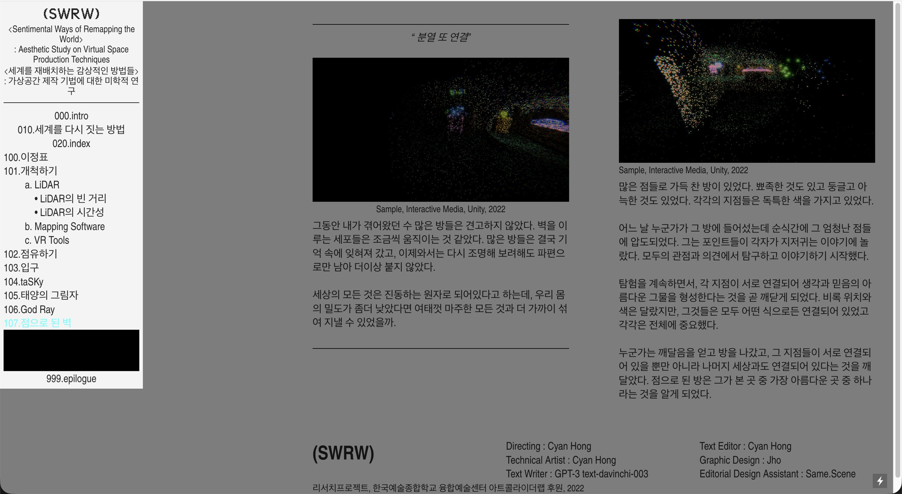
