가상공간 제작 기법을 미학적으로 연구한 리서치 프로젝트. 한국예술종합학교 융합예술센터 아트콜라이더랩의 후원으로 진행했고 결과를 웹 출판물로 엮었다.

공간의 정체성은 좌표나 재료 같은 객관적 정보보다 그 공간을 겪는 사람의 감각과 감정에서 온다고 보았다. 라이다와 매핑 소프트웨어와 VR 툴 같은 제작 기법을 미학적인 관점에서 다시 읽고 기능 중심으로 설계되는 디지털 공간의 요소들을 정서를 매개하는 공간으로 바꿔 보았다.

'개척하기' '점유하기' '입구' '태양의 그림자' 'God Ray' '점으로 된 벽' 같은 챕터마다 실험 작업과 글을 실었다. 글은 GPT-3(text-davinci-003)가 쓰고 직접 편집했다.

Web Publication · LiDAR · VR · GPT-3

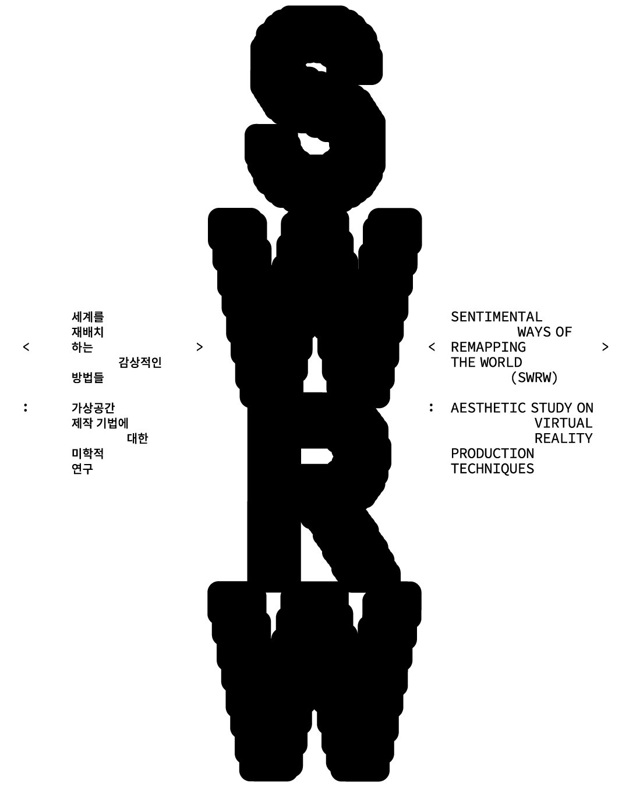

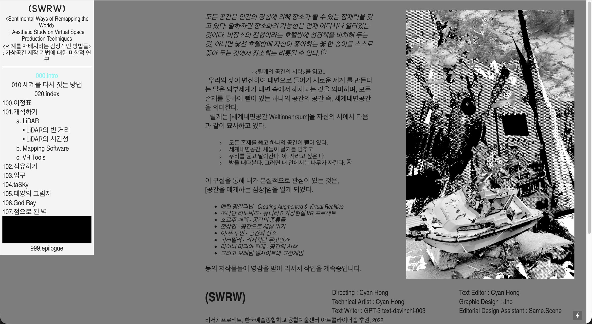

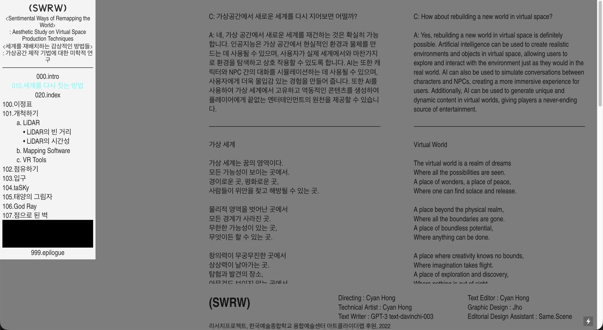

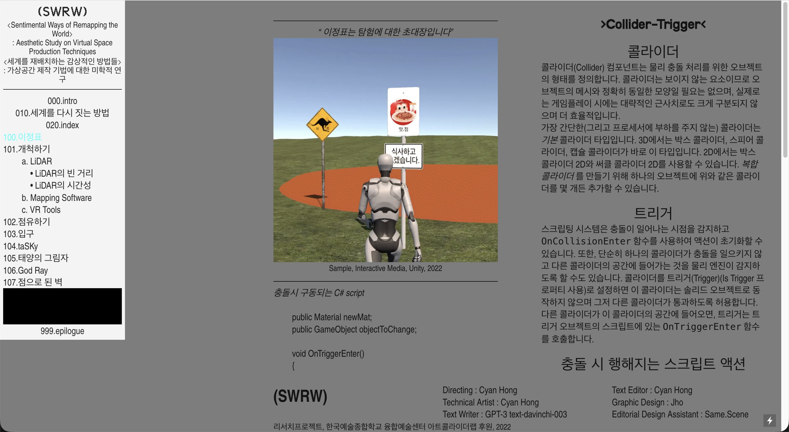

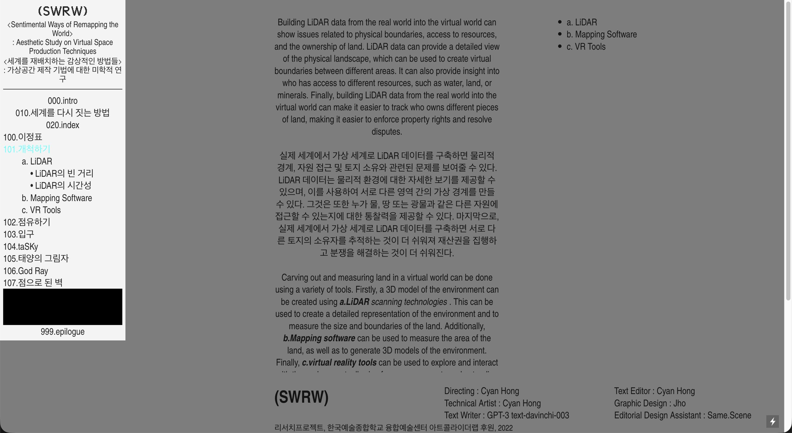

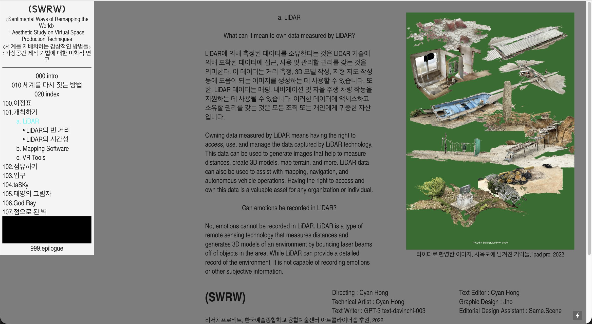

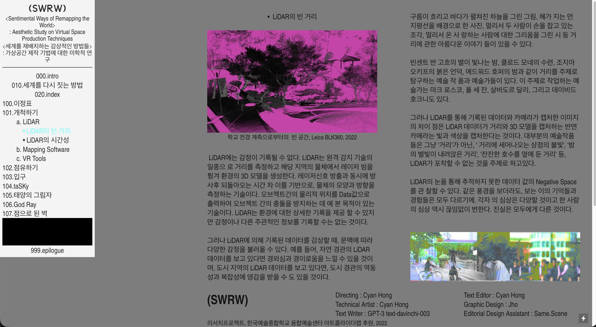

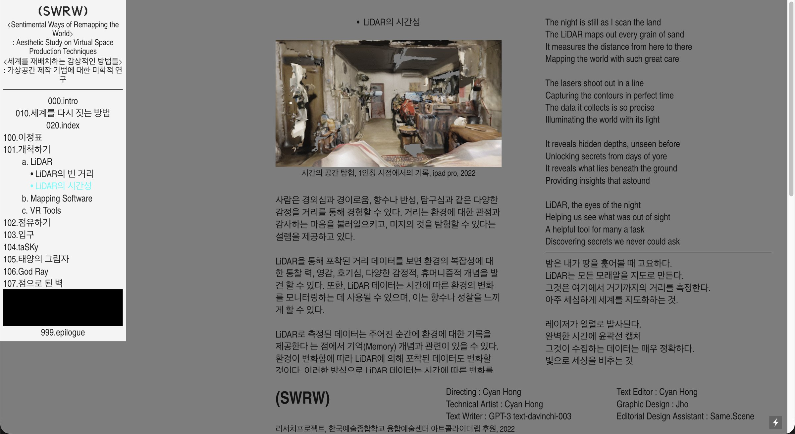

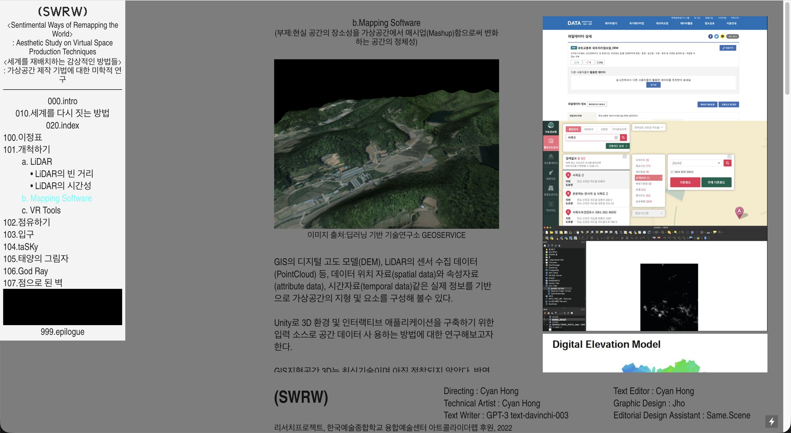

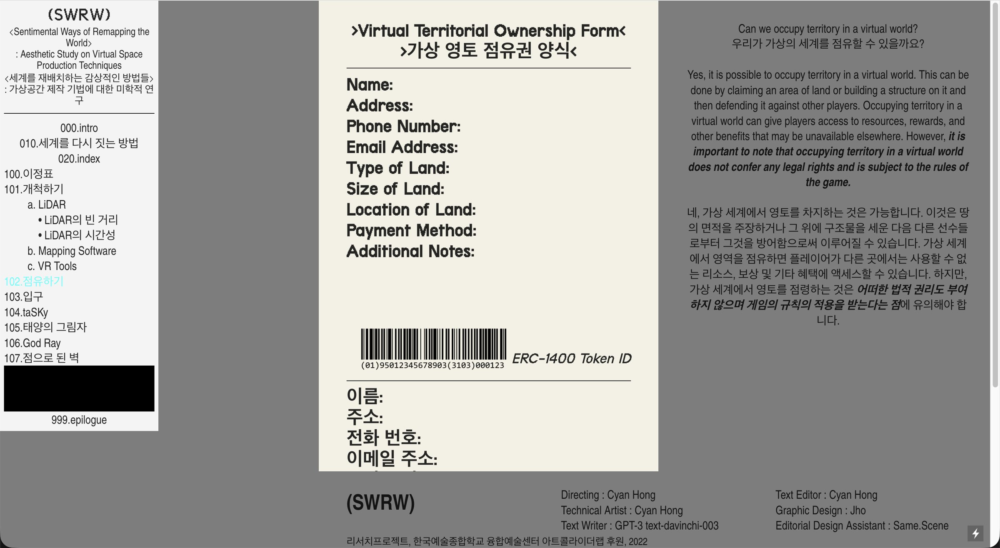

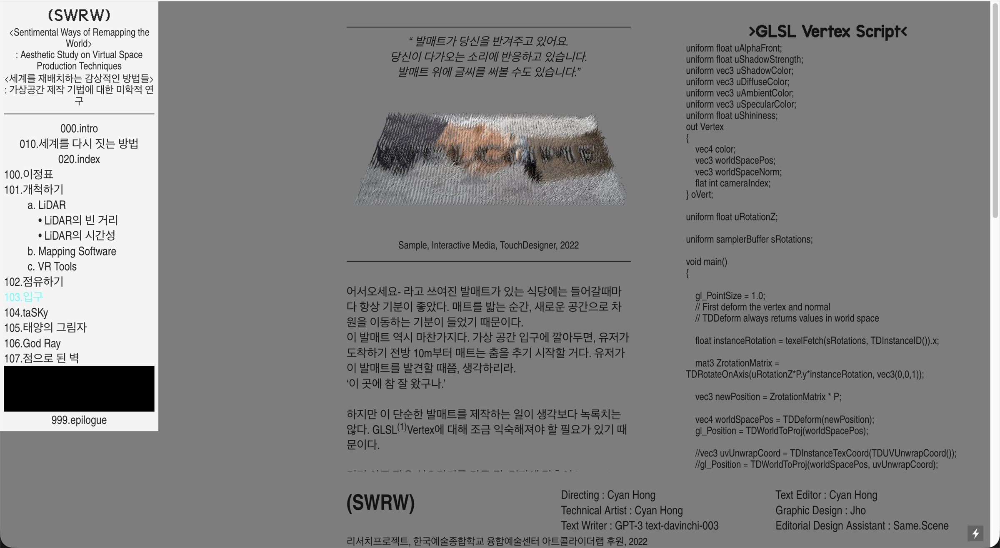

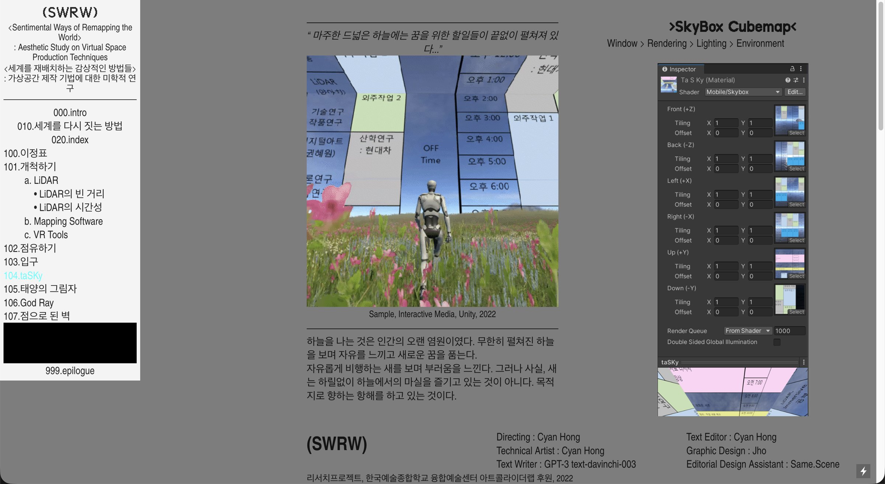

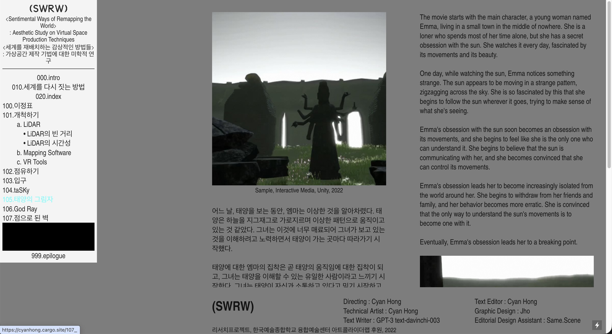

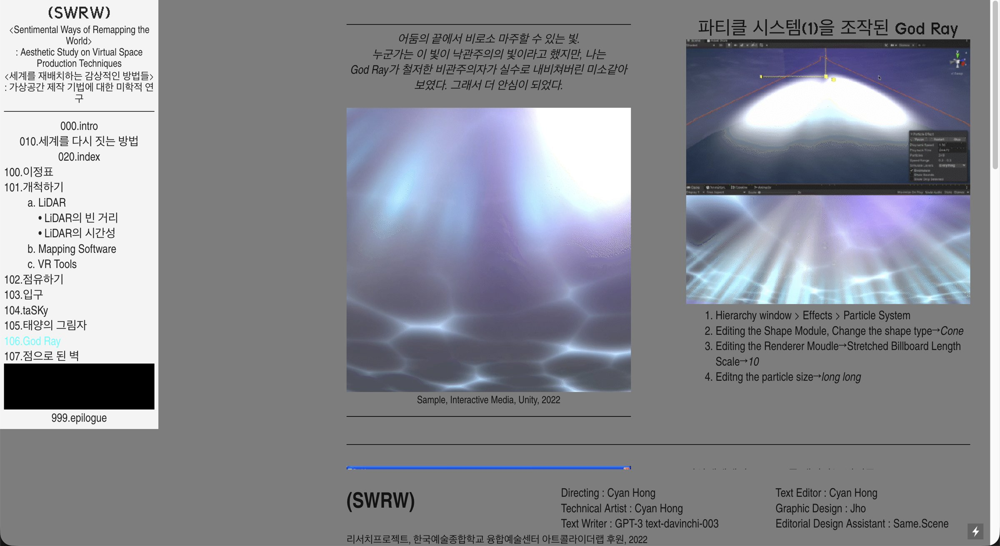

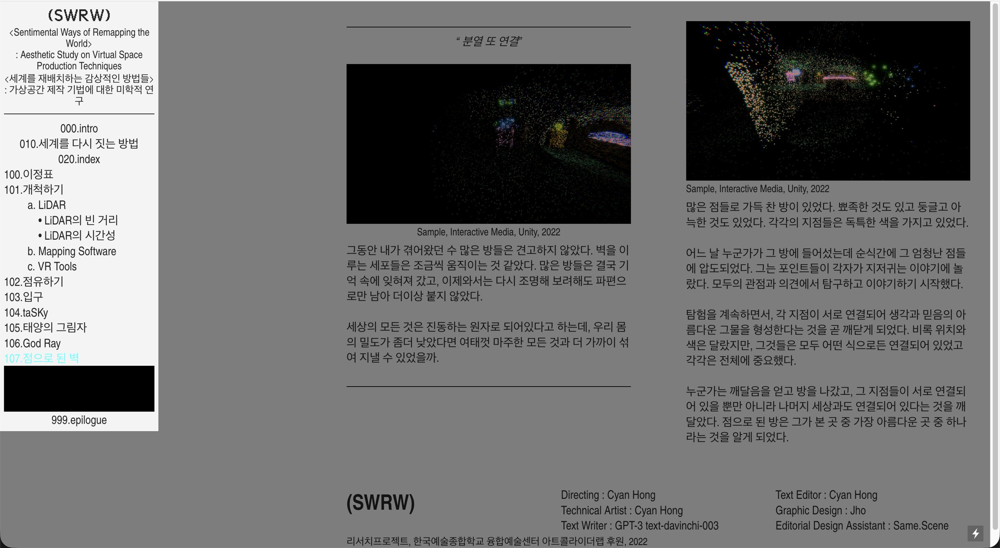
