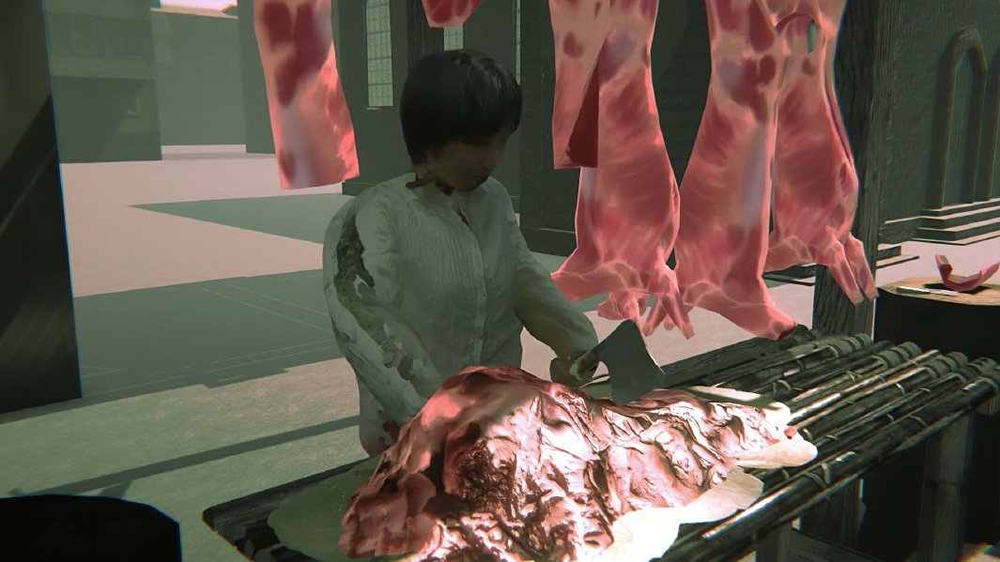
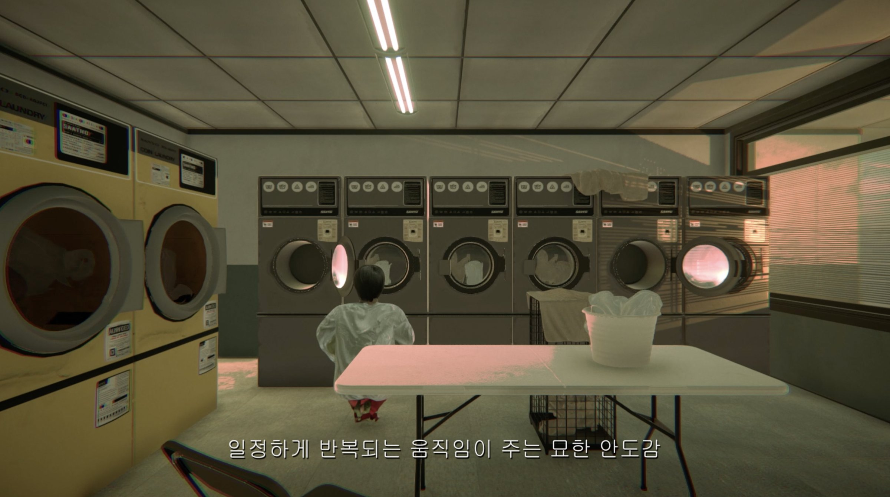
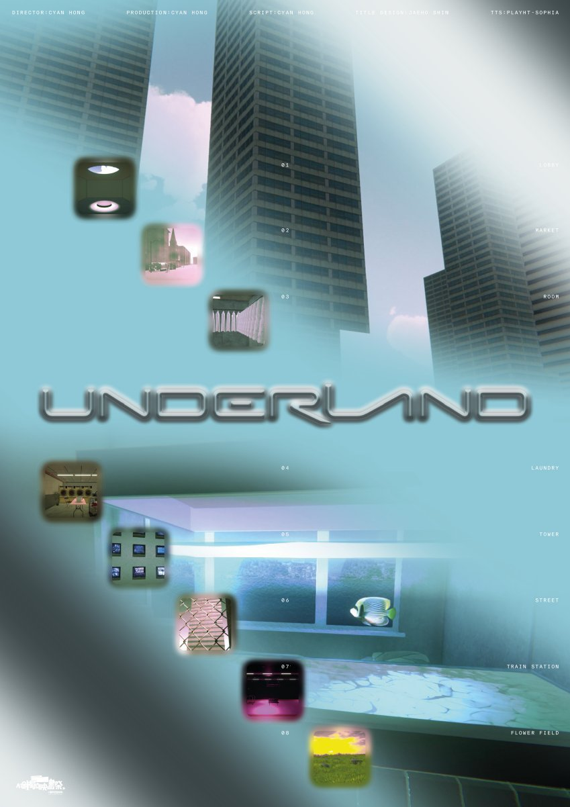
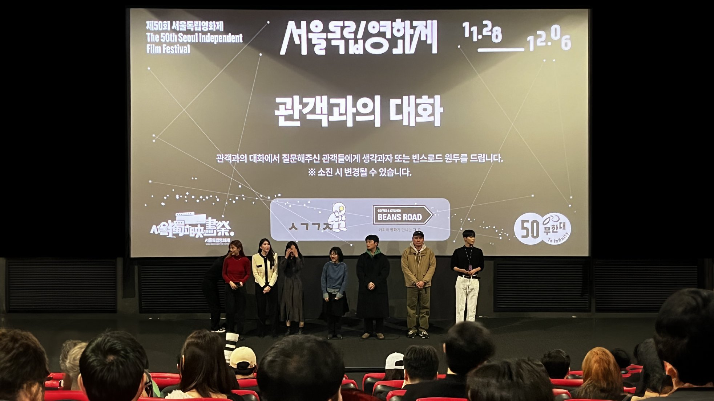

A 12-minute experimental short film made with a game engine, screened in the New Choice section of the 2024 Seoul Independent Film Festival.

It follows an isolated being who logs into a forgotten world and faces depression, hatred, self-blame and shame on the way to finding hope. The film overlaps the lives of isolated young people, subculture enthusiasts and NPCs. Instead of a fixed plot, the emotions and keywords inside one person connect like hyperlinks as the film unfolds.

The protagonist was made from a LiDAR 3D scan of the artist herself. The character performs repetitive actions on its own through an algorithm, and the scenes were shot with Unity's real-time rendering.

Unity · Machinima · 3D Scan

## Credits

Poster Design: studio jho
