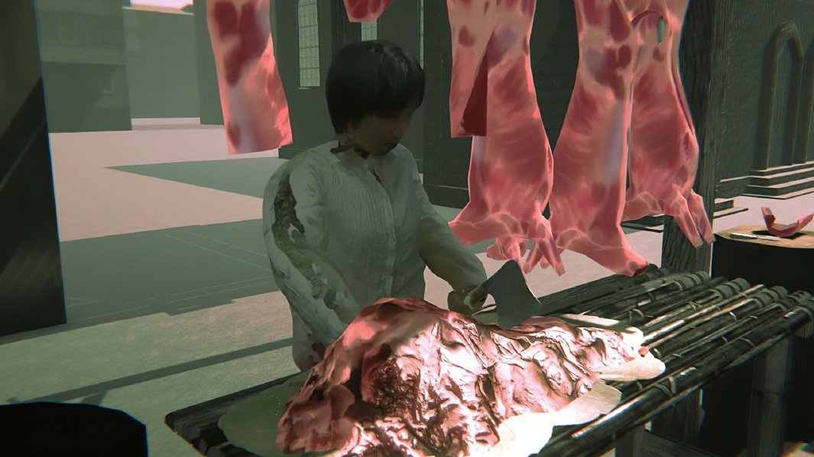
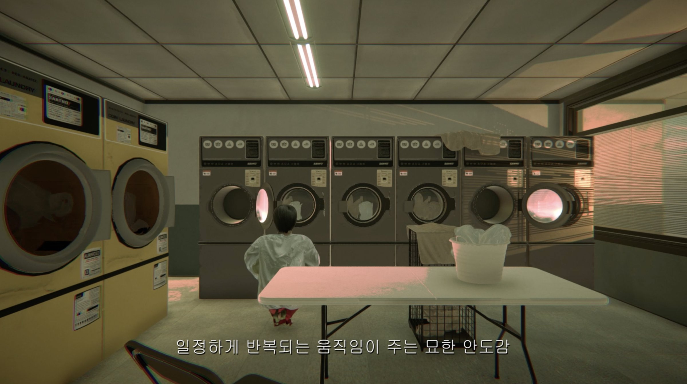
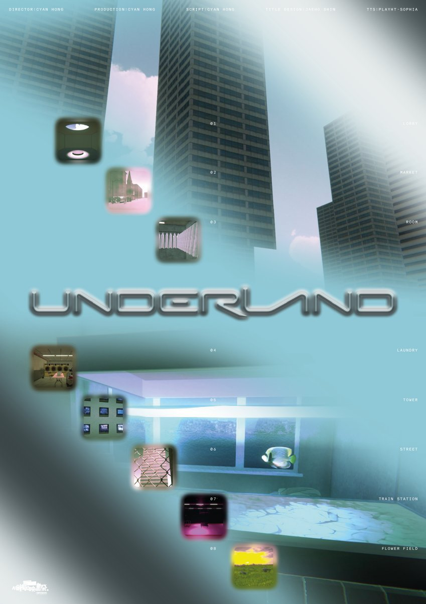
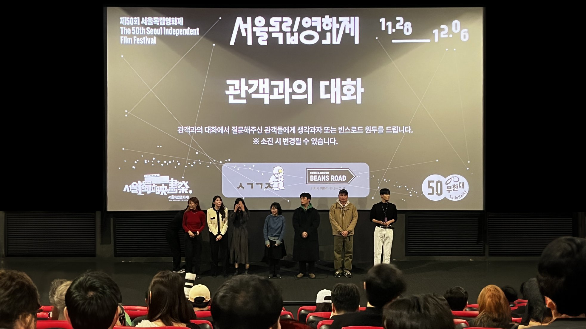

게임엔진으로 만든 12분 실험 단편영화. 서울독립영화제 2024 새로운선택 부문에서 상영했다.

잊혀진 세계에 접속한 고립된 존재가 우울과 증오와 자책감과 수치심을 마주하며 희망을 찾아가는 이야기다. 사회에서 고립된 청년과 서브컬처 향유자와 NPC의 삶을 겹쳐 그렸다. 영화는 정해진 줄거리 대신 한 사람 안의 감정과 키워드가 하이퍼링크처럼 이어지며 흘러간다.

주인공은 라이다로 3D 스캔한 작가 자신의 모습으로 만들었다. 캐릭터는 알고리즘에 따라 반복적인 행동을 스스로 수행하고 장면은 Unity의 실시간 렌더링으로 촬영했다.

Unity · Machinima · 3D Scan

## 크레딧

포스터 디자인: studio jho
