An AI film made by K-Arts Art & Technology Lab (AT Lab) and invited to the Jeju AI International Film Festival. Hong served as AI art director.

The actors were filmed in a chroma key studio in Seoul and the landscapes of Jeju were painted with AI. Keeping the actors' performances intact, the figures and backgrounds were bound together in the style of Korean painting so that the actors walk through an on-screen Jeju.

TouchDesigner · Stable Diffusion · After Effects

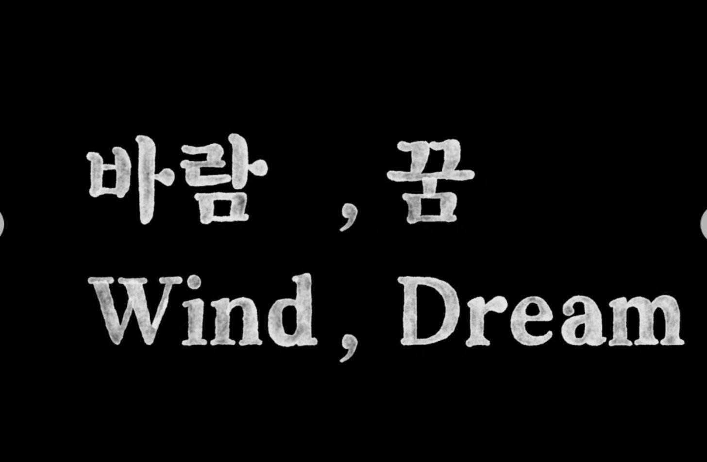

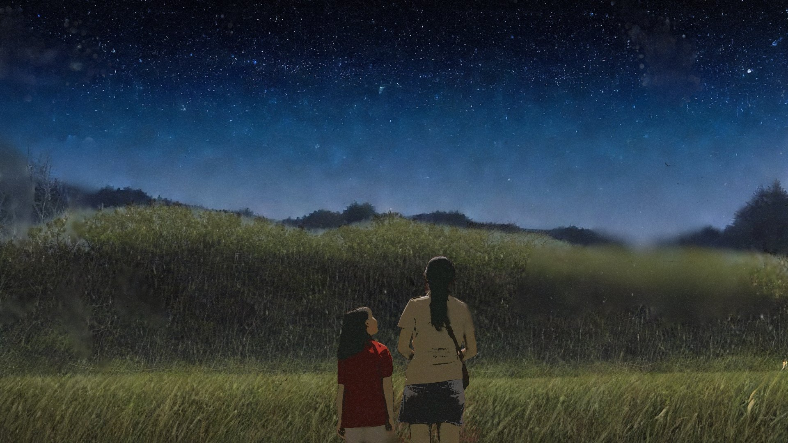

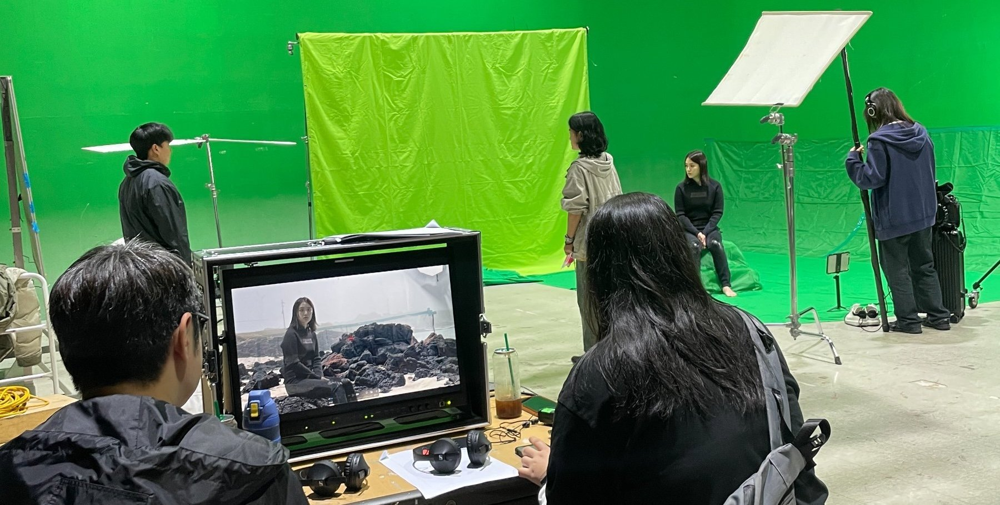

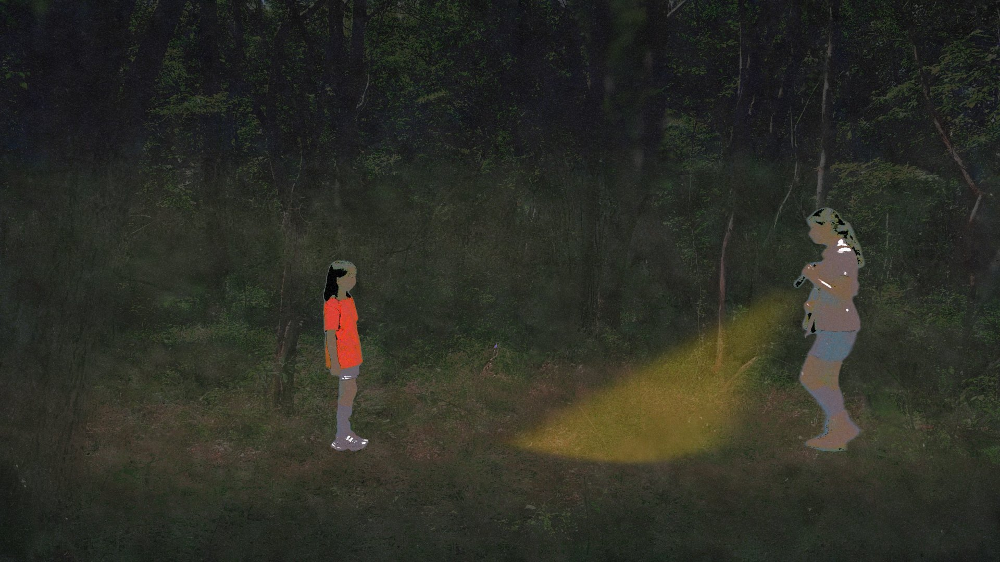

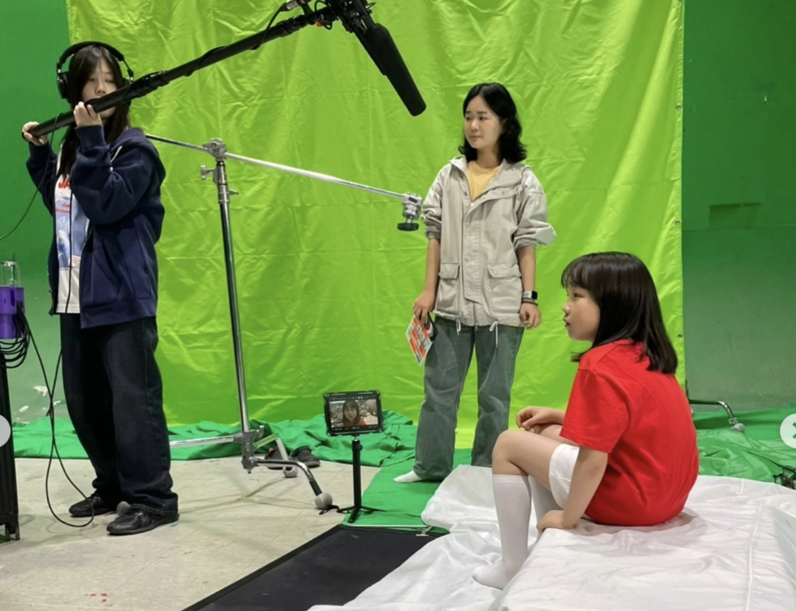

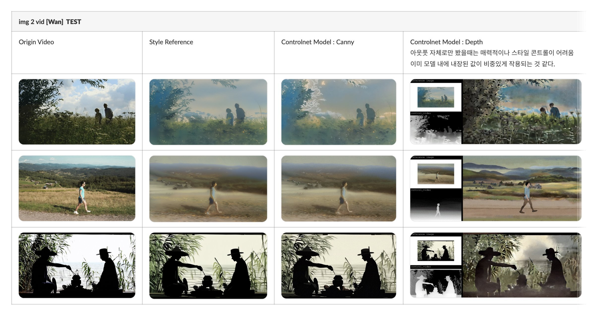

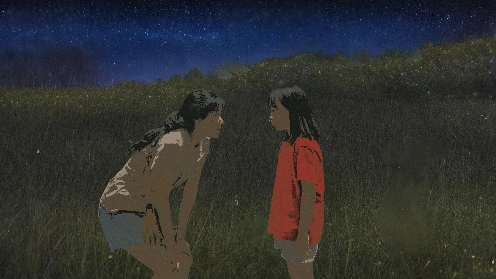

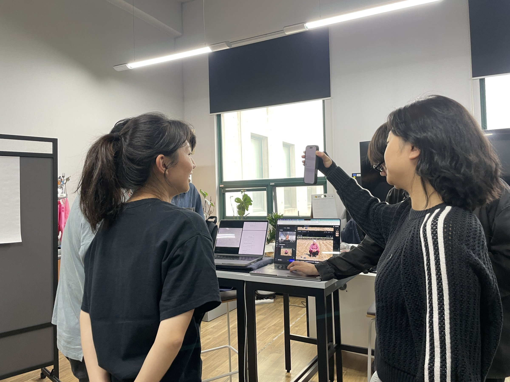

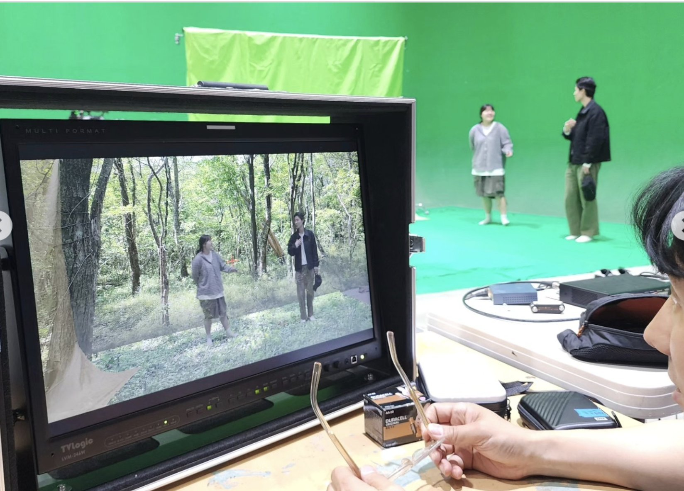

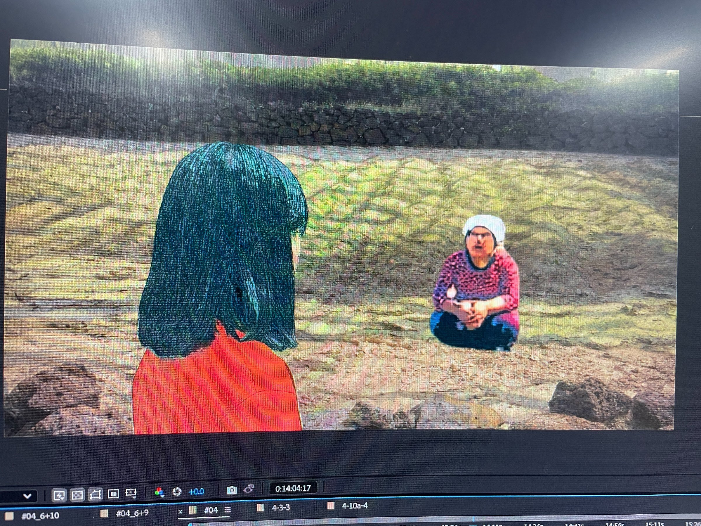

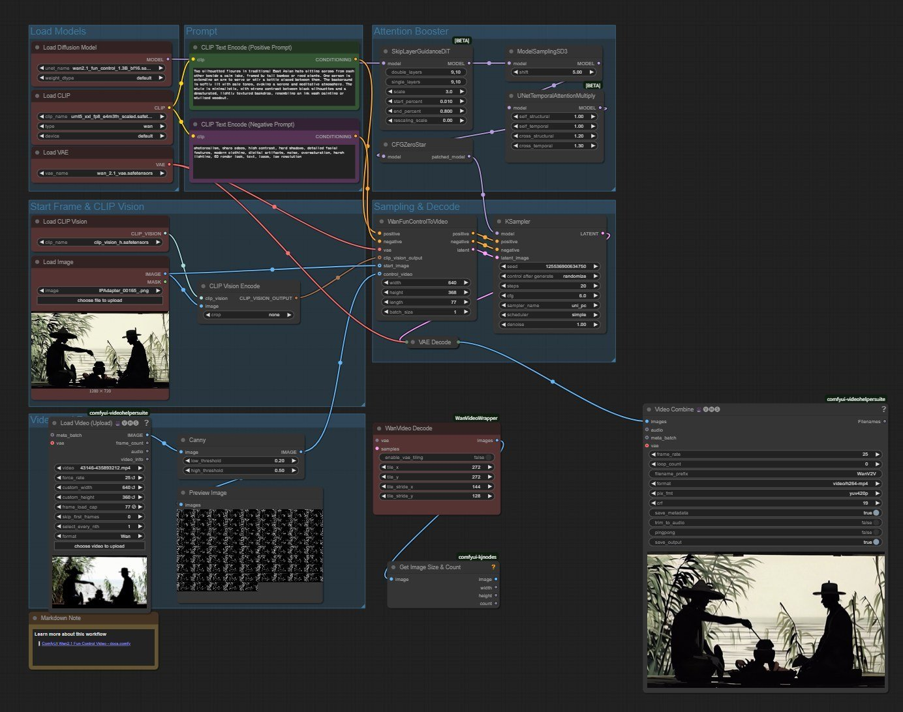
